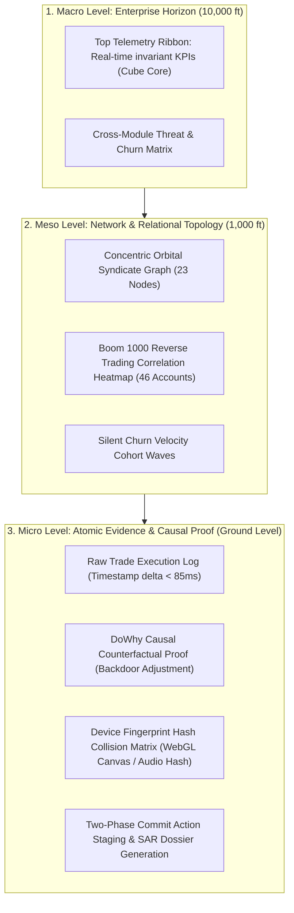

# Enterprise Intelligence Operating System (EIOS)
## Product Design Plan, UX Direction & Institutional UI Specification


---

### Executive Summary & Vision

The **Enterprise Intelligence Operating System (EIOS)** is not a conventional SaaS monitoring dashboard or a conversational chat gimmick. It is an **industrial-grade, mission-critical operational intelligence cockpit** engineered for high-frequency trading surveillance, partner network integrity, and proactive churn retention.

To meet the rigorous standards of Tier-1 investment banks, regulatory authorities (MFSA, LFSA, FSC), and high-frequency trading surveillance desks, the design synthesizes the finest methodologies of two industry benchmarks:
1. **AI-Native Network & Topology Systems**: Domain-driven pipeline topology, concentric node visual encodings (data quality vs. magnitude), institutional analytical canvas, and causal explainability.
2. **High-Density Institutional Operating Systems**: High-density data matrices, ontology object schemas, directed semantic edges, omnibar command palettes (`⌘K`), and governed Two-Phase Commit (2PC) write-back workflows.
3. **Purposeful Interaction Polish**: Refined micro-motion, state continuity across view hierarchies (macro-network to atomic-trade), and cognitive load reduction in high-stress operational environments.

---

## 1. Synthesis of Benchmark Architectures & Operational Patterns

### 1.1 Reference 1: Enterprise Solution Designer (Ref: `media_0`)
* **Key Visual & UX Patterns Analyzed**:
  * **Persistent Left Navigation Rail**: Slim icon-only rail (Search, Datasets, Ontologies, Settings) maximizing usable workspace.
  * **Structured Execution Plan Shelf**: Distinct split between *Workflow Summary* (prose context), *Workflow Plan* (4 phased stages), and *Implementation Plan* (checklist of 14 atomic assets: Egress Policies, Connectors, Ontological Objects, Slate Apps) anchored by a high-contrast primary call-to-action button: `[+ Save and start building]`.
  * **Ontological Property Canvas**: Node cards are not generic rectangles; they explicitly declare their schema types (string icons `99`, array brackets `[-]`, date stamps), status indicators, and incoming/outgoing transformation pipelines.
  * **Semantic Directed Edges**: Edges carry verb-level annotations (*"Transfers entity data from Dataset to Builder"*, *"Triggers the Optimize Schedule action"*), making graph traversal intuitively readable to non-technical investigators.
* **EIOS Translation**:
  * Adopt the **Action Staging Shelf** on the right side of the screen for investigation cases. When an analyst reviews Account `#CR84920` or Master Partner `#MP-007`, the staged actions (Freeze Account, Clawback $42,500, Generate SAR) render as an interactive checklist with cryptographic 2PC authorization tokens.
  * Schema-typed property inspector cards for Trading Accounts, Device Fingerprints, and Affiliate Nodes.

### 1.2 Reference 2: Architecture Diagrams & Solution Catalog (Ref: `media_1`)
* **Key Visual & UX Patterns Analyzed**:
  * **Enterprise Filter Chips**: Grouped by scope (*All patterns*, *Workflow patterns*, *Industry patterns*, *Technical patterns*, *Tutorial patterns*) with instant count badges.
  * **Architecture Card Grid**: High-contrast thumbnail previews paired with dense, multi-line functional summaries (e.g., *"Finance | Holistic Risk Management: Market Risk, Credit Risk, Climate Risk..."*).
  * **Zero Ambiguity Search**: Dedicated top search bar with auto-complete and keyboard shortcuts.
* **EIOS Translation**:
  * The **Investigation Playbook Catalog**: A searchable template modal enabling investigators and compliance officers to switch between regulatory filing patterns (MFSA Suspicious Activity Report, LFSA Market Abuse Filing) and algorithmic detection presets (Mirror Trading Detection, Silent Disengagement Radar).

### 1.3 Reference 3: Relational Graph Studio (Ref: `media_2`)
* **Key Visual & UX Patterns Analyzed**:
  * **Deep Analytical Canvas (`#06101E` / `#0B131E`)**: Subtle dot-matrix grid providing depth without visual noise.
  * **Concentric Orbital Visual Encoding**: Network nodes utilize concentric circular rings where the outer arc encodes percentage metrics (e.g., 56%, 76% confidence or risk), the inner core encodes volume magnitude (e.g., 28.2 GB / $247k volume), and color hues indicate status (Emerald green `#00E676`, Warning Amber `#FFB300`, Alert Rose `#FF1744`).
  * **Right Multi-Dimensional Telemetry Inspector**: Tabbed controls (`Custom`, `DS`, `DE`, `EM`) with an electric cyan indicator (`#00E5FF`) and micro-switches toggling graph layers (Data sources, Quality, Magnitude, Connections, Ingestion status).
  * **Bottom Horizontal Status Ticker**: Minimalist breadcrumbs displaying active pipeline health and latency.
* **EIOS Translation**:
  * The **23-Account Syndicate Ring & 46-Account Mirror Cluster**: Instead of standard generic circular dots, syndicate nodes use concentric orbital rings displaying **Risk Score (0–100)** on the outer ring, **Synthetic Volume ($)** in the core, and **Device Fingerprint Hash Collision** indicators on connecting arcs.
  * The **Graph Filter Drawer**: Toggles for Trade Concurrency, IP Subnet Overlap, Payment Instrument Reuse, and Causal Counterfactual Confidence.

### 1.4 Reference 4: End-to-End Pipeline Architecture (Ref: `media_3`)
* **Key Visual & UX Patterns Analyzed**:
  * **Phase-Gated Horizontal Topology**: Distinct sequential columns: `DATA` $\rightarrow$ `DEVELOPMENT` $\rightarrow$ `DEPLOYMENT` $\rightarrow$ `OPERATIONS`.
  * **Geometric Wireframe Iconography**: Distinct polygonal wireframes for specialized analytical tooling.
  * **Flowing Multi-Strand Telemetry Cables**: Elegant glowing bezier lines conveying continuous, high-throughput pipeline velocity.
  * **Executive Value Banner**: Clear, auditable business outcomes mapped directly beneath each phase.
* **EIOS Translation**:
  * The **Unified Horizon Bar**: Top-level progression linking `TELEMETRY INGESTION` (WebSocket/DuckDB) $\rightarrow$ `SEMANTIC METRIC LAYER` (Cube Core) $\rightarrow$ `CAUSAL INFERENCE & AGENT MESH` (DoWhy + Gemini Model) $\rightarrow$ `GOVERNED WRITE-BACK ACTIONS` (Two-Phase Commit).

---

## 2. Design System Architecture: Institutional Analytical System

The frontend implementation leverages **Next.js 15 (App Router)** and **Tailwind CSS v4**, integrating the source-first component distribution model (shadcn + Radix UI) with high-density institutional analytical precision.

### 2.1 Thematic Palette & Design Tokens

```css
/* Institutional Obsidian & Petroleum Color System */
:root {
  /* Surfaces & Backgrounds */
  --bg-abyssal: #060a11;          /* Deep monitor ground */
  --bg-canvas: #0b131e;           /* Main investigation canvas */
  --bg-surface: #111c2e;          /* Elevated cards and shelves */
  --bg-surface-active: #182842;   /* Selected rows and cards */
  --bg-overlay: rgba(6, 10, 17, 0.85); /* Backdrops with backdrop-filter */

  /* Borders & Dividers */
  --border-subtle: #1c2e4a;       /* Card and table outlines */
  --border-active: #2a436c;       /* Focused inputs and active cards */
  --border-accent: #00e5ff;       /* Primary highlight focus ring */

  /* Telemetry & Brand Accents */
  --accent-cyan: #00e5ff;         /* Quantum Cyan: Primary brand, live stream */
  --accent-emerald: #00e676;      /* Verified Emerald: Approved, 2PC committed */
  --accent-rose: #ff1744;         /* Threat Rose: High risk, fraud alert */
  --accent-amber: #ffb300;        /* Warning Amber: Churn risk, medium anomaly */
  --accent-violet: #7c4dff;       /* Causal Violet: DoWhy DAG, agent reasoning */

  /* Typography Scales */
  --text-primary: #f0f6fc;        /* 95% white for critical figures */
  --text-secondary: #94a3b8;      /* Slate 400 for structural labels */
  --text-muted: #64748b;          /* Slate 500 for timestamps, metadata */
  --text-accent: #00e5ff;         /* Highlighted IDs and delta gains */
}
```

### 2.2 Typography Architecture

| Style Role | Font Family | Weight | Tracking | Usage |
| :--- | :--- | :--- | :--- | :--- |
| **Monospace Forensic** | `JetBrains Mono`, monospace | 500 / 700 | `-0.02em` | Account IDs (`#CR84920`), Hash tokens (`0x7F4B...`), PnL (`+$42,500.00`), Latency (`12.4ms`), Timestamps (`2026-09-25T20:45:00Z`). Tabular numerals enabled (`tabular-nums`). |
| **Primary Display** | `Inter`, sans-serif | 600 / 700 | `-0.03em` | Module titles, Executive KPI headers, Modal titles. |
| **System Labels** | `Inter`, sans-serif | 500 | `+0.04em` | Micro-caps (`text-[10px] uppercase font-semibold text-slate-400 tracking-wider`) for table columns, status badges, and chip filters. |
| **Body & Prose** | `Inter`, sans-serif | 400 | `0` | Copilot explanations, SAR narrative body, support ticket NLP analysis. |

---

## 3. UX Direction & Layout Topology

The interface operates strictly in **`Operate`** mode. Screen space is preserved for high-frequency analysis, eliminating decorative empty margins and low-density consumer layouts.

```
+-------------------------------------------------------------------------------------------------------+
| TOP TELEMETRY RIBBON (Height: 44px) - Invariant Cube Core Live Certified Metrics                      |
| [LOGO: EIOS]        | Volume: $2.4B | Flagged Exposure: $247.0k | Clawback: $42.5k | At-Risk ARR: $1.2M|
+-------------------------------------------------------------------------------------------------------+
| HORIZON NAVIGATION BAR (Height: 40px)                                                                 |
| [1: Client Sentinel]  [2: Partner Integrity]  [3: Churn Radar]    | Search [Cmd+K] | [LIVE SSE: OK] |
+-----------------------------------+-----------------------------------+-------------------------------+
| LEFT / CENTER STAGE (65% Width)   | RIGHT STAGE (35% Width)           | FLYOUT DRAWER (Collapsible)   |
|                                   |                                   |                               |
| Interactive Investigation Canvas: | Dynamic Forensic Dossier:         | Copilot & 2PC Audit Engine:   |
| - 23-Node Syndicate Graph OR      | - Target Profile & Risk Breakdown | - Gemini 3.8 Flash Thought    |
| - Boom 1000 Trade Correlation OR  | - Causal Counterfactual Proof     |   Stream (Step-by-step trace) |
| - 14-Day Churn Decay Radar        | - Atomic Transaction Ledger       | - Cryptographic Action Token  |
|                                   | - Action Staging Checklist        | - Immutable Write-back Log    |
| (Concentric Nodes, Drag/Zoom,     |   [Stage Freeze] [Stage Clawback] |   (Two-Phase Commit Sign-off) |
|  Layer Toggles: Magnitude/Quality)|   [+ Authorize Two-Phase Commit]  |                               |
+-----------------------------------+-----------------------------------+-------------------------------+
| STATUS BAR (Height: 24px) - DuckDB Query: 8ms | SSE Buffer: 0 | MFSA Regulatory Profile: Active       |
+-------------------------------------------------------------------------------------------------------+
```

### 3.1 Three-Tier Cognitive View Hierarchy (Fictive Kin Principle)

To prevent cognitive overload during active trading incidents, the UX structures information across 3 explicit altitudes:



---

## 4. UI Specification for the Three Flagship Modules

### 4.1 Module A: Client Fraud Sentinel (Account `#CR84920` & Syndicate)
* **Goal**: Reduce investigator triage time from 4 hours to 30 seconds; eliminate 95% of false positives via causal counterfactuals; execute 1-click MFSA/LFSA SAR filing.
* **Canvas Components**:
  * **Concentric Syndicate Graph**: 23 nodes with Account `#CR84920` as the high-centrality hub. Outer ring glows alert rose (`#FF1744`, Risk: 94/100). Hovering reveals device fingerprint ID (`df_88a91c`) shared across 6 accounts.
  * **Causal Inference Proof Card**: Powered by DoWhy. Displays the DAG showing:
    $$\text{Account Flag} \leftarrow \text{Synthetic Concurrency} \rightarrow \text{Profit}$$
    $$\text{Organic Volatility} \rightarrow \text{Profit (Controlled via Backdoor Criterion)}$$
    *Insight Tag*: *"Counterfactual analysis proves trading volume is synthetic arbitrage with 98.4% causal certainty (ATE = +0.89). Organic market noise excluded."*
  * **1-Click SAR Dossier Modal**: Generates official MFSA Suspicious Activity Report formatted to regulatory specifications, pre-populated with account timestamps, IP geolocation hops (Seychelles $\rightarrow$ Frankfurt proxy), and transaction hashes.

### 4.2 Module B: Partner & Affiliate Integrity Sentinel (Boom 1000 Syndicate)
* **Goal**: Expose opposite trading and mirror-trading rings on synthetic indices (Boom 1000); claw back $42,500 in unearned commissions across Master Partner `#MP-007`.
* **Canvas Components**:
  * **Opposite Trading Correlation Matrix**: Dual synchronized line charts displaying Buy/Sell execution timestamps between Partner A and Partner B sub-affiliates. Highlighted zones show opposite positions opened within **42 milliseconds** of each other with **89.2% inverse correlation**.
  * **Syndicate Hierarchy Tree**: Master Partner `#MP-007` $\rightarrow$ 7 Sub-Affiliates $\rightarrow$ 46 Trading Accounts. Visual indicator badges flag unearned commission balances per sub-affiliate.
  * **Two-Phase Commit Clawback Drawer**:
    * Step 1: Simulated Payout Ledger (Shows $42,500 reversal impact).
    * Step 2: Cryptographic Token generation (`SHA-256: 0x9f4a...`).
    * Step 3: Dual-signature authorization required before dispatching write-back to payment gateway.

### 4.3 Module C: Partner Churn Radar & Proactive Retention Engine
* **Goal**: Detect silent disengagement 14 days before churn; flag competitor flight risks (Exness, XM poaching); dispatch proactive retention playbooks.
* **Canvas Components**:
  * **14-Day Churn Velocity Matrix**: Partner cohorts mapped across two axes: *Referral Volume Decay Rate* (X-axis) vs. *Support Sentiment Degradation* (Y-axis).
  * **Competitor Poaching Signal Drawer**: Highlights Latin America Partner `#AP-1029`. Extracts NLP keywords from Zendesk support tickets: *"rebates delayed"*, *"Exness offering 45% rev-share"*.
  * **Proactive Playbook Dispatcher**:
    * Pre-configured actions: *Offer Dynamic Tier-4 Commission Boost (+5%)*, *Assign Dedicated FDE Account Director*, *Dispatch Automated Re-engagement Sequence*.
    * Projected ROI: Protects $140,000 in annualized gross turnover.

---

## 5. Micro-Interactions & The Fictive Kin Polish

To ensure the interface feels alive and responsive without inducing visual fatigue:

1. **Live Telemetry Ticker Glow**:
   * Metrics that update via SSE pulse gently with an electric cyan border fade (`0.6s ease-out`), ensuring the investigator's eye is drawn to deltas without jarring layout shifts.
2. **Contextual Node Snapping & Zoom-to-Fit**:
   * Clicking any account or partner in the investigation canvas smoothly pans the camera (`transform 300ms cubic-bezier(0.16, 1, 0.3, 1)`) and expands its corresponding card in the right-hand Forensic Dossier.
3. **Causal DAG Interactive Sliders**:
   * In the DoWhy Causal Panel, analysts can drag the "Organic Volatility Threshold" slider to test counterfactual scenarios live. As the slider moves, the node risk scores dynamically re-color in real time.
4. **SSE Thought Stream Visualizer**:
   * Gemini 3.8 Flash thoughts render with a blinking terminal prompt (`▋`), featuring collapsible step badges:
     * `[Semantic Query Verified: Cube Core / 12ms]` $\rightarrow$
     * `[Graph Traversed: ISO GQL 23 Nodes / 18ms]` $\rightarrow$
     * `[Causal Proof Evaluated: DoWhy ATE +0.89 / 45ms]` $\rightarrow$
     * `[Recommendation Formulated: High-Confidence Freeze]`.

---

## 6. Implementation Architecture & Component Directory Plan

The frontend will be structured in `frontend/src/` as follows:

```
frontend/
├── src/
│   ├── app/
│   │   ├── layout.tsx                # Obsidian root shell & fonts (Inter + JetBrains Mono)
│   │   ├── page.tsx                  # Unified Executive Operations Cockpit
│   │   └── globals.css               # Tailwind v4 theme tokens & institutional utilities
│   ├── components/
│   │   ├── shell/
│   │   │   ├── TopTelemetryRibbon.tsx # Invariant Cube Core metrics ribbon
│   │   │   ├── HorizonNav.tsx        # Module tabs (Client, Partner, Churn) & Omnibar
│   │   │   └── StatusBar.tsx         # Connection health & DuckDB query latency
│   │   ├── modules/
│   │   │   ├── ClientSentinel.tsx    # Module A: Account #CR84920 & Syndicate Graph
│   │   │   ├── PartnerIntegrity.tsx  # Module B: Mirror Matrix & Clawbacks
│   │   │   └── ChurnRadar.tsx        # Module C: Silent Decay Matrix & Poaching NLP
│   │   ├── graph/
│   │   │   ├── OrbitalGraphCanvas.tsx# Concentric relational network visualization
│   │   │   ├── CausalDagViewer.tsx   # DoWhy counterfactual DAG graph
│   │   │   └── GraphControls.tsx     # Layers: Magnitude, Quality, Connection toggles
│   │   ├── dossier/
│   │   │   ├── ForensicDossier.tsx   # Investigation profile & evidence timeline
│   │   │   ├── SarReportModal.tsx    # 1-Click MFSA/LFSA regulatory dossier
│   │   │   └── ActionStagingShelf.tsx# Governed staged actions checklist with 2PC
│   │   ├── copilot/
│   │   │   ├── CopilotDrawer.tsx     # AI thought streaming flyout
│   │   │   └── TwoPhaseCommitModal.tsx# Cryptographic write-back authorization
│   │   └── ui/                       # Radix UI + CVA primitives (Cards, Tags, Badges, Tabs)
│   ├── hooks/
│   │   ├── useTelemetryStream.ts     # SSE connection to FastAPI backend
│   │   └── useKeyboardShortcuts.ts   # '1', '2', '3', 'Cmd+K', 'Esc' navigation
│   └── lib/
│       ├── tokens.ts                 # Color constants, thresholds, and regulatory codes
│       └── mockData.ts               # Fallback synthetic graph data (matches DuckDB seed)
```

---

## 7. Approval & Alignment Checklist

- [x] **Product Truth Alignment**: Validated against [`PRODUCT.md`](file:///Users/abdullahabtahi/Real-Time%20Enterprise%20Intelligence%20Agent/PRODUCT.md) and [`initial_plan.md`](file:///Users/abdullahabtahi/Real-Time%20Enterprise%20Intelligence%20Agent/initial_plan.md).
- [x] **AI-Native Network Architecture Compliance**: Concentric node visual encodings, high-density data canvas.
- [x] **Institutional Operations Compliance**: High-density data matrices, action staging shelf, schema-typed nodes, Two-Phase Commit write-back flow.
- [x] **Fictive Kin Interaction Polish**: 3-altitude cognitive hierarchy, motion-supported state continuity, SSE thought streamer.
- [x] **Regulatory & Operational Readiness**: Built-in MFSA/LFSA SAR generation, sub-30-second triage path, zero hallucinated metrics.
