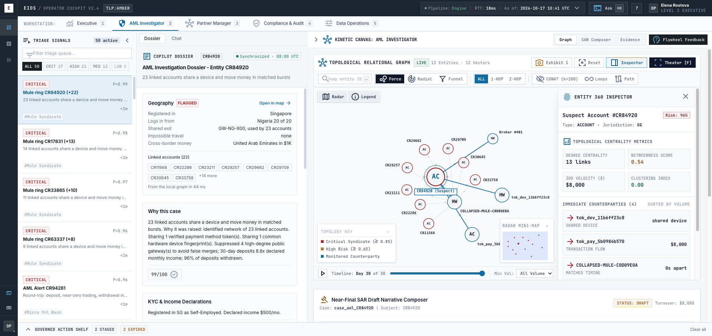
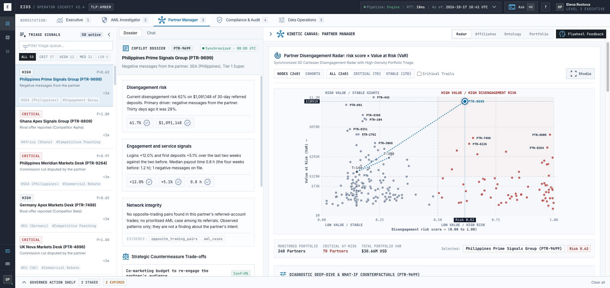
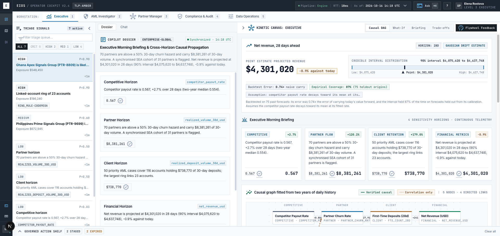
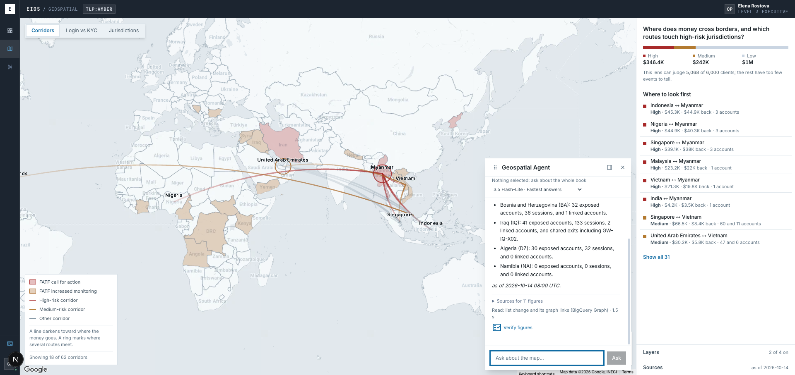

<div align="center">

# EIOS · Enterprise Intelligence Operating System

**An ontology-grounded AI copilot for financial-crime, partner and executive decisions, built so the model explains the numbers and never makes them up.**

[](https://github.com/abdullahabtahi/EIOS/actions/workflows/pr.yml)
[](https://github.com/abdullahabtahi/EIOS/actions/workflows/codeql.yml)


[Live demo](https://eios-web-562008989053.us-central1.run.app) · [Architecture](#architecture) · [Evals](#evaluation-what-we-measured-including-the-misses) · [Quickstart](#quickstart)



<sub>The AML investigator workstation. Every figure in the dossier carries a check mark: a tool returned it in that same turn.</sub>

</div>

---

## The problem

> *"We get 2,000 alerts per week. I spend my day clicking through accounts, checking if that $5,000 deposit is suspicious. Most aren't. The real fraud hides in the noise."*
> — from the [transaction-monitoring brief](docs/brief/monitoring.md)

Financial-crime, partnerships and finance teams at a high-volume trading broker work across silos. Rule engines raise thousands of alerts and about 95% are false positives. An investigator pulls context from five or more systems to rebuild one timeline. A partner goes quiet for weeks before anyone notices. An executive pieces together a decision from four dashboards. The four challenge briefs ([monitoring](docs/brief/monitoring.md), [fraud](docs/brief/fraud.md), [churn](docs/brief/churn.md), [data](docs/brief/data.md)) describe the same failure: **noise, silos, and detection that is always one step late.**

The obvious fix is to put an LLM on top. In a regulated setting that creates a new problem: a model that writes a plausible but wrong number into a SAR, or proposes an action nobody approved, is worse than no model.

## What EIOS does

EIOS gives each role one workstation and one copilot. The copilot reasons over a **governed ontology** of the business, calls deterministic engines for every number, and shows an answer only after code has verified it.

| | |
|---|---|
| **Cut the noise** | A triage scorer ranks ~2,000 raw alerts into a short queue; graph and ML engines group them into rings and typologies. |
| **Explain, don't assert** | The copilot writes a dossier from tool results. Each figure links to the tool call that produced it. A figure no tool returned is rejected. |
| **Act under control** | Agents *propose*. A change of state needs a Cloud KMS-signed, expiring action intent approved by a second human. |
| **Be honest about uncertainty** | A causal claim shows as causal only if it passes placebo refutation. Otherwise it says "Correlation only". A figure nothing measured shows as `NO_DATA`, never as zero. |

### Who uses it

| Persona | Story |
|---|---|
| **AML investigator** | *"23 accounts share a device and move money in matched bursts."* Opens the top ring, reads a dossier that states why it was raised, expands the graph (CGNAT hubs suppressed so shared Wi-Fi does not look like laundering), and drafts a SAR narrative with every figure cited. |
| **Partner manager** | Sees 240 partners on a risk × value-at-risk radar. Picks the high-value partner whose disengagement risk jumped from 29% to 62% in 30 days, reads the driver, and proposes a retention playbook for approval. |
| **Executive** | Opens a morning briefing with a causal graph fitted from two years of history, a 28-day revenue forecast with a backtested interval, and what-if shocks that propagate in milliseconds. |
| **MLRO / approver** | Reviews proposed holds and SARs. The second approver sees the exact evidence bundle that was frozen when the proposal was made, hash-checked. |
| **Geo analyst** | Asks the map *"which corridors touch call-for-action jurisdictions?"* The answer moves the map to the objects it cited. |

<table>
<tr>
<td width="50%"><br><sub><b>Partner radar.</b> Risk × value-at-risk across 240 partners, with a dossier of verified figures.</sub></td>
<td width="50%"><br><sub><b>Executive briefing.</b> Forecast with a backtested interval, and a causal graph labelled "verified causal" or "correlation only".</sub></td>
</tr>
<tr>
<td colspan="2"><br><sub><b>Geospatial workstation.</b> Corridors over FATF-tiered jurisdictions. The agent's answer cites 11 figures and can move the map, but only to objects a tool returned in that turn.</sub></td>
</tr>
</table>

---

## The ontology is the product

The central idea is the same one that makes operational platforms like Palantir Foundry useful: **model the business once as typed objects, links, functions and actions, and make every consumer (dashboard, API, AI agent) go through it.** In EIOS the ontology is also the safety boundary for the AI.

```mermaid
graph LR
  subgraph Objects
    CA[ClientAccount]:::o --- DV[Device]:::o
    CA --- IP[IPAddress]:::o
    CA --- PM[PaymentMethod]:::o
    CA --- PT[Partner]:::o
    PT --- SA[SubAffiliate]:::o
    AL[Alert]:::o --> CS[Case]:::o
    CS --> DC[Decision]:::o
    MV[MacroEvent]:::o -. AFFECTS .-> PT
  end
  subgraph Functions["Functions (deterministic, unit-tested)"]
    F1[ring_membership]:::f
    F2[partner_value_at_risk]:::f
    F3[churn_priority]:::f
    F4[scenario_propagate]:::f
  end
  subgraph Actions["Actions (governed)"]
    A1[HoldWithdrawal]:::a
    A2[FreezeAccount]:::a
    A3[FileSARDraft]:::a
    A4[SuspendPartner]:::a
  end
  Objects --> Functions
  Functions --> P{{"Governed tool port<br/>typed · allow-listed · traced"}}:::p
  P --> LLM(["Gemini via ADK<br/>narrates, never computes"]):::l
  LLM -. propose only .-> Actions
  Actions --> H["Intent hub → Cloud KMS signature → 2nd human → WORM ledger"]:::a
  classDef o fill:#e1f3e8,stroke:#1d7646,color:#16202e
  classDef f fill:#efe6fa,stroke:#7440b2,color:#16202e
  classDef a fill:#fff0d1,stroke:#a8620a,color:#16202e
  classDef p fill:#e3edff,stroke:#2c5bcf,color:#16202e
  classDef l fill:#e3edff,stroke:#2c5bcf,color:#16202e
```



| Ontology element | What it is here | Where |
|---|---|---|
| **Objects and links** | `ClientAccount`, `Device`, `IPAddress`, `PaymentMethod`, `Partner`, `Case`, `Alert`, `Decision` and the links between them, hydrated from the data plane | [`ontology/core/`](EIOS/src/eios/ontology/core) |
| **Functions** | Versioned, unit-tested metrics (a registry, ADR-003) and engines such as ring detection and scenario propagation. The model calls them and never re-implements them | [`ontology/metrics/`](EIOS/src/eios/ontology/metrics), [`ontology/functions/`](EIOS/src/eios/ontology/functions) |
| **Tool port** | The typed surface the agent calls: arguments validated, per-workstation allow-list and security markings, result checked against a contract, every call traced. **There is no approve or execute tool.** | [`ontology/omcp/port/`](EIOS/src/eios/ontology/omcp/port) |
| **Actions** | `HoldWithdrawal`, `FreezeAccount`, `FileSARDraft`, `SuspendPartner` and more as *intents*: validated, KMS-signed, expiring, four-eyes approved | [`ontology/actions/`](EIOS/src/eios/ontology/actions) |
| **Markings** | PII is tokenised before it reaches the model; sensitive objects are filtered by the caller's role | `ingestion/` token vault, port markings |
| **Metric Auditor** | Any number in a draft that does not trace to a tool result is refused | [`ontology/auditor/`](EIOS/src/eios/ontology/auditor) |

---

## Gen AI design: how the copilot earns trust

EIOS runs on **Google ADK** with **Gemini on Vertex AI**. One agent per workstation sits behind the governed port. The design question was never "which prompt" but **"what can the model be trusted with?"**

- **Draft, then verify.** A `LoopAgent` runs a *prefetcher*, a Gemini *drafter* and a deterministic *assembler*. The assembler checks every figure and regulation quote against the tool results of that same turn (kept in ADK session state). A rejection goes back to the drafter with reasons. After three rejections it **fails closed** with a plain "cannot answer", never a guess.
- **Quotes are fetched, not typed.** Regulation text is retrieved from **Agent Search** and cited by sentence number. The model cannot paraphrase a rule into existence.
- **Screening.** **Model Armor** screens the prompt and reply once per turn. We measured that it caught 1 of 15 attack prompts, so it is not what we rely on: the tool port and four-eyes approval are the real controls.
- **Fairness is structural.** On the geospatial agent, a question that ranks people by nationality, ethnicity or religion is refused by a callback *before the model runs*. Geography is evidence, never a verdict.
- **Outage means 503.** There is no replay and no fallback for the copilot. It never serves an invented answer.

<details>
<summary><b>Inside one ADK turn</b> (diagram)</summary>


</details>

<details>
<summary><b>Where a request can end</b> (diagram)</summary>


</details>

<details>
<summary><b>The geospatial assistant</b>: the map as input and output (diagram)</summary>


The model never writes SQL, GQL, coordinates or layer settings. It can only name a query from a catalogue and a map object a tool returned. A hold or SAR draft freezes its evidence, and the signed intent names that exact bundle.

</details>

---

## Architecture


| Layer | Role |
|---|---|
| **L0 `foundry/`** | Seeded generators and planted-truth worlds (AML, partner, executive). Truth tables are read by evaluations only, never by an engine. |
| **L1 `ingestion/`, `contracts/`** | Pub/Sub, contract validation (a breach goes to a dead-letter queue, never dropped), DuckDB hot state with Parquet warm start. |
| **L2 `ontology/`** | Metrics registry, graph with hub suppression, the typed tool port, action intents and the Metric Auditor. |
| **L3 `assistant/`** | The ADK assistant: one agent per workstation, drafter, assembler, Firestore sessions, Model Armor. |
| **L4 `cockpit/`** | FastAPI gateway, Firebase auth (analyst, approver, compliance head), signer, ledger, WORM storage. |

### The engines behind the port (classical ML, causal and graph, all testable against planted truth)

| Capability | Technique |
|---|---|
| Alert triage | Supervised scorer and queue prioritiser: ~2,000 alerts to 50 or fewer cases |
| Mule rings | NetworkX bipartite graphs over payments, devices, IPs; degree-penalised CGNAT hub suppression |
| Novel typologies | IsolationForest with RobustScaler on residual transactions |
| Partner churn | Discrete-time logistic hazard; change-point and cohort detectors |
| Causal graph | Confounder removal, standardised ridge, bootstrap intervals; an edge survives only if placebo, random-common-cause and subset refuters pass |
| Effect estimation | Doubly robust AIPW with clipped propensities |
| Forecast and what-if | Ridge autoregression, intervals from rolling-origin backtests, shocks with attribution summing to 100% |
| Regulation retrieval | Agent Search in chunk mode, jurisdiction filter, relevance floor |
| Graph analytics | Named GQL queries on **BigQuery Graph**, with a DuckDB double and a measured parity check |

---

## Data: synthetic core, real reference layer

**The transactional world is synthetic.** Clients, payments, devices, partners and alerts come from seeded generators with planted ground truth (rings, round-trip wash trades, churning partners, shared-exit gateways), so engines can be scored on whether they *find what was planted*. No real customer data is used. A signed-in demo shows synthetic accounts, and nothing in this repository should be mistaken for production data.

**The reference layer that enriches it is real and public**, loaded into BigQuery (`warm_reference`) with source and as-of date on every row:

| Source | Used for |
|---|---|
| **Overture Maps** (BigQuery public data) | Country boundaries and centroids that place every corridor and login on the map |
| **FATF** high-risk and increased-monitoring lists | Jurisdiction tiers on the map and in agent answers |
| **EU** high-risk third-country list, **Basel AML Index** | Alternative risk bases the analyst can switch between |
| **ICIJ Offshore Leaks** (jurisdiction-level counts) | Structural context. The UI states it is not evidence of wrongdoing. |
| **World Bank indicators** | Macro context per jurisdiction |
| IP-to-country network data | IP versus declared-country checks, where "none listed" never means "clean" |

---

## Speed: why a turn takes about 2 seconds

The first measured copilot turn took **10.4 s** and the second 8.4 s. The model was only 3.4 to 4.4 s of that. We measured per stage before changing anything:


| Change | Effect |
|---|---|
| **Write-behind sessions.** ADK's Firestore service wrote each event as an awaited transaction (6 to 8 per turn). Now the answer returns first and Firestore catches up in order. | First turn 10.4 s → 4.2 s, second 8.4 s → 3.0 s |
| **Prefetch.** The platform runs the obvious tool before the model's first call, so the model drafts once instead of choosing a tool first. | One model call per turn on average (1.28, down from 1.67) |
| **Fast model tier by default**, one client per model for the process lifetime, and a **hedge** for calls that stall. | Median 2.0 s vs 7.3 s on the larger tier |
| **Plain figures.** The drafter writes "61.67%"; the assembler matches it to a returned value at the written precision, instead of forcing placeholder syntax. | No invented figure in 18 comparison answers |

After the changes: 18 of 18 questions answered over HTTP, **median 2.4 s, p90 3.7 s**, none failing closed. Model Armor adds a median of 375 ms. Details in [`docs/assistant-latency.md`](docs/assistant-latency.md).

---

## Evaluation: what we measured, including the misses

Agents are judged through an agent port against golden cases, never by the agent itself. Splits are `dev`, `validation` and a sealed set that is run only to judge a finished change ([`docs/agent-eval-splits.md`](docs/agent-eval-splits.md)).

| Check | Result | Note |
|---|---|---|
| Live baseline, default (fast) model, 83 turns, engine data plane | **77 pass / 6 fail / 0 inconclusive** | The larger tier scored 69 / 4 / 10: all 10 inconclusive hit the 30 s deadline |
| Numeric faithfulness | **94.6%** | The larger tier: 88.2% |
| p95 turn latency | **6.9 s** | The larger tier: 24.6 s |
| Offline baseline after fixes | **83 / 83** | Scripted model, free to run in CI |
| Judge accuracy on a recorded corpus | 1,014 of 1,014 wrong answers blocked, 832 of 832 faithful accepted | Corpus written by the same author: a caveat, not a proof |
| Model Armor | 0 false positives on 32 golden questions; blocked 1 of 15 attack prompts | Why it is not the main control |
| Geo lens vs planted truth | IP-versus-KYC: precision 1.00, recall 0.77; geo score top 50: lift 41.7× over base rate | The first rule scored 0.81 precision, and we changed it |
| Executive forecast | Backtested on 75 past forecasts: error 0.74× a naive carry-forward, interval held 87% of the time | |

**Known gaps, stated up front.** Three remaining baseline failures are grader false positives (digits inside names such as "Boom 1000"). We left the grader alone on purpose: loosening a judge to turn a result green is what a baseline exists to prevent. Not yet measured: the live agent judges on the newest rules, and load on Cloud Run. See [`docs/agent-baseline.md`](docs/agent-baseline.md).

---

## Seven invariants the code enforces

| | Invariant |
|---|---|
| **RL-1** | No LLM-computed metrics. Every number comes from a deterministic engine. |
| **RL-2** | No autonomous write-back. Agents propose; a KMS-signed, expiring intent needs a second human. |
| **RL-3** | Honest uncertainty. "Causal" only if placebo p > 0.05 and confidence ≥ 0.80; else "Correlation only". |
| **RL-4** | Shared-IP nodes with degree > 100 are collapsed out of laundering rings. |
| **RL-5** | WORM decision ledger: monotonic sequence numbers and SHA-256 chaining on every approval. |
| **RL-6** | What-if shocks propagate in under 200 ms with attribution summing to 100.0%. |
| **RL-7** | A workstation outage serves a labelled verified replay, never invented state. |

## Engineering practice

- **Gates as data.** 15+ CI gates are rows in [`config/gates.yaml`](EIOS/config/gates.yaml), shared by `make check` locally and by CI. They include lint, strict types, coverage, contract and red-line tests, eval smoke, vulnerability and secret scans, infra policy, ADR consistency, CodeQL and a [Postman/Newman API gate](EIOS/docs/postman/README.md).
- **Every claim carries a provenance tag.** `[BRIEF]`, `[ASSUMPTION]`, `[TARGET]`, `[MEASURED]`. A `label_check` gate fails the build on an untagged number in the docs.
- **Decisions are recorded.** Architecture decision records and numbered specs ([`specs/`](specs)) explain why, including what was superseded.
- **Security by construction.** KMS signing with ECDSA P-256, Secret Manager, tokenised PII, least-privilege deploy identities, Terraform for Cloud Run, KMS, BigQuery and Firestore.
- **Observability.** OpenTelemetry to Cloud Trace with no prompt text on spans, and per-call timing returned with every answer.

## Tech stack

| | |
|---|---|
| **Gen AI** | Google ADK 2.11 · Gemini on Vertex AI · Model Armor · Agent Search · Firestore sessions |
| **Backend** | Python 3.14 · FastAPI · DuckDB · scikit-learn · NetworkX · Pydantic |
| **Data and graph** | BigQuery (warm tier, BigQuery Graph) · Pub/Sub · Parquet |
| **Frontend** | Next.js 16 · React 19 · Tailwind 4 · deck.gl on Google Maps · Firebase auth |
| **Security and infra** | Cloud KMS · Secret Manager · Cloud Run · Terraform · GitHub Actions |
| **Quality** | pytest · Vitest · Ruff · strict mypy · CodeQL · Newman |

---

## Quickstart

Prerequisites: Python 3.14 with [`uv`](https://docs.astral.sh/uv/), Node 20+.

```bash
# Backend
cd EIOS
make setup
PYTHONPATH=src uv run uvicorn eios.api.app:app --host 127.0.0.1 --port 8002

# Cockpit (second terminal)
cd EIOS/web-prototype
npm install
npm run dev -- -p 3000     # http://localhost:3000/cockpit
```

The cockpit, engines and tool port run offline against the seeded world. The **copilot** also needs Vertex AI: set `GOOGLE_GENAI_USE_VERTEXAI=true`, `GOOGLE_CLOUD_PROJECT`, `GOOGLE_CLOUD_LOCATION=global` and `EIOS_GEMINI_MODEL`. Without them copilot queries return a plain 503, by design.

```bash
make check                 # every PR gate, same as CI
make test                  # unit tests
python -m evals.agent.baseline --runtime adk   # offline agent baseline, no model spend
npx newman run EIOS/docs/postman/eios_showcase.postman_collection.json \
  -e EIOS/docs/postman/eios_environment.postman_environment.json
```

## Repository map

```
EIOS/
├── src/eios/
│   ├── foundry/        seeded worlds with planted truth
│   ├── ingestion/      contracts, dead-letter queue, DuckDB hot state
│   ├── ontology/       metrics, graph, tool port, action intents, auditor
│   ├── assistant/      ADK runtime, drafter, assembler, prefetch, timing
│   ├── aml/ churn/ fraud/ synthesis/   engines that produce the numbers
│   ├── knowledge/      regulation retrieval (Agent Search)
│   ├── reference/ netintel/   the real-data reference layer
│   ├── agent_gates/    judges and golden-case harness
│   └── cockpit/ api/   gateway, auth, signer, ledger
├── web-prototype/      Next.js operator cockpit
├── infra/              Terraform
└── docs/postman/       API quality-gate collection
docs/                   design notes, measured baselines, briefs
specs/                  numbered feature specs
```

## Honest limits

- All transactional data is synthetic. Reference data is real; the cockpit does not currently mark synthetic figures on screen, so do not present this build as production data.
- The shared reviewer login on the demo is public by design. Only the copilot is rate-limited.
- The live quality baseline predates some of the latest assistant changes; re-measure before quoting it.
- Some operations-board lines (RL-2 and RL-7 coverage) report `NOT_MEASURED` on purpose, rather than a green they have not earned.

<div align="center"><sub>MIT License · Built on Google Cloud</sub></div>
