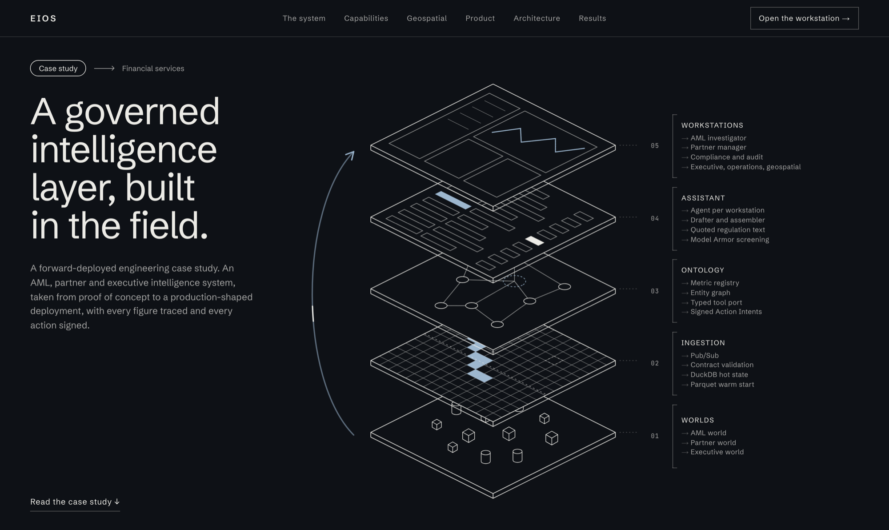
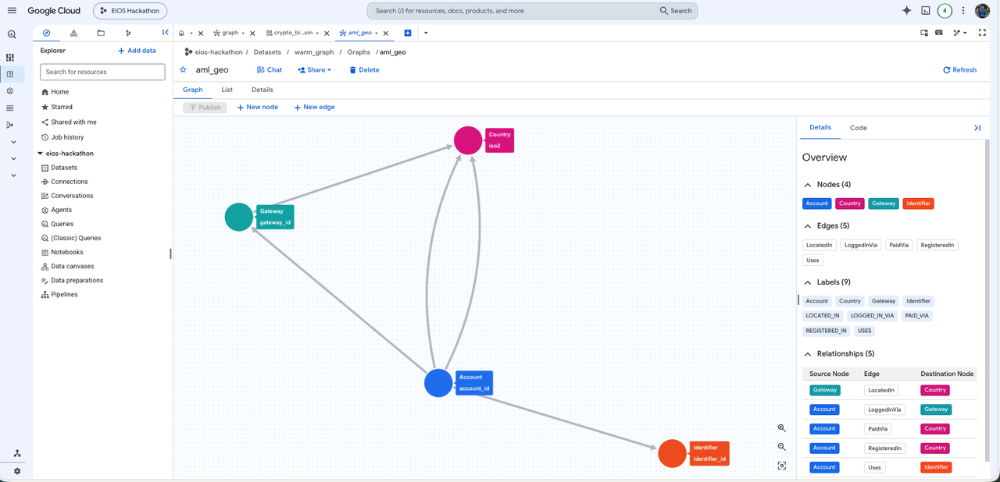

<div align="center">

# EIOS · Enterprise Intelligence Operating System

**An ontology-grounded AI copilot for financial-crime, partner and executive decisions, built so the model explains the numbers and never makes them up.**

[](https://github.com/abdullahabtahi/EIOS/actions/workflows/pr.yml)
[](https://github.com/abdullahabtahi/EIOS/actions/workflows/codeql.yml)


[Live demo](https://eios-web-562008989053.us-central1.run.app) · [Who uses it](#who-uses-it) · [Architecture](#architecture) · [Evals](#evaluation-what-we-measured-including-the-misses) · [Quickstart](#quickstart)



<sub>EIOS as five layers. Every number is produced in the lower three and only narrated in the fourth; people act in the fifth.</sub>

</div>

---

## In 30 seconds

| You ask | The answer |
|---|---|
| **Who uses it?** | AML investigators, partner managers, executives, second-line approvers, compliance heads and geo analysts. One workstation each. |
| **What triggers it?** | A signal in the transaction stream: for example a customer who deposits 16× what they declared, then withdraws 96% of it. |
| **How does EIOS help?** | It assembles the case from five systems into one cited screen, finds the ring, quotes the rule that applies, and drafts the report. A number appears only if a deterministic engine returned it that turn. |
| **What does the human do?** | Reviews, edits and decides. Then a *second* person approves. The proposer cannot approve their own action, and the AI has no approve or execute tool at all. |
| **What happens afterward?** | The approved action is signed with Cloud KMS, expires if nobody acts, and is chained into a ledger that cannot be rewritten. The evidence is sealed so anyone can re-check it. |

---

## The problem

> *"We get 2,000 alerts per week. I spend my day clicking through accounts, checking if that $5,000 deposit is suspicious. Most aren't. The real fraud hides in the noise."*
> — from the [transaction-monitoring brief](docs/brief/monitoring.md)

Financial-crime, partnerships and finance teams at a high-volume trading broker work across silos. Rule engines raise thousands of alerts and about 95% are false positives. An investigator pulls context from five or more systems to rebuild one timeline. A partner goes quiet for weeks before anyone notices. An executive pieces together a decision from four dashboards. The four challenge briefs ([monitoring](docs/brief/monitoring.md), [fraud](docs/brief/fraud.md), [churn](docs/brief/churn.md), [data](docs/brief/data.md)) describe the same failure: **noise, silos, and detection that is always one step late.**

The obvious fix is to put an LLM on top. In a regulated setting that creates a new problem: a model that writes a plausible but wrong number into a SAR, or proposes an action nobody approved, is worse than no model.

## What EIOS does


<sub>The AML investigator workstation. Every figure in the dossier carries a check mark: a tool returned it in that same turn.</sub>


EIOS gives each role one workstation and one copilot. The copilot reasons over a **governed ontology** of the business, calls deterministic engines for every number, and shows an answer only after code has verified it.

| | |
|---|---|
| **Cut the noise** | A triage scorer ranks ~2,000 raw alerts into a short queue; graph and ML engines group them into rings and typologies. |
| **Explain, don't assert** | The copilot writes a dossier from tool results. Each figure links to the tool call that produced it. A figure no tool returned is rejected. |
| **Act under control** | Agents *propose*. A change of state needs a Cloud KMS-signed, expiring action intent approved by a second human. |
| **Be honest about uncertainty** | A causal claim shows as causal only if it passes placebo refutation. Otherwise it says "Correlation only". A figure nothing measured shows as `NO_DATA`, never as zero. |

### Who uses it

Each role gets one workstation. Each story says who needs something, what they need and why. The last column is what the build delivers today, on the seeded world.

| Persona | User story | What it delivers |
|---|---|---|
| **AML investigator** | **As an** AML investigator, **I want** the top-ranked alert opened with the reason it was raised and the accounts around it, **so that** I can decide in minutes instead of rebuilding a timeline from five systems. | One cited dossier for case CR84920: a ring of 23 accounts sharing a device, with a shared gateway of 142 people left out. A SAR narrative in which every figure is checked. |
| **Partner manager** | **As a** partner manager, **I want** to see which valuable partners are drifting away and why, **so that** I can step in before they leave. | 240 partners on a risk × value-at-risk radar. One partner's disengagement risk rises from 29% to 62% in 30 days, with the driver named and a retention playbook proposed for approval. |
| **Executive** | **As an** executive, **I want** a morning briefing that separates what caused a change from what only moved with it, **so that** I act on causes and not on coincidences. | A causal graph fitted from two years of history, a 28-day revenue forecast with a backtested interval, and what-if shocks that propagate in milliseconds. |
| **MLRO / approver** | **As a** second-line approver, **I want** to review the exact evidence behind a proposed hold or SAR, **so that** I can approve it, or refuse it, knowing nothing changed after it was proposed. | The evidence bundle frozen when the proposal was made, hash-checked. The proposer cannot approve their own action. |
| **Geo analyst** | **As a** geo analyst, **I want** to ask the map a question in plain words, **so that** I see which corridors touch high-risk jurisdictions without building a query. | *"Which corridors touch call-for-action jurisdictions?"* The answer moves the map to the objects it cited, and only to those. |

<table>
<tr>
<td width="50%"><br><sub><b>Partner radar.</b> Risk × value-at-risk across 240 partners, with a dossier of verified figures.</sub></td>
<td width="50%"><br><sub><b>Executive briefing.</b> Forecast with a backtested interval, and a causal graph labelled "verified causal" or "correlation only".</sub></td>
</tr>
<tr>
<td colspan="2"><br><sub><b>Geospatial workstation.</b> Corridors over FATF-tiered jurisdictions. The agent's answer cites 11 figures and can move the map, but only to objects a tool returned in that turn.</sub></td>
</tr>
</table>

---

## The ontology is the product

The central idea is the same one that makes operational platforms like Palantir Foundry useful: **model the business once as typed objects, links, functions and actions, and make every consumer (dashboard, API, AI agent) go through it.** In EIOS the ontology is also the safety boundary for the AI.


| Ontology element | What it is here | Where |
|---|---|---|
| **Objects and links** | `ClientAccount`, `Device`, `IPAddress`, `PaymentMethod`, `Partner`, `Case`, `Alert`, `Decision` and the links between them, hydrated from the data plane | [`ontology/core/`](EIOS/src/eios/ontology/core) |
| **Functions** | Versioned, unit-tested metrics (a registry, ADR-003) and engines such as ring detection and scenario propagation. The model calls them and never re-implements them | [`ontology/metrics/`](EIOS/src/eios/ontology/metrics), [`ontology/functions/`](EIOS/src/eios/ontology/functions) |
| **Tool port** | The typed surface the agent calls: arguments validated, per-workstation allow-list and security markings, result checked against a contract, every call traced. **There is no approve or execute tool.** | [`ontology/omcp/port/`](EIOS/src/eios/ontology/omcp/port) |
| **Actions** | `HoldWithdrawal`, `FreezeAccount`, `FileSARDraft`, `SuspendPartner` and more as *intents*: validated, KMS-signed, expiring, four-eyes approved | [`ontology/actions/`](EIOS/src/eios/ontology/actions) |
| **Markings** | PII is tokenised before it reaches the model; sensitive objects are filtered by the caller's role | `ingestion/` token vault, port markings |
| **Metric Auditor** | Any number in a draft that does not trace to a tool result is refused | [`ontology/auditor/`](EIOS/src/eios/ontology/auditor) |

---

## Gen AI design: how the copilot earns trust

EIOS runs on **Google ADK** with **Gemini on Vertex AI**. One agent per workstation sits behind the governed port. The design question was never "which prompt" but **"what can the model be trusted with?"**

- **Draft, then verify.** A `LoopAgent` runs a *prefetcher*, a Gemini *drafter* and a deterministic *assembler*. The assembler checks every figure and regulation quote against the tool results of that same turn (kept in ADK session state). A rejection goes back to the drafter with reasons. After three rejections it **fails closed** with a plain "cannot answer", never a guess.
- **Quotes are fetched, not typed.** Regulation text is retrieved from **Agent Search** and cited by sentence number. The model cannot paraphrase a rule into existence.
- **Screening.** **Model Armor** screens the prompt and reply once per turn. We measured that it caught 1 of 15 attack prompts, so it is not what we rely on: the tool port and four-eyes approval are the real controls.
- **Fairness is structural.** On the geospatial agent, a question that ranks people by nationality, ethnicity or religion is refused by a callback *before the model runs*. Geography is evidence, never a verdict.
- **Outage means 503.** There is no replay and no fallback for the copilot. It never serves an invented answer.

<details>
<summary><b>Inside one ADK turn</b> (diagram)</summary>


</details>

<details>
<summary><b>Where a request can end</b> (diagram)</summary>


</details>

<details>
<summary><b>The geospatial assistant</b>: the map as input and output (diagram)</summary>


The model never writes SQL, GQL, coordinates or layer settings. It can only name a query from a catalogue and a map object a tool returned. A hold or SAR draft freezes its evidence, and the signed intent names that exact bundle.

</details>

---

## Architecture


| Layer | Role |
|---|---|
| **L0 `foundry/`** | Seeded generators and planted-truth worlds (AML, partner, executive). Truth tables are read by evaluations only, never by an engine. |
| **L1 `ingestion/`, `contracts/`** | Pub/Sub, contract validation (a breach goes to a dead-letter queue, never dropped), DuckDB hot state with Parquet warm start. |
| **L2 `ontology/`** | Metrics registry, graph with hub suppression, the typed tool port, action intents and the Metric Auditor. |
| **L3 `assistant/`** | The ADK assistant: one agent per workstation, drafter, assembler, Firestore sessions, Model Armor. |
| **L4 `cockpit/`** | FastAPI gateway, Firebase auth (analyst, approver, compliance head), signer, ledger, WORM storage. |

### The engines behind the port (classical ML, causal and graph, all testable against planted truth)

| Capability | Technique |
|---|---|
| Alert triage | Supervised scorer and queue prioritiser: ~2,000 alerts to 50 or fewer cases |
| Mule rings | NetworkX bipartite graphs over payments, devices, IPs; degree-penalised CGNAT hub suppression |
| Novel typologies | IsolationForest with RobustScaler on residual transactions |
| Partner churn | Discrete-time logistic hazard; change-point and cohort detectors |
| Causal graph | Confounder removal, standardised ridge, bootstrap intervals; an edge survives only if placebo, random-common-cause and subset refuters pass |
| Effect estimation | Doubly robust AIPW with clipped propensities |
| Forecast and what-if | Ridge autoregression, intervals from rolling-origin backtests, shocks with attribution summing to 100% |
| Regulation retrieval | Agent Search in chunk mode, jurisdiction filter, relevance floor |
| Graph analytics | Named GQL queries on **BigQuery Graph**, with a DuckDB double and a measured parity check |

---

## BigQuery Graph: the ontology as a queryable property graph

The network side of the ontology (who shares a device, a payment token, or a login gateway with whom) is a **BigQuery property graph**, `warm_graph.aml_geo`, queried with **GQL**. Most AML stacks bolt a separate graph database onto the warehouse. Here the graph lives next to the data it is derived from, in the warehouse the rest of the platform already uses.



<sub>The <code>aml_geo</code> graph in BigQuery Studio: 4 node types, 5 edge types.</sub>

| | |
|---|---|
| **Model** | Nodes: `Account`, `Gateway`, `Country`, `Identifier` (device, payment token, IP). Edges: `REGISTERED_IN`, `LOGGED_IN_VIA`, `LOCATED_IN`, `PAID_VIA`, `USES`. Built from the world's raw frames, not from any engine's output, so it is an independent second derivation. |
| **How it is queried** | A catalogue of **named queries** (`shared_exits`, `account_neighbourhood`, `exit_ring`, `country_links`), each a GQL `MATCH` run through `GRAPH_TABLE`. The agent can only name a query from the catalogue. It never writes GQL or SQL. |
| **Where it is used** | The geospatial agent's "who else uses this exit?" and "what is this account's neighbourhood?" answers, the linked-accounts list in the dossier, and the effect of a list change (FATF, EU, Basel) on the book. Each answer says it came from BigQuery Graph and how long it took. |
| **Why it matters** | A ring is a multi-hop pattern: account → gateway ← account, or account → shared device ← account. In GQL that is one readable pattern instead of a stack of self-joins, and it runs where the data already lives. No second system to sync, secure or audit. |
| **Cost control** | GQL runs on a dedicated Enterprise reservation with a baseline of 0 slots and autoscale capped at 50. Each graph job names the reservation, so nothing else in the project is billed differently. An idle reservation costs nothing. |

**How we know it is right.** A DuckDB double runs the same named queries as plain joins, so offline development, CI and a parity check need no cloud. Measured: BigQuery equals the local double on every query, and the graph's shared-exit accounts equal the engine's independent flags (71 of 71). Warm queries take 1.7 to 1.8 s, the first cold query about 9 s, and 54 to 133 slot-milliseconds each. The store also refuses graph tables built from a different world than the one being served. Details in [`docs/geospatial-milestones.md`](docs/geospatial-milestones.md) (N1). BigQuery Graph currently runs in the dev project.

---

## Data: synthetic core, real reference layer

**The transactional world is synthetic.** Clients, payments, devices, partners and alerts come from seeded generators with planted ground truth (rings, round-trip wash trades, churning partners, shared-exit gateways), so engines can be scored on whether they *find what was planted*. No real customer data is used. A signed-in demo shows synthetic accounts, and nothing in this repository should be mistaken for production data.

**The reference layer that enriches it is real and public**, loaded into BigQuery (`warm_reference`) with source and as-of date on every row:

| Source | Used for |
|---|---|
| **Overture Maps** (BigQuery public data) | Country boundaries and centroids that place every corridor and login on the map |
| **FATF** high-risk and increased-monitoring lists | Jurisdiction tiers on the map and in agent answers |
| **EU** high-risk third-country list, **Basel AML Index** | Alternative risk bases the analyst can switch between |
| **ICIJ Offshore Leaks** (jurisdiction-level counts) | Structural context. The UI states it is not evidence of wrongdoing. |
| **World Bank indicators** | Macro context per jurisdiction |
| IP-to-country network data | IP versus declared-country checks, where "none listed" never means "clean" |

---

## Speed: why a turn takes about 2 seconds

The first measured copilot turn took **10.4 s** and the second 8.4 s. The model was only 3.4 to 4.4 s of that. We measured per stage before changing anything:


| Change | Effect |
|---|---|
| **Write-behind sessions.** ADK's Firestore service wrote each event as an awaited transaction (6 to 8 per turn). Now the answer returns first and Firestore catches up in order. | First turn 10.4 s → 4.2 s, second 8.4 s → 3.0 s |
| **Prefetch.** The platform runs the obvious tool before the model's first call, so the model drafts once instead of choosing a tool first. | One model call per turn on average (1.28, down from 1.67) |
| **Fast model tier by default**, one client per model for the process lifetime, and a **hedge** for calls that stall. | Median 2.0 s vs 7.3 s on the larger tier |
| **Plain figures.** The drafter writes "61.67%"; the assembler matches it to a returned value at the written precision, instead of forcing placeholder syntax. | No invented figure in 18 comparison answers |

After the changes: 18 of 18 questions answered over HTTP, **median 2.4 s, p90 3.7 s**, none failing closed. Model Armor adds a median of 375 ms. Details in [`docs/assistant-latency.md`](docs/assistant-latency.md).

---

## Evaluation: what we measured, including the misses

Agents are judged through an agent port against golden cases, never by the agent itself. Splits are `dev`, `validation` and a sealed set that is run only to judge a finished change ([`docs/agent-eval-splits.md`](docs/agent-eval-splits.md)).

| Check | Result | Note |
|---|---|---|
| Live baseline, default (fast) model, 246 turns (`live_final`) | **200 pass / 13 fail / 0 inconclusive** | 0 timeouts; the previous run scored 204 / 9 / 0 (single 3-repeat runs of a live model) |
| Sealed held-out split (`live_sealed`), run once | **40 pass / 2 fail / 0 inconclusive** | 7 cases, 3 repeats; p95 10.3 s over 42 turns. One failure is a tool-routing miss (`partner.signals` instead of `entity.resolve`); the other is the judge reading the first digits of a SHA-256 hash as a figure |
| Numeric faithfulness | **96.8%** | Share of figures that traced to a tool result; the 3% that did not are mostly digits in labels the judge cannot bind |
| p95 turn latency | **4.8 s (4,803 ms)** | p95 over 246 live turns; 19.7% of turns ran on fixture data |
| Financial red-team probes (Promptfoo) | **15 of 15 passed** | Small hand-written set with string-match assertions and no LLM grader ([`docs/evidence/financial-redteam-audit.md`](docs/evidence/financial-redteam-audit.md)) |
| Offline baseline after fixes | **198 / 198** | Scripted model, free to run in CI |
| Judge accuracy on a recorded corpus | 1,014 of 1,014 wrong answers blocked, 832 of 832 faithful accepted | Corpus written by the same author: a caveat, not a proof |
| Model Armor | 0 false positives on 32 golden questions; blocked 1 of 15 attack prompts | Why it is not the main control |
| Geo lens vs planted truth | IP-versus-KYC: precision 1.00, recall 0.77; geo score top 50: lift 41.7× over base rate | The first rule scored 0.81 precision, and we changed it |
| Executive forecast | Backtested on 75 past forecasts: error 0.74× a naive carry-forward, interval held 87% of the time | |

**Known gaps, stated up front.** The 13 failing verdicts in `live_final` are mostly figure-check cases where digits sit inside labels or echo the question ("28-day", "16.0x", a year), plus five trajectory misses (an extra tool round or a missing call); one, `geo_country_exposure`, has not been read closely enough to call it a false positive. The previous run scored 204 pass, so the 4-verdict gap is not shown to be either noise or a regression. We left the grader alone on purpose: loosening a judge to turn a result green is what a baseline exists to prevent. Also: 19.7% of `live_final` turns ran on fixture data, no spend was recorded, and load on Cloud Run is not measured. See [`docs/agent-baseline.md`](docs/agent-baseline.md) and [`docs/evidence/live-final-eval-visual-report.md`](docs/evidence/live-final-eval-visual-report.md).

---

## Seven invariants the code enforces

| | Invariant |
|---|---|
| **RL-1** | No LLM-computed metrics. Every number comes from a deterministic engine. |
| **RL-2** | No autonomous write-back. Agents propose; a KMS-signed, expiring intent needs a second human. |
| **RL-3** | Honest uncertainty. "Causal" only if placebo p > 0.05 and confidence ≥ 0.80; else "Correlation only". |
| **RL-4** | Shared-IP nodes with degree > 100 are collapsed out of laundering rings. |
| **RL-5** | WORM decision ledger: monotonic sequence numbers and SHA-256 chaining on every approval. |
| **RL-6** | What-if shocks propagate in under 200 ms with attribution summing to 100.0%. |
| **RL-7** | A workstation outage serves a labelled verified replay, never invented state. |

## Engineering practice

- **Gates as data.** 15+ CI gates are rows in [`config/gates.yaml`](EIOS/config/gates.yaml), shared by `make check` locally and by CI. They include lint, strict types, coverage, contract and red-line tests, eval smoke, vulnerability and secret scans, infra policy, ADR consistency, CodeQL and a [Postman/Newman API gate](EIOS/docs/postman/README.md).
- **Every claim carries a provenance tag.** `[BRIEF]`, `[ASSUMPTION]`, `[TARGET]`, `[MEASURED]`. A `label_check` gate fails the build on an untagged number in the docs.
- **Decisions are recorded.** Architecture decision records and numbered specs ([`specs/`](specs)) explain why, including what was superseded.
- **Security by construction.** KMS signing with ECDSA P-256, Secret Manager, tokenised PII, least-privilege deploy identities, Terraform for Cloud Run, KMS, BigQuery and Firestore.
- **Observability.** OpenTelemetry to Cloud Trace with no prompt text on spans, and per-call timing returned with every answer.

## Tech stack

Google Cloud where trust matters, open source where the numbers are computed.

| | |
|---|---|
| **Gen AI** | Google ADK 2.11 · Gemini on Vertex AI · Model Armor · Agent Search · Firestore sessions |
| **Backend** | Python 3.14 · FastAPI · DuckDB · scikit-learn · NetworkX · Pydantic |
| **Data and graph** | BigQuery (warm tier) · **BigQuery Graph (GQL)** · Pub/Sub · Parquet |
| **Frontend and maps** | Next.js 16 · React 19 · Tailwind 4 · deck.gl on the Google Maps JavaScript API · Firebase auth |
| **Security and infra** | Cloud KMS · Secret Manager · Cloud Run · Terraform · GitHub Actions |
| **Quality** | pytest · Vitest · Ruff · strict mypy · CodeQL · Newman · Promptfoo |

<details>
<summary><b>The full inventory</b>, by the job each technology does (each appears once)</summary>

Google services are in **bold**. Versions are the ranges in `pyproject.toml` and `package.json`.

| Job | Technologies |
|---|---|
| **See** (screens and maps) | Next.js 16.4, React 19.3, TypeScript 5, Tailwind CSS 4, Base UI, Radix UI, lucide-react, class-variance-authority, clsx, tailwind-merge, tw-animate-css, Schibsted Grotesk, deck.gl 9.4 (with its Google Maps overlay), vis.gl React Google Maps, **Google Maps JavaScript API** |
| **Serve** (APIs and services) | Python 3.14, FastAPI, Starlette, Uvicorn, Pydantic 2, httpx, Node.js 22 |
| **Think** (agents and models) | **Vertex AI**, **Gemini 3.5 Flash-Lite, 3.5 Flash and 3.8 Flash**, **Agent Search**, Google ADK 2.11, google-genai SDK |
| **Compute** (analytics) | NumPy, SciPy, scikit-learn, pandas, Polars, NetworkX. Methods: ridge regression, IsolationForest, discrete-time hazard, placebo refuters, AIPW |
| **Data** (stores, streams, graph) | **BigQuery**, **BigQuery Graph**, **Firestore**, **Cloud Storage**, **Pub/Sub**, DuckDB, Apache Parquet, PyArrow, JSON Schema, PyYAML |
| **Sources** (public data and lists) | IPinfo Lite, Tor exit list, AWS IP ranges, Google Cloud IP ranges, X4BNet VPN and datacenter lists, Overture Maps, FATF lists, EU high-risk list, Basel AML Index, ICIJ Offshore Leaks, World Bank WDI, Natural Earth, five regulatory documents, seeded synthetic worlds (Faker), pycountry |
| **Protect** (identity, secrets, signing, screening) | **Cloud KMS**, **Secret Manager**, **Identity Platform**, **Model Armor**, **Workload Identity Federation**, cryptography, limits, Firebase SDK 13 |
| **Run** (runtime and observability) | **Cloud Run**, **Cloud Trace**, **Cloud Logging**, **Cloud Monitoring**, **Cloud Billing budgets**, OpenTelemetry, Arize Phoenix (local only) |
| **Ship** (build and deploy) | **Cloud Build**, **Artifact Registry**, GitHub Actions, Terraform, Docker, uv, npm, Make, TFLint |
| **Prove** (test, evaluate, scan) | pytest (xdist, cov), Vitest, Vite 8, jsdom, Testing Library, mypy, Ruff, ESLint, Promptfoo, Newman, pip-audit, python-hcl2, Firestore emulator, CodeQL, Dependabot, SonarQube |

</details>

---

## Quickstart

Prerequisites: Python 3.14 with [`uv`](https://docs.astral.sh/uv/), Node 20+.

```bash
# Backend
cd EIOS
make setup
PYTHONPATH=src uv run uvicorn eios.api.app:app --host 127.0.0.1 --port 8002

# Cockpit (second terminal)
cd EIOS/web-prototype
npm install
npm run dev -- -p 3000     # http://localhost:3000/cockpit
```

The cockpit, engines and tool port run offline against the seeded world. The **copilot** also needs Vertex AI: set `GOOGLE_GENAI_USE_VERTEXAI=true`, `GOOGLE_CLOUD_PROJECT`, `GOOGLE_CLOUD_LOCATION=global` and `EIOS_GEMINI_MODEL`. Without them copilot queries return a plain 503, by design.

```bash
make check                 # every PR gate, same as CI
make test                  # unit tests
python -m evals.agent.baseline --runtime adk   # offline agent baseline, no model spend
npx newman run EIOS/docs/postman/eios_showcase.postman_collection.json \
  -e EIOS/docs/postman/eios_environment.postman_environment.json
```

## Repository map

```
EIOS/
├── src/eios/
│   ├── foundry/        seeded worlds with planted truth
│   ├── ingestion/      contracts, dead-letter queue, DuckDB hot state
│   ├── ontology/       metrics, graph, tool port, action intents, auditor
│   ├── assistant/      ADK runtime, drafter, assembler, prefetch, timing
│   ├── aml/ churn/ fraud/ synthesis/   engines that produce the numbers
│   ├── knowledge/      regulation retrieval (Agent Search)
│   ├── reference/ netintel/   the real-data reference layer
│   ├── agent_gates/    judges and golden-case harness
│   └── cockpit/ api/   gateway, auth, signer, ledger
├── web-prototype/      Next.js operator cockpit
├── infra/              Terraform
└── docs/postman/       API quality-gate collection
docs/                   design notes, measured baselines, briefs
specs/                  numbered feature specs
```

## Honest limits

- All transactional data is synthetic. Reference data is real; the cockpit does not currently mark synthetic figures on screen, so do not present this build as production data.
- The shared reviewer login on the demo is public by design. Only the copilot is rate-limited.
- The live quality numbers above were measured on `main` at `99f29ba` (2026-10-18), the build deployed to the demo; re-measure after any assistant change.
- Some operations-board lines (RL-2 and RL-7 coverage) report `NOT_MEASURED` on purpose, rather than a green they have not earned.

<div align="center"><sub>MIT License · Built on Google Cloud for the AI Builder Cup</sub></div>
