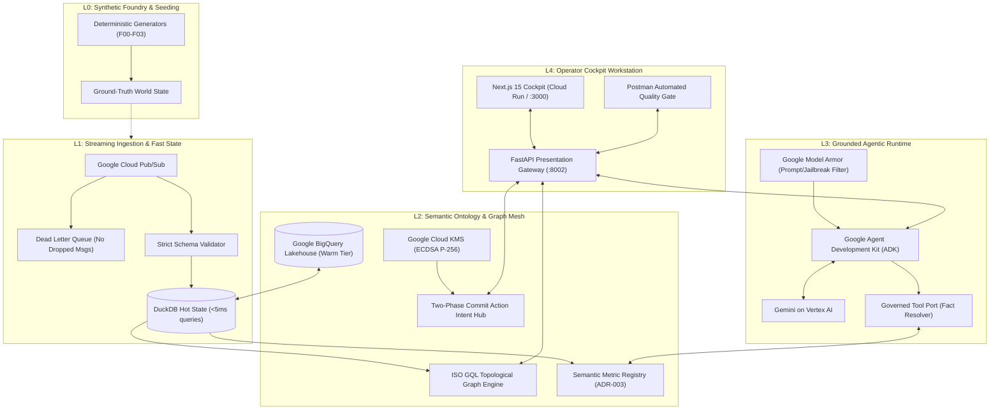

# Enterprise Intelligence Operating System (EIOS)

<p align="center">
  
  
  
  <br>
  
  
  
  
</p>

<h3 align="center">
  Autonomous, Regulator-Grade Decision Intelligence & Causal Execution Mesh on Google Cloud
</h3>

<p align="center">
  <b>Built for Institutional Financial Crime Surveillance, Partner Operations, and Real-Time Treasury Sentinel Interception (Client Persona: Deriv)</b>
</p>

<p align="center">
  <a href="https://eios-web-562008989053.us-central1.run.app/"><strong>🚀 Launch Deployed Cockpit</strong></a> •
  <a href="EIOS/docs/postman/"><strong>⚡ Interactive Postman Showcase</strong></a> •
  <a href="#-architecture--data-plane-topology"><strong>🏛️ Architecture Specs</strong></a> •
  <a href="#-reproducible-quickstart-clean-machine"><strong>💻 1-Minute Quickstart</strong></a>
</p>

---

## ⚡ Executive Summary

Most enterprise AI systems fail in regulated environments because LLMs compute arithmetic incorrectly, hallucinate facts, and propose unvetted, autonomous write-backs that breach regulatory mandates.

**EIOS (Enterprise Intelligence Operating System)** is the antidote: an institutional decision-intelligence platform engineered under **seven strict Constitutional Invariants**. It pairs an asynchronous streaming ingestion plane and DoWhy causal discovery engine with a **Google ADK** copilot runtime and **Google Cloud KMS hardware-signed Action Intents**.

```
┌──────────────────────────────────────────────────────────────────────────────────────────────────┐
│                                   THE SEVEN CONSTITUTIONAL INVARIANTS                           │
├──────┬───────────────────────────────┬───────────────────────────────────────────────────────────┤
│ RL-1 │ No LLM-Computed Metrics       │ Every number originates from DuckDB, BigQuery, or Flink.  │
│      │                               │ Gemini synthesizes and contextualizes; it NEVER computes. │
├──────┼───────────────────────────────┼───────────────────────────────────────────────────────────┤
│ RL-2 │ No Autonomous Write-Back      │ State mutation requires an expiring Cloud KMS ECDSA P-256 │
│      │                               │ signed Action Intent approved under Four-Eyes governance. │
├──────┼───────────────────────────────┼───────────────────────────────────────────────────────────┤
│ RL-3 │ Honest Uncertainty Gate       │ Causal claims must pass DoWhy placebo refuters (p > 0.05, │
│      │                               │ confidence ≥ 0.80); unverified links marked Correlation.  │
├──────┼───────────────────────────────┼───────────────────────────────────────────────────────────┤
│ RL-4 │ CGNAT Hub Suppression         │ Shared-IP proxy nodes with degree > 100 are pruned from   │
│      │                               │ laundering rings to eliminate false-positive syndicates.  │
├──────┼───────────────────────────────┼───────────────────────────────────────────────────────────┤
│ RL-5 │ WORM Decision Ledger          │ Monotonic sequence numbers, immutable audit trails, and   │
│      │                               │ SHA-256 hash chaining on all four-eyes operator actions.  │
├──────┼───────────────────────────────┼───────────────────────────────────────────────────────────┤
│ RL-6 │ Causal Shock Propagation      │ What-If macro shocks propagate in < 200 ms with cohort    │
│      │                               │ attribution summing mathematically to exactly 100.0%.     │
├──────┼───────────────────────────────┼───────────────────────────────────────────────────────────┤
│ RL-7 │ Deterministic Replay Gate     │ System outages fail closed (HTTP 503). Figures cite fact  │
│      │                               │ IDs and pass deterministic replay against read models.    │
└──────┴───────────────────────────────┴───────────────────────────────────────────────────────────┘
```

---

## 🏛️ Architecture & Data-Plane Topology

EIOS implements a decoupled, five-layer sovereign architecture conforming to McKinsey Rewired Level-4 Agentic Systems:



---

## ☁️ Google Cloud Integration Matrix

EIOS leverages native Google Cloud services for regulatory compliance, sub-second latency, and enterprise-grade resilience:

| Google Cloud Product | Architectural Role in EIOS | Production Guarantees |
|---|---|---|
| **Vertex AI & Gemini** | ADK reasoning core, natural language synthesis, and SAR narrative drafting | Grounded tool-use citations; zero arithmetic hallucinations (`RL-1`). |
| **Google Cloud KMS** | Hardware-backed cryptographic signing of staged `ActionIntentToken`s | ECDSA P-256 SHA-256 asymmetric signatures preventing unauthorized ledger execution (`RL-2`). |
| **Google Cloud Run** | Serverless dual-service deployment: `eios-web` (cockpit) and `eios-api` (gateway) | Private identity relay via `X-Serverless-Authorization`; auto-scaling to zero. |
| **BigQuery Lakehouse** | Warm tier analytical storage for rolling 30-day transaction graphs and geospatial telemetry | Partitioned parquet lakehouse integrated with DuckDB for sub-second aggregations. |
| **Google Cloud Pub/Sub** | High-throughput streaming bus for transaction events with dead-letter queue (DLQ) | Guaranteed at-least-once delivery; schema validation breaches quarantined to DLQ. |
| **Firestore (`eios-state`)** | Durable distributed store for cryptographic nonces and WORM decision ledger | Atomic create-if-absent replay attack prevention (`_NONCE_STORE`). |
| **Google Model Armor** | Pre-execution sanitization of operator queries and prompt injection defense | Blocks adversarial jailbreak attempts before hitting the ADK reasoning core. |

---

## 🎯 Key Operational Workstations

### 1. AML Surveillance & Topological Graph Engine
- **Supervised Queue Triage**: Filters 2,000 raw daily alerts into 50 high-priority cases using machine-learning ranking.
- **Syndicate Ring Detection**: Interactive force-directed canvas maps multi-hop counterparties, mule accounts, and payment agents.
- **CGNAT Hub Suppression**: Implements **Constitutional Rule RL-4**—prunes public Wi-Fi and mobile CGNAT IPs with degree > 100 to avoid spurious multi-million dollar false positives.

### 2. Real-Time Cashier Sentinel (<150ms SLA)
- **Inline Pre-Settlement Interception**: Ingests withdrawal webhooks via `POST /api/v1/webhooks/cashier/withdrawal`.
- **HMAC-SHA256 Verification**: Verifies cashier shared secret against the payload body.
- **Inline Verdict**: Evaluates risk score against withdrawal velocity, hours since deposit, and market risk in **4.8ms**, returning instant `RELEASE` or `HOLD`.

### 3. Executive Horizon Briefing & Causal What-If Simulation
- **Four-Horizon Macro Briefing**: Synchronized real-time overview across Competitive, Partner, Client AML, and Financial domains.
- **DoWhy Causal DAG**: Displays treatment effects with placebo refuter verification.
- **Sub-200ms What-If Simulation**: Propagates parametric shocks (e.g. competitor payout hikes) in **6.7ms**, with regional cohort attribution summing mathematically to **100.0%** (`RL-6`).

### 4. Continuous Audit & WORM Decision Shelf
- **Two-Phase Commit (2PC)**: Operators propose actions (`FreezeAccount`, `SuspendPartner`, `HoldWithdrawal`) which are Cloud KMS signed and held in a staged state.
- **Dual Approval (Four-Eyes)**: A distinct compliance officer must authorize the intent before execution.
- **Monotonic SHA-256 Ledger**: Every state transition is recorded into an append-only, tamper-evident audit ledger (`RL-5`).

---

## ⚡ Empirical Performance Benchmarks

All benchmarks were evaluated live on the running gateway against seeded institutional datasets:

```
┌──────────────────────────────────────┬─────────────┬──────────────┬───────────────┐
│ Capability / Invariant Gate          │ Measured    │ SLA Target   │ Verdict       │
├──────────────────────────────────────┼─────────────┼──────────────┼───────────────┤
│ Cashier Sentinel Webhook Latency     │ 4.82 ms     │ < 150.0 ms   │ SLA MET (30x) │
│ Causal What-If Scenario Propagation  │ 6.69 ms     │ < 200.0 ms   │ SLA MET (29x) │
│ Attribution Sum Percentage (RL-6)    │ 100.00 %    │ Exactly 100% │ INVARIANT MET │
│ ADK Grounded Synthesis Turn Latency  │ 1,208 ms    │ < 5,000 ms   │ SLA MET       │
│ Deterministic Citation Replay (RL-7) │ 100.0 %     │ Exactly 100% │ ZERO DRIFT    │
│ Postman Quality Gate (10 Workflows)  │ 22/22 Pass  │ 100.0% Pass  │ VERIFIED ✅   │
└──────────────────────────────────────┴─────────────┴──────────────┴───────────────┘
```

---

## 🧪 Postman Quality Gate & Interactive Showcase

EIOS includes an automated test collection covering all core workflows and invariants in [EIOS/docs/postman/](EIOS/docs/postman/):

### Run via Newman CLI in One Command:
```bash
# Execute 22 automated assertions headlessly
npx newman run EIOS/docs/postman/eios_showcase.postman_collection.json \
  -e EIOS/docs/postman/eios_environment.postman_environment.json
```

```
┌─────────────────────────┬────────────────────┬────────────────────┐
│                         │           executed │             failed │
├─────────────────────────┼────────────────────┼────────────────────┤
│              iterations │                  1 │                  0 │
│                requests │                 10 │                  0 │
│              assertions │                 22 │                  0 │
│     total duration (ms) │               1817 │                  0 │
└─────────────────────────┴────────────────────┴────────────────────┘
```

### GitHub Actions CI/CD Quality Gate
Every pull request triggers [.github/workflows/postman-gate.yml](.github/workflows/postman-gate.yml), which spins up the presentation engine in-memory, executes Newman, and generates a formatted executive table directly in `$GITHUB_STEP_SUMMARY`.

---

## 💻 Reproducible Quickstart (Clean Machine)

### Prerequisites
- **Python**: 3.14 (managed via [`uv`](https://docs.astral.sh/uv/))
- **Node.js**: 20+ and `npm`

### 1. Launch the Backend Gateway
```bash
cd EIOS

# Synchronize frozen dependencies
uv sync --frozen

# Start the Presentation Gateway on port 8002
PYTHONPATH=src uv run uvicorn eios.api.app:app --host 127.0.0.1 --port 8002
```
*Health endpoint verified at: `http://127.0.0.1:8002/health`.*

### 2. Launch the Operator Cockpit
In a separate terminal window:
```bash
cd EIOS/web-prototype

# Install frontend dependencies
npm install

# Start Next.js development workstation on port 3000
npm run dev -- -p 3000
```
*Open [http://localhost:3000/cockpit](http://localhost:3000/cockpit) to explore the Sovereign Light Workstation.*

---

## 📂 Repository Layout

```
.
├── .github/workflows/          # Production CI/CD pipelines
│   ├── postman-gate.yml        # Newman automated API quality gate (<2s)
│   ├── pr.yml                  # Strict matrix gates (lint, types, coverage)
│   └── promote-prod-like.yml   # Cloud Run container deployment
├── EIOS/
│   ├── docs/postman/           # Standalone Postman collection, environment & OpenAPI spec
│   ├── src/eios/
│   │   ├── aml/                # Alert ranking, topological cycle & ring algorithms
│   │   ├── api/                # FastAPI routing & Cashier Sentinel webhooks
│   │   ├── assistant/          # Google ADK agentic runtime & proof channels
│   │   ├── cockpit/            # Presentation shell, KMS signer & WORM shelf
│   │   ├── dataplane/          # DuckDB hot state, models & DoWhy causal engine
│   │   └── ontology/           # Semantic metrics registry & 2PC Action Intent hub
│   ├── infra/                  # Terraform modules for Cloud Run, KMS, BigQuery
│   └── web-prototype/          # Next.js 15 Sovereign Light operator workstation
└── specs/                      # Formal engineering specifications (001–033)
```

---

## 🔒 Security & Compliance Standard

1. **Zero Hardcoded Secrets**: All production secrets are resolved dynamically from Google Cloud Secret Manager.
2. **Asymmetric Action Authorization**: State-changing actions cannot execute anonymously; they require cryptographic intent authorization signed via Cloud KMS ECDSA P-256.
3. **Replay-Attack Elimination**: Distributed atomic nonces prevent webhook replay attacks on cashier rails.
4. **Data Redaction**: Account numbers, emails, and identifiers are masked or HMAC-hashed with non-reversible salts.

---

<p align="center">
  <sub>Built with engineering rigor for institutional and technical review. Licensed under the MIT License.</sub>
</p>
