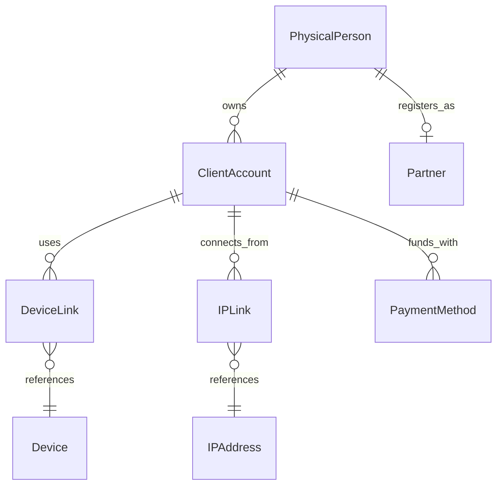
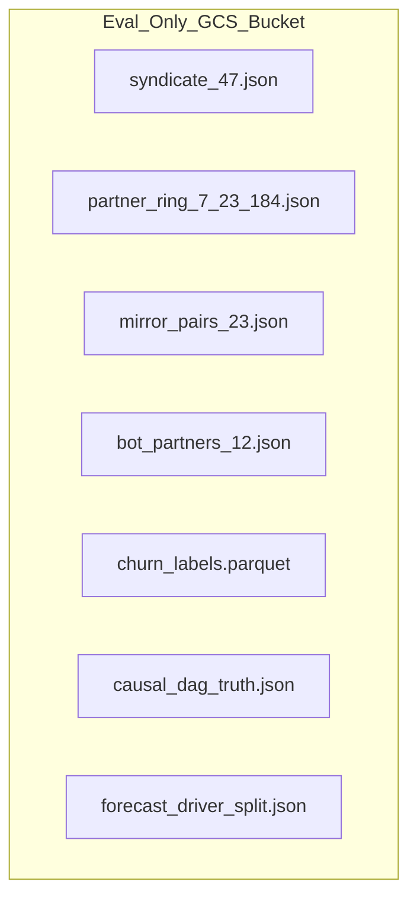

# Data Model: Synthetic Enterprise Data Foundry (F01)

**Feature**: `002-synthetic-foundry` | **Date**: 2026-10-02 | **Plan**: [plan.md](./plan.md) | **Research**: [research.md](./research.md)

This document specifies the core entities, relations, state machines, and data schemas for Feature F01 (Layer 0). All data structures follow the EIOS Constitution: immutable-by-default, strictly typed, validated at boundaries, and partitioned cleanly between public simulated telemetry and isolated evaluation ground truth.

---

## 1. Provenance & Control Entities

### 1.1 RunManifest

The single source of truth for deterministic execution and cryptographic provenance (`FR-001`, `FR-002`, `SC-001`).

| Field | Type | Description / Rules |
|---|---|---|
| `manifest_id` | string (UUIDv4) | Unique run execution identifier. |
| `manifest_version` | string | Semantic schema version (`"1.0.0"`). |
| `seed` | integer (uint64) | Root PRNG seed for `numpy.random.SeedSequence`. |
| `seed_tier` | enum | `dev` \| `validation` \| `sealed`. |
| `git_sha` | string (hex40) | Git commit revision of generator code. |
| `spec_hash` | string (hex64) | SHA-256 of `specs/002-synthetic-foundry/spec.md`. |
| `generator_versions` | map[string, string] | Explicit semantic versions of each sub-generator. |
| `dataset_hash` | string (hex64) | Merkle SHA-256 root of all emitted Parquet partitions `[TARGET]`. |
| `generated_at` | timestamp (UTC ISO-8601) | Recorded timestamp of generator execution. |

*Validation Rule*: `seed_tier == "sealed"` strictly requires `CI_RELEASE_CANDIDATE == "true"` in the execution environment; otherwise, instantiation aborts.

### 1.2 SeedTierConfig

Controls distribution shifts and typology visibility across evaluation tiers (`FR-003`, `FR-005`, `FR-006`).

| Field | Type | Description / Rules |
|---|---|---|
| `tier` | enum | `dev` \| `validation` \| `sealed`. |
| `volume_multiplier` | float | Volume adjustment factor (1.0 for dev, 0.85–1.20 for sealed). |
| `false_positive_target` | float | Target FP alert rate ($0.95 \pm 0.02$). |
| `label_noise_rate` | float | Fraction of flipped ground-truth labels ($0.03 \le r \le 0.08$ `[ASSUMPTION]`). |
| `inject_novel_typologies` | boolean | True for `sealed` tier only; false for `dev` and `validation`. |

---

## 2. Global Entity Universe (Internal Physical Reality)

Generated by `gen_client` to represent physical people, devices, and financial instruments before system fragmentation (`FR-011`, `FR-015`).



### 2.1 PhysicalPerson
* `person_id`: string (UUIDv5 derived from master seed + seq).
* `first_name`, `last_name`: string (synthetic via `Faker`).
* `dob`: date (18 to 75 years before generation as-of date).
* `country`: string (ISO 3166-1 alpha-2, e.g. `MY`, `ID`, `TH`, `NG`, `BR`).
* `synthetic_tax_id`: string (masked synthetic format).

### 2.2 ClientAccount
* `client_id`: string (UUIDv5).
* `person_id`: ref `PhysicalPerson`.
* `kyc_tier`: enum (`TIER_0_UNVERIFIED`, `TIER_1_IDENTITY`, `TIER_2_ADDRESS`, `TIER_3_ENHANCED`).
* `kyc_approved_at`: optional timestamp (UTC).
* `created_at`: timestamp (UTC).
* `status`: enum (`ACTIVE`, `SUSPENDED`, `CLOSED`).

### 2.3 Partner (Affiliate)
* `partner_id`: string (UUIDv5).
* `person_id`: ref `PhysicalPerson`.
* `referral_code`: string (alphanumeric, 8 chars).
* `parent_partner_id`: optional ref `Partner` (supports multi-tier trees).
* `commission_tier`: enum (`STANDARD`, `VIP`, `MASTER`).
* `joined_at`: timestamp (UTC).

### 2.4 Device, IPAddress, PaymentMethod
* `device_hash`: string (SHA-256 synthetic fingerprint).
* `ip_address`: string (IPv4 formatted string).
* `ip_type`: enum (`RESIDENTIAL`, `CARRIER_NAT`, `DATACENTER`, `CAMPUS`).
* `payment_method_id`: string (UUIDv5).
* `payment_type`: enum (`CREDIT_CARD`, `CRYPTO_WALLET`, `EWALLET`, `BANK_WIRE`).
* `is_hub_node`: boolean (true if designated as carrier-NAT hub).

---

## 3. Fragmented System Projections (Simulated Data Feeds)

Projected from the Global Universe to emulate siloed broker infrastructure (`FR-012`, `FR-013`).

### 3.1 MT5AccountProjection
*Target Data Product*: Raw MetaTrader 5 trade server logs.
* `mt5_login_id`: integer (uint64, e.g. `1089421`).
* `client_id_ref`: ref `ClientAccount` (hidden during export; used for ER evaluation).
* `mt5_group`: string (e.g. `real\\deriv-svg\\hedging-01`).
* `server_cluster`: string (`mt5-cluster-sg-1`).
* `currency`: string (`USD`).
* `leverage`: integer (`100`, `500`, `1000`).

### 3.2 DerivTraderProjection
*Target Data Product*: Core Web Trader database (`client_360`, `client_funnel`).
* `account_id`: string (`CR` prefix, e.g. `CR902184`).
* `client_id_ref`: ref `ClientAccount`.
* `email`: string (synthetic email; 5% have deliberate variant domains).
* `registered_ip`: string (IPv4).
* `client_funnel_step`: enum (`VISIT`, `SIGNUP`, `KYC_SUBMIT`, `FIRST_DEPOSIT`).

### 3.3 DP2PProfileProjection
*Target Data Product*: Peer-to-Peer cash-in/out network.
* `p2p_nickname`: string (synthetic handle).
* `client_id_ref`: ref `ClientAccount`.
* `completed_orders_count`: integer.
* `positive_feedback_rate`: float ($0.0 \dots 1.0$).

---

## 4. Telemetry & Event Feeds (Published Mock Topics)

### 4.1 TransactionEvent (`transactions_aml`)
*Target Data Product*: Financial deposits, withdrawals, and ledger events (`FR-017`–`FR-021`).
* `transaction_id`: string (UUIDv4).
* `account_id`: string (`CR902184`).
* `mt5_login_id`: optional integer.
* `direction`: enum (`DEPOSIT`, `WITHDRAWAL`, `INTERNAL_TRANSFER`).
* `amount`: decimal(18, 4).
* `currency`: string (`USD`).
* `payment_method_id`: string.
* `ip_address`: string.
* `device_hash`: string.
* `timestamp`: timestamp (UTC ISO-8601).
* `time_since_kyc_approval_hours`: optional float.

### 4.2 TradeExecutionEvent (`trading_activity`)
*Target Data Product*: Executed CFD and Forex positions (`FR-020`, `FR-028`).
* `deal_id`: string.
* `mt5_login_id`: integer.
* `symbol`: string (e.g. `EURUSD`, `BTCUSD`, `VOLATILITY_75`).
* `side`: enum (`BUY`, `SELL`).
* `volume_lots`: decimal(10, 2).
* `open_price`: decimal(18, 5).
* `close_price`: decimal(18, 5).
* `open_time`: timestamp (UTC).
* `close_time`: timestamp (UTC).
* `profit_loss`: decimal(18, 2).
* `commission_paid`: decimal(18, 2).

### 4.3 CommissionLedgerEntry (`commission_ledger`)
*Target Data Product*: Partner commission payouts (`FR-026`).
* `ledger_id`: string.
* `partner_id`: string.
* `client_account_id`: string.
* `deal_id_ref`: string.
* `commission_amount`: decimal(18, 4).
* `calculation_tier`: integer (1, 2, 3).
* `timestamp`: timestamp (UTC).

### 4.4 PartnerWeeklySignal (`partner_engagement_signals`)
*Target Data Product*: Module C Churn Radar time series (`FR-035`).
* `partner_id`: string.
* `week_start_date`: date.
* `active_traders_count`: integer.
* `weekly_ftd_count`: integer (first-time deposits).
* `click_to_signup_conversion`: float.
* `weekly_logins`: integer.
* `average_ticket_sentiment`: float ($-1.0 \dots 1.0$).
* `poaching_language_flags`: integer.

### 4.5 PartnerCommunicationTicket (`partner_comms`)
*Target Data Product*: Support tickets and partner manager comms (`FR-039`, `FR-040`).
* `ticket_id`: string.
* `partner_id`: string.
* `sender_role`: enum (`PARTNER`, `ACCOUNT_MANAGER`, `SUPPORT`).
* `subject`: string.
* `body_text`: string (untrusted text; contains sarcasm and prompt-injection test payloads).
* `created_at`: timestamp (UTC).

### 4.6 FinancialPnLEntry (`financial_pnl`)
*Target Data Product*: Executive financial metrics (`FR-043`).
* `date`: date.
* `gross_trading_revenue`: decimal(18, 2).
* `net_spread_revenue`: decimal(18, 2).
* `partner_commission_expense`: decimal(18, 2).
* `operational_infrastructure_cost`: decimal(18, 2).
* `net_ebitda`: decimal(18, 2).

### 4.7 PlatformOperationsTelemetry (`platform_operations`)
*Target Data Product*: Operational health and incident logs (`FR-045`).
* `timestamp`: timestamp (UTC).
* `service_name`: string.
* `p95_latency_ms`: float.
* `dispute_ticket_count`: integer.
* `error_rate`: float.
* `is_incident_active`: boolean.

---

## 5. Isolated Ground Truth Entities (Eval-Only Bucket)

Stored exclusively in `eval-truth/` and isolated by IAM (`FR-008`, `SC-004`, `SC-005`).



### 5.1 SyndicateRingTruth
* `syndicate_id`: string (`"SYN-47-ALPHA"`).
* `member_client_ids`: list of 47 string UUIDs.
* `shared_device_hashes`: list of 6 strings.
* `shared_ips`: list of 4 strings.
* `round_trip_laundering_tx_ids`: list of string transaction IDs.

### 5.2 PartnerFraudTruth
* `ring_id`: string (`"RING-7-23-184"`).
* `master_partner_ids`: list of 7 partner UUIDs.
* `sub_affiliate_ids`: list of 23 partner UUIDs.
* `client_ids`: list of 184 client UUIDs.
* `mirror_trading_pairs`: list of pairs `[{client_a, client_b, symbol, timing_corr: 0.89}]`.
* `traffic_fraud_partner_ids`: list of 12 partner UUIDs with planted bot conversion rates.

### 5.3 ChurnGroundTruth
* `partner_id`: string UUID.
* `true_churn_event_date`: optional date (null if retained).
* `is_seasonal_dip_hard_negative`: boolean (true for 8% recovery cohort).
* `is_cohort_disengagement`: boolean.
* `cohort_region_tag`: optional string (`"LATAM-Cluster-4"`).

### 5.4 CausalDAGTruth & DriverAttributionTruth
* `dag_version`: string (`"1.0.0"`).
* `edges`: list of edge records:
  ```json
  [
    {"from": "competitive_payout", "to": "partner_mix", "true_effect": -0.42, "is_placebo": false},
    {"from": "partner_mix", "to": "client_quality", "true_effect": -0.38, "is_placebo": false},
    {"from": "client_quality", "to": "ltv", "true_effect": 0.55, "is_placebo": false},
    {"from": "competitive_payout", "to": "ltv", "true_effect": 0.00, "is_placebo": true, "refuter_p_val": 0.48}
  ]
  ```
* `forecast_driver_split`:
  ```json
  {
    "forecast_miss_id": "MISS-2026-Q3",
    "drivers": {
      "competitive": 40.0,
      "partner": 35.0,
      "operational": 25.0
    },
    "sum_percentage": 100.0
  }
  ```

---

## 6. Entity State Transitions

### Client Lifecycle
$$\text{REGISTERED} \longrightarrow \text{KYC\_APPROVED} \longrightarrow \text{FIRST\_DEPOSIT} \longrightarrow \text{ACTIVE} \longrightarrow [\text{SUSPENDED} \mid \text{CLOSED}]$$

### Partner Churn Hazard
$$\text{ENGAGED} \xrightarrow[\Delta \text{Logins} < 0]{\text{Week } t} \text{DECAYING} \xrightarrow{\text{Lead Time } 30\text{d}} \text{DISENGAGED (CHURNED)}$$
$$\text{ENGAGED} \xrightarrow[\text{Day } 14]{\text{Season}} \text{SEASONAL\_DIP (BENIGN)} \xrightarrow[\text{Day } 30]{\text{Recovery}} \text{ENGAGED}$$

All transitions are deterministically emitted based on the seed sequence.
