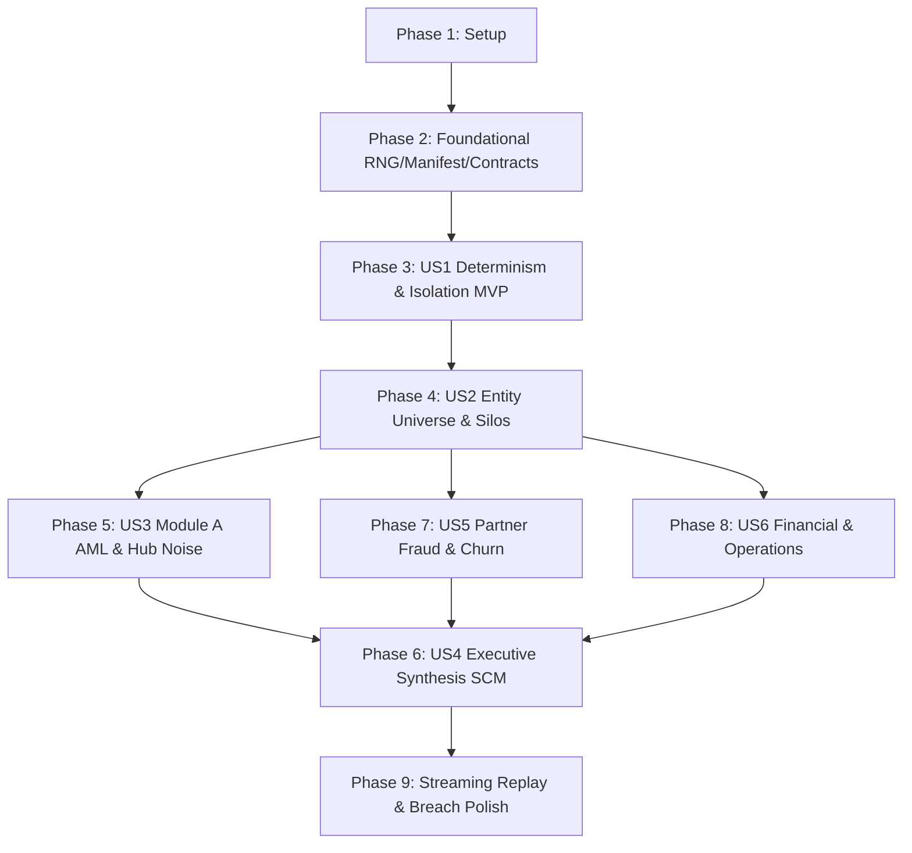

# Tasks: Synthetic Enterprise Data Foundry (F01)

**Input**: Design documents from `/specs/002-synthetic-foundry/`  
**Path convention**: every code, config, docs, infra and test path in this file is relative to `FEIOS/` (the production repository root). Planning documents (`specs/`, `initial_plan.md`, `docs/brief/`) stay at the workspace root.  
**Prerequisites**: plan.md, spec.md, research.md, data-model.md, contracts/, quickstart.md (all present and verified)  
**Tests**: MANDATORY. Constitution Principle VI requires test-first (RED $\rightarrow$ GREEN $\rightarrow$ refactor). Every implementation task is preceded by a test task that must fail first. Coverage gate is $\ge 80\%$ `[TARGET]`.  
**Organisation**: Grouped by user story (US1..US6) following priority order, enabling independent implementation and testing of each story.

## Format: `- [ ] T### [P?] [US#?] Description with file path`

- `[P]`: Can run in parallel (different files, no unmet dependencies).
- `[US#]`: User story label. Present only in story phases (Phases 3 to 8). Absent in Setup, Foundational, and Polish.
- "RED" in a test task means: write the test, run it, and confirm it fails for the right reason before starting the matching implementation task.

---

## Phase 1: Setup (Foundry Directory Skeleton & Environment)

**Purpose**: Initialize the Layer 0 Foundry library structure, dependencies, and configuration templates.

- [X] T001 Create directory structure for Layer 0 Foundry: `src/eios/foundry/generators/`, `src/eios/foundry/noise/`, `src/eios/foundry/storage/`, and `tests/foundry/`.
- [X] T002 Configure Foundry module exports in `src/eios/foundry/__init__.py`.
- [X] T003 [P] Add dependencies to `pyproject.toml` (`numpy>=1.26.0`, `pyarrow>=15.0.0`, `polars>=0.20.0`, `faker>=24.0.0`, `pyyaml>=6.0.0`, `google-cloud-pubsub>=2.19.0`).
- [X] T004 [P] Copy JSON schemas from `specs/002-synthetic-foundry/contracts/` into `schemas/` (`manifest.schema.json`, `eval-ground-truth.schema.json`).

---

## Phase 2: Foundational (Deterministic PRNG, Manifest & Contract Validation)

**Purpose**: Shared core infrastructure required by all generators and user stories.

### Tests first (RED)

- [X] T005 [P] Write `tests/foundry/test_rng.py`: verify `SeedSequence` initializes `numpy.random.Generator(PCG64)`, spawn produces independent streams, and identical seeds yield identical floating-point sequences across OSes. RED.
- [X] T006 [P] Write `tests/foundry/test_manifest_schema.py`: verify valid manifests parse cleanly, missing fields reject, invalid seed tiers fail, and dataset hash calculation matches SHA-256 Merkle root. RED.
- [X] T007 [P] Write `tests/foundry/test_contract_validator.py`: verify Pydantic v2 `TypeAdapter` batch validator passes compliant records and raises `ContractValidationError` immediately on schema mutation. RED.
- [X] T008 [P] Write `tests/foundry/test_parquet_writer.py`: verify sorted Parquet writer enforces fixed column ordering, dictionary encoding, and Snappy compression with reproducible metadata. RED.

### Implementation (GREEN)

- [X] T009 [P] Implement `src/eios/foundry/rng.py`: deterministic PRNG manager using `SeedSequence` and `PCG64` bit generators. Makes T005 pass.
- [X] T010 [P] Implement `src/eios/foundry/manifest.py`: manifest parser, validator against `schemas/manifest.schema.json`, and Merkle SHA-256 root calculator. Makes T006 pass.
- [X] T011 [P] Implement `src/eios/foundry/contracts.py`: vectorized Pydantic v2 batch validation gate with loud failure (`ContractValidationError`). Makes T007 pass.
- [X] T012 [P] Implement `src/eios/foundry/storage/parquet_writer.py`: deterministic sorted Parquet partition writer with deterministic row-group settings. Makes T008 pass.
- [X] T013 [P] Implement `src/eios/foundry/storage/lineage.py`: Foundry MMDP dataset transaction and lineage metadata recorder (`_lineage.json`).
- [X] T014 Run `uv run pytest tests/foundry/ -q` to verify foundational infrastructure passes.

**Checkpoint**: Foundational layer green. User Story implementation can begin.

---

## Phase 3: User Story 1 - Deterministic Generation with Sealed Isolation (Priority: P1) 🎯 MVP

**Goal**: Deliver a single CLI command to run deterministic generation, write mock telemetry, enforce sealed seed CI locks, and isolate ground truth in the Eval-Only store (`FR-001`–`FR-008`, `FR-010`).

**Independent Test**: Generate with seed `A` to directory 1 and directory 2; verify byte-identical SHA-256 Merkle root. Generate with `sealed` tier locally and verify permission failure without `CI_RELEASE_CANDIDATE=true`. Verify Reasoning Mesh role cannot read `eval-truth/` (`SC-001`, `SC-004`, `SC-007`).

### Tests first (RED)

- [X] T015 [P] [US1] Write `tests/foundry/test_determinism.py`: two full generator runs with seed `42` yield byte-identical Parquet files and identical `dataset_hash` in `manifest.yaml` (SC-001). RED.
- [X] T016 [P] [US1] Write `tests/foundry/test_sealed_tier.py`: local generation with `--tier sealed` raises `PermissionError`; generation with `CI_RELEASE_CANDIDATE=true` succeeds and injects distribution shift (SC-009). RED.
- [X] T017 [P] [US1] Write `tests/foundry/test_iam_isolation.py`: verify file permissions or IAM simulation denies read access on `eval-truth/` for `sa-reasoning-mesh` role while granting `sa-eval-harness` (SC-004). RED.

### Implementation (GREEN)

- [X] T018 [US1] Implement `src/eios/foundry/storage/eval_truth_store.py`: isolated ground-truth writer with role-based access checks and isolated path routing. Makes T017 pass.
- [X] T019 [US1] Implement sealed tier gate and distribution shift logic in `src/eios/foundry/manifest.py`. Makes T016 pass.
- [X] T020 [US1] Implement core pipeline orchestrator in `src/eios/foundry/cli.py` (`generate`, `verify-hash`, `test-iam-isolation`). Makes T015 pass.
- [X] T021 [US1] Run determinism test suite: `uv run pytest tests/foundry/test_determinism.py tests/foundry/test_sealed_tier.py tests/foundry/test_iam_isolation.py -q`.

**Checkpoint**: User Story 1 MVP is fully testable and operational.

---

## Phase 4: User Story 2 - Global Entity Universe & Fragmented Silos (Priority: P1)

**Goal**: Generate the underlying physical reality (persons, devices, IPs) and project fragmented, siloed representations for MetaTrader 5, Deriv Web Trader, and DP2P, injecting duplicate identity noise for L1 Entity Resolution (`FR-011`–`FR-016`).

**Independent Test**: Inspect `client_360`, `client_funnel`, and `device_network_graph`. Confirm synthetic PII scan passes (0 real names). Confirm same physical person maps to multiple disparate system IDs (`SC-002`, `SC-003`).

### Tests first (RED)

- [X] T022 [P] [US2] Write `tests/foundry/test_pii_anonymity.py`: scans all generated person names, emails, and tax IDs against `Faker` dictionaries and confirms zero real broker/competitor names exist (SC-003). RED.
- [X] T023 [P] [US2] Write `tests/foundry/test_universe_fragmentation.py`: verifies that internal UUIDv5 maps to `mt5_login_id` in MT5, `CR` account ID in Deriv Trader, and nickname in DP2P, with 5% domain variations and 3% shared device fingerprints. RED.
- [X] T024 [P] [US2] Write `tests/foundry/test_client_contracts.py`: validates emitted `client_360`, `client_funnel`, and `device_network_graph` tables against L1 Pydantic contracts (SC-002). RED.

### Implementation (GREEN)

- [X] T025 [P] [US2] Implement `src/eios/foundry/universe.py`: `GlobalEntityUniverse` managing UUIDv5 pools for `PhysicalPerson`, `ClientAccount`, `Partner`, `Device`, `IPAddress`, and `PaymentMethod`.
- [X] T026 [US2] Implement `src/eios/foundry/generators/client.py`: system projections for MT5, Deriv Trader, and DP2P; funnel progression; shared-device family hard negatives (`FR-014`). Makes T022, T023, T024 pass.
- [X] T027 [US2] Run `uv run pytest tests/foundry/test_pii_anonymity.py tests/foundry/test_universe_fragmentation.py tests/foundry/test_client_contracts.py -q`.

**Checkpoint**: Global Entity Universe and fragmented customer master are operational.

---

## Phase 5: User Story 3 - Module A AML, Syndicate Rings & Hub Suppression (Priority: P1)

**Goal**: Generate transaction telemetry yielding ~2,000 alerts/wk (~95% FP), the 47-account syndicate ring, round-trip laundering ($500 $\rightarrow$ 10 min $\rightarrow$ $0.01), 72h post-KYC bursts, and carrier-NAT hub suppression noise (`FR-017`–`FR-025`).

**Independent Test**: Query transaction feeds; verify presence of 47-account ring in ground truth, $500 round-trip sequences, and at least one IP shared by $\ge 500$ unlinked clients (`SC-005`, `SC-006`).

### Tests first (RED)

- [X] T028 [P] [US3] Write `tests/foundry/test_aml_contracts.py`: verifies emitted `transactions_aml`, `trading_activity`, and `compliance_cases` pass Pydantic models. RED.
- [X] T029 [P] [US3] Write `tests/foundry/test_planted_syndicate.py`: verifies `eval-truth/module_a/syndicate_47.json` contains exactly 47 client UUIDs linked by 6 devices, 4 IPs, and round-trip laundering transaction IDs (SC-005). RED.
- [X] T030 [P] [US3] Write `tests/foundry/test_hub_suppression.py`: queries generated network graph to confirm $\ge 1$ IP address is shared by $\ge 500$ benign unlinked accounts tagged as `BENIGN_HUB` (SC-006). RED.
- [X] T031 [P] [US3] Write `tests/foundry/test_kyc_recency_burst.py`: verifies suspicious transaction bursts are concentrated within 72 hours of KYC approval for flagged accounts. RED.

### Implementation (GREEN)

- [X] T032 [US3] Implement `src/eios/foundry/generators/aml.py`: deposits, withdrawals, trades, rules-engine alert calibration (~2,000/wk, 95% FP), round-trip laundering typology, and 72h post-KYC bursts. Makes T028, T031 pass.
- [X] T033 [US3] Implement 47-account syndicate graph topology and round-trip event tagging in `src/eios/foundry/generators/aml.py`. Makes T029 pass.
- [X] T034 [US3] Implement carrier-NAT / campus hub IP generator in `src/eios/foundry/noise/hard_negatives.py` ($\ge 500$ unlinked accounts). Makes T030 pass.
- [X] T035 [US3] Run `uv run pytest tests/foundry/test_aml_contracts.py tests/foundry/test_planted_syndicate.py tests/foundry/test_hub_suppression.py tests/foundry/test_kyc_recency_burst.py -q`.

**Checkpoint**: Module A AML transaction feeds, syndicate rings, and hub suppression noise are operational.

---

## Phase 6: User Story 4 - Executive Synthesis, Placebo Edges & Causal Truth (Priority: P1)

**Goal**: Construct structural causal equations propagating a 4-domain shock (Competitive $\rightarrow$ Partner $\rightarrow$ Client $\rightarrow$ Financial), inject Placebo Edges ($p > 0.05$ refuters), decompose forecast variance to 100.0%, and apply 3–8% label noise (`FR-046`–`FR-051`).

**Independent Test**: Verify ground truth causal DAG contains structural coefficients and explicit Placebo Edge. Verify forecast driver decomposition sums to 100.0%. Verify analyst labels contain 3–8% noise (`SC-005`, `SC-008`).

### Tests first (RED)

- [X] T036 [P] [US4] Write `tests/foundry/test_causal_dag.py`: verifies structural causal DAG equations, validates presence of at least 1 Placebo Edge with structural coefficient $\gamma = 0.0$, and verifies placebo refuter expected $p > 0.05$ (SC-005). RED.
- [X] T037 [P] [US4] Write `tests/foundry/test_driver_attribution.py`: verifies ground-truth forecast driver split sums to exactly 100.0% (SC-008). RED.
- [X] T038 [P] [US4] Write `tests/foundry/test_label_noise.py`: verifies that analyst ground-truth labels have between 3.0% and 8.0% flipped classifications uniformly distributed across ambiguous cases. RED.

### Implementation (GREEN)

- [X] T039 [US4] Implement `src/eios/foundry/generators/causal_truth.py`: structural equations across 4 domains, placebo treatment edge injection, and forecast driver decomposition to 100.0%. Makes T036, T037 pass.
- [X] T040 [US4] Implement `src/eios/foundry/noise/label_noise.py`: 3–8% random and ambiguity-driven label flipper for analyst decisions. Makes T038 pass.
- [X] T041 [US4] Deposit causal ground-truth files into `eval-truth/synthesis/` via `eval_truth_store.py`.
- [X] T042 [US4] Run `uv run pytest tests/foundry/test_causal_dag.py tests/foundry/test_driver_attribution.py tests/foundry/test_label_noise.py -q`.

**Checkpoint**: Executive Synthesis SCM, placebo edge, driver attribution, and label noise are operational.

---

## Phase 7: User Story 5 - Partner Fraud, Churn Radar & Comms Security (Priority: P2)

**Goal**: Generate 5,000 partners, the 3-tier ring (7/23/184), mirror trading (0.89 correlation), 12 bot partners, 5 churn signal families, seasonal dip hard negatives (8%), regional cohort churn events, and adversarial prompt injections in comms (`FR-026`–`FR-042`).

**Independent Test**: Verify presence of 3-tier ring, mirror pairs, and 12 bot partners in ground truth. Confirm 8% seasonal dip partners recover after 30 days. Confirm prompt-injection strings exist in `partner_comms` (`SC-005`).

### Tests first (RED)

- [X] T043 [P] [US5] Write `tests/foundry/test_partner_fraud.py`: verifies 3-tier ring (7/23/184), 23 mirror-trading pairs with $\ge 0.89$ timing correlation and net P&L $\approx \$0.00$, 12 bot-traffic partners with impossible conversion, and 35% bonus abuse share. RED.
- [X] T044 [P] [US5] Write `tests/foundry/test_churn_radar.py`: verifies 5 signal families, 8% seasonal dip hard negatives recovering in 30 days, and regional cohort disengagement event with 14-day lag. RED.
- [X] T045 [P] [US5] Write `tests/foundry/test_prompt_injections.py`: verifies that support tickets and partner comms contain adversarial prompt-injection test strings for Red-Line RL-6 without leaking unescaped formatting. RED.

### Implementation (GREEN)

- [X] T046 [US5] Implement `src/eios/foundry/generators/partner.py`: 5,000 affiliates, 3-tier referral tree, 23 mirror-trading pairs, 35% bonus abuse sequences, and 12 bot-traffic partners. Makes T043 pass.
- [X] T047 [US5] Implement `src/eios/foundry/generators/churn.py`: discrete-time logistic hazard model, 5 signal families, 8% seasonal dip hard negatives, and 8-partner regional cohort shock. Makes T044 pass.
- [X] T048 [US5] Implement `src/eios/foundry/noise/prompt_injections.py`: embeds adversarial prompt injection test corpus and sarcasm into `partner_comms`. Makes T045 pass.
- [X] T049 [US5] Run `uv run pytest tests/foundry/test_partner_fraud.py tests/foundry/test_churn_radar.py tests/foundry/test_prompt_injections.py -q`.

**Checkpoint**: Partner fraud, churn radar, and prompt-injection corpora are operational.

---

## Phase 8: User Story 6 - Enterprise Operations & Financial Telemetry (Priority: P2)

**Goal**: Generate financial P&L, competitor benchmarks with generic aliases, and platform operational metrics with benign noise and 1 planted shock (`FR-043`–`FR-045`).

**Independent Test**: Verify `financial_pnl` revenue and costs correlate with client trades and commission payouts. Verify competitor events use generic aliases ("Competitor X"). Verify platform operations contains 1 planted latency shock.

### Tests first (RED)

- [X] T050 [P] [US6] Write `tests/foundry/test_financial_pnl.py`: verifies revenue, commission expenses, and net margin tie organically to `trading_activity` and `commission_ledger`. RED.
- [X] T051 [P] [US6] Write `tests/foundry/test_competitive_intel.py`: verifies competitor events use generic aliases and contains payout/spread adjustments. RED.
- [X] T052 [P] [US6] Write `tests/foundry/test_platform_operations.py`: verifies latency, incident tickets, and dispute logs contain background benign noise and exactly one planted operational shock. RED.

### Implementation (GREEN)

- [X] T053 [US6] Implement `src/eios/foundry/generators/financial.py`: daily P&L, revenue, costs, and LTV cohorts. Makes T050 pass.
- [X] T054 [US6] Implement `src/eios/foundry/generators/competitive.py`: competitor market intel with generic aliases. Makes T051 pass.
- [X] T055 [US6] Implement `src/eios/foundry/generators/operational.py`: operational health, dispute volumes, and planted outage shock. Makes T052 pass.
- [X] T056 [US6] Run `uv run pytest tests/foundry/test_financial_pnl.py tests/foundry/test_competitive_intel.py tests/foundry/test_platform_operations.py -q`.

**Checkpoint**: Financial, competitive, and operational feeds are operational.

---

## Phase 9: Streaming Replay, Breach Injection & Platform Verification (Polish)

**Purpose**: Provide Layer 1 streaming replay bridge, S-07 contract breach injector, and full end-to-end suite validation.

### Tests first (RED)

- [X] T057 [P] Write `tests/foundry/test_replay.py`: verifies `replay.py` streams Parquet records to Pub/Sub emulator topics with configurable velocity. RED.
- [X] T058 [P] Write `tests/foundry/test_breach_injector.py`: verifies `breach_injector.py` emits deliberate contract breaches and duplicate identities for S-07 L1 testing. RED.
- [X] T059 [P] Write `tests/foundry/test_lineage_metadata.py`: verifies every emitted dataset partition writes an accompanying `_lineage.json` with commit SHA, spec hash, and input entity universe IDs. RED.

### Implementation (GREEN)

- [X] T060 Implement `src/eios/foundry/replay.py`: streaming Pub/Sub publisher for Layer 1 ingestion replay. Makes T057 pass.
- [X] T061 Implement `src/eios/foundry/noise/breach_injector.py`: deliberate contract breach and duplicate identity injector. Makes T058 pass.
- [X] T062 Connect lineage metadata generator in `src/eios/foundry/storage/lineage.py`. Makes T059 pass.
- [X] T063 Run complete end-to-end test suite: `uv run pytest tests/foundry/ -q --cov=src/eios/foundry --cov-fail-under=80`.

---

## Dependencies & Execution Order

### Parallel Opportunities

- In **Phase 2**, T005, T006, T007, T008 (RED tests) can be written in parallel.
- In **Phase 4**, T022, T023, T024 (RED tests) can run in parallel.
- In **Phase 5**, T028, T029, T030, T031 can run in parallel.
- **Phase 5 (Module A)**, **Phase 7 (Module B/C)**, and **Phase 8 (Financial/Ops)** can be developed in parallel once Phase 4 (Entity Universe) completes.

---

## MVP Scope Recommendation

* **MVP Milestone**: Complete **Phase 1 through Phase 3 (US1)**.  
* This establishes the deterministic manifest engine, PRNG bit generators, Pydantic v2 contract gate, Parquet storage, and isolated Eval-Only ground-truth bucket, proving byte-identical reproducibility (`SC-001`) and IAM security (`SC-004`) before domain generators are attached.

---

## Phase 10: Convergence

- [X] T064 Implement `generate_partner_360()`, `generate_referral_tree()`, and `generate_commission_ledger()` in `src/eios/foundry/generators/partner.py` adhering to L1 Pydantic contracts per `FR-026`, `FR-034`, `contracts/generator-output-catalog.md` (`partial`)
- [X] T065 Wire all 8 domain generators (`gen_client`, `gen_aml`, `gen_partner`, `gen_churn`, `gen_financial`, `gen_competitive`, `gen_operational`, `gen_causal_truth`) into `src/eios/foundry/cli.py:run_pipeline` to emit all 14 Layer 1 data product Parquet partitions and dataset lineage per `FR-007`, `FR-016`, `FR-025`, `FR-034`, `FR-043`–`FR-045`, `SC-001`, `SC-002` (`partial`)
- [X] T066 Assemble and validate unified `eval-ground-truth.json` in `src/eios/foundry/cli.py` / `src/eios/foundry/storage/eval_truth_store.py` conforming to `schemas/eval-ground-truth.schema.json` per `FR-008`, `FR-024`, `FR-033`, `FR-051`, `SC-005` (`partial`)
- [X] T067 Update `tests/foundry/test_determinism.py` to assert end-to-end byte-identical reproducibility across all 14 data product Parquet partitions and dataset Merkle root hash per `FR-002`, `SC-001` (`partial`)

