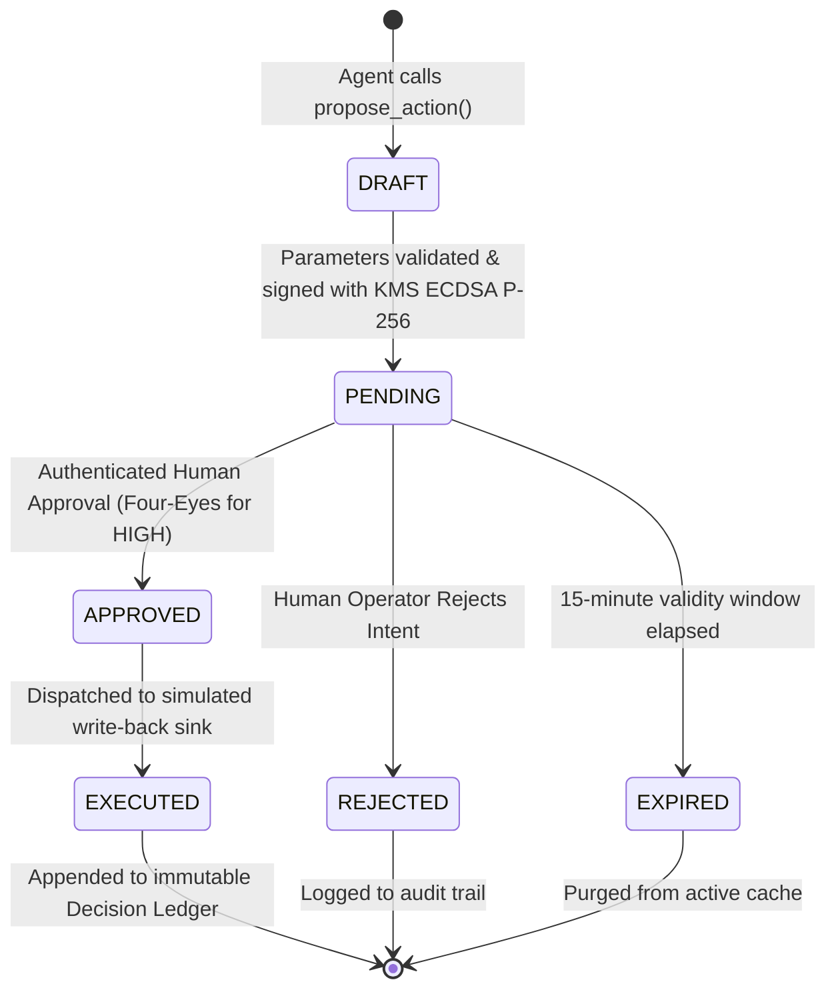

# Data Model: Layer 2 Kinetic Ontology & Semantic Metric Layer (F03)

**Branch**: `004-ontology-metrics` | **Date**: 2026-10-05 | **Spec**: [spec.md](./spec.md)

---

## 1. Kinetic Ontology Core (Palantir Object & Link Types)

The Kinetic Ontology models enterprise entities, relationships, and actions with four-fold integration: Data, Logic, Action, and Security.

### 1.1 Canonical Object Types (13 Entities)

```mermaid
classDiagram
    class ClientAccount {
        +string client_id [PK]
        +string kyc_status
        +datetime kyc_approved_at
        +string segment
        +string region_id [FK]
        +float lifetime_value_usd
        +string partner_id [FK]
        +list markings [PII]
    }

    class Device {
        +string device_id [PK]
        +string device_fingerprint
        +string os
        +string browser
        +boolean is_shared_context
        +int degree
    }

    class IPAddress {
        +string ip_id [PK]
        +string ip_address
        +string asn
        +string country_code
        +boolean is_datacenter
        +boolean is_vpn
        +boolean is_shared_context
        +int degree
    }

    class PaymentMethod {
        +string payment_method_id [PK]
        +string method_type
        +string provider
        +string tokenized_account [PII]
        +string risk_tier
    }

    class Partner {
        +string partner_id [PK]
        +string tier
        +string region_id [FK]
        +int tenure_days
        +float value_at_risk_usd
        +string manager_id
        +list markings [PARTNER_COMMERCIAL]
    }

    class SubAffiliate {
        +string sub_affiliate_id [PK]
        +string parent_partner_id [FK]
        +int attribution_layer
        +datetime registered_at
    }

    class Competitor {
        +string competitor_id [PK]
        +string name
        +float payout_rate_estimate
        +string primary_region_id [FK]
    }

    class Product {
        +string product_id [PK]
        +string name
        +string category
        +float target_margin
    }

    class Region {
        +string region_id [PK]
        +string name
        +string regulatory_tier
    }

    class Case {
        +string case_id [PK]
        +string target_id
        +string status
        +string typology
        +string assigned_analyst
        +list markings [SENSITIVE_COMPLIANCE]
    }

    class Alert {
        +string alert_id [PK]
        +string case_id [FK]
        +string rule_name
        +float confidence_score
        +datetime triggered_at
        +list markings [SENSITIVE_COMPLIANCE]
    }

    class Decision {
        +string decision_id [PK]
        +string action_intent_id [FK]
        +string outcome
        +string approver_id
        +datetime decided_at
    }

    class MacroEvent {
        +string event_id [PK]
        +string event_type
        +string description
        +datetime occurred_at
        +float shock_intensity
    }

    ClientAccount --> Device : USES_DEVICE
    ClientAccount --> IPAddress : CONNECTS_FROM
    ClientAccount --> PaymentMethod : FUNDS_VIA
    ClientAccount --> Partner : REFERRED_BY
    SubAffiliate --> Partner : SUB_OF
    Competitor --> Region : COMPETES_IN
    MacroEvent --> Partner : AFFECTS
    Alert --> Case : RAISED
    Decision --> Case : DECIDED
```



### 1.2 Canonical Link Types (9 Relationships)

| Link Type | Source Type | Target Type | Cardinality | Metadata / Properties |
|---|---|---|---|---|
| `USES_DEVICE` | `ClientAccount` | `Device` | Many-to-Many | `first_seen`, `last_seen`, `session_count` |
| `CONNECTS_FROM` | `ClientAccount` | `IPAddress` | Many-to-Many | `first_seen`, `last_seen`, `is_shared_context` |
| `FUNDS_VIA` | `ClientAccount` | `PaymentMethod` | Many-to-Many | `is_primary`, `first_used_at` |
| `REFERRED_BY` | `ClientAccount` | `Partner` | Many-to-One | `attribution_layer` (1..3), `referred_at` |
| `SUB_OF` | `SubAffiliate` | `Partner` | Many-to-One | `depth_level`, `commission_split_pct` |
| `COMPETES_IN` | `Competitor` | `Region` | Many-to-Many | `market_share_estimate` |
| `AFFECTS` | `MacroEvent` | `Partner` | Many-to-Many | `estimated_impact_usd`, `causal_edge_ref` |
| `RAISED` | `Alert` | `Case` | Many-to-One | `severity_weight` |
| `DECIDED` | `Decision` | `Case` | Many-to-One | `ledger_sequence`, `prev_hash` |

### 1.3 Polymorphic Interfaces

1. **`TransactingEntity`**:
   - Implemented by: `ClientAccount`, `Partner`.
   - Contract methods: `get_total_volume(window) -> float`, `get_net_flow(window) -> float`, `get_risk_rating() -> str`.
2. **`AuditableEntity`**:
   - Implemented by: `Case`, `Alert`, `Decision`.
   - Contract methods: `get_audit_trail() -> list[dict]`, `get_security_markings() -> list[str]`.

---

## 2. Governed Metric Registry Schema

### 2.1 Metric Definition Schema

```yaml
metric_id: net_deposit_volume_usd
name: "Net Deposit Volume (USD)"
description: "Total deposits minus total withdrawals denominated in USD."
formula: "SUM(CASE WHEN type = 'deposit' THEN amount_usd ELSE -amount_usd END)"
source_products: ["transactions_aml"]
grain: ["region", "currency"]
dimension_filters: ["region", "currency", "segment"]
owner_role: "financial_analyst"
unit: "USD"
semantic_version: "1.0.0"
freshness_sla: "PT30S"
is_active: true
```

### 2.2 Metric Query & Result Envelopes

```json
// Query Envelope
{
  "metric_id": "net_deposit_volume_usd",
  "grain": "region",
  "filters": {
    "region": "LATAM"
  },
  "period": "last_7d",
  "as_of": "2026-10-05T12:00:00Z"
}

// Result Envelope
{
  "metric_id": "net_deposit_volume_usd",
  "value": 1425000.50,
  "unit": "USD",
  "grain": "region",
  "filters_applied": {"region": "LATAM"},
  "period": "last_7d",
  "definition_version": "1.0.0",
  "as_of": "2026-10-05T12:00:00Z",
  "source_product": "transactions_aml",
  "execution_duration_ms": 3.82
}
```

---

## 3. Governed Action Intent & Approval Model

### 3.1 Canonical Action Types (7 Types)

| Action Type | Severity | Target Entity | Parameters Schema | Required Approvals |
|---|---|---|---|---|
| `FreezeAccount` | `HIGH` | `ClientAccount` | `{"client_id": str, "reason_code": str, "evidence_refs": list[str]}` | Four-eyes (2 approvers) |
| `HoldWithdrawal` | `HIGH` | `Transaction` | `{"txn_id": str, "reason": str, "expires_at": str}` | Single approver (fast path) |
| `ClawbackCommission` | `HIGH` | `Partner` | `{"partner_id": str, "period": str, "amount": float, "evidence_refs": list[str]}` | Four-eyes (2 approvers) |
| `SuspendPartner` | `HIGH` | `Partner` | `{"partner_id": str, "scope": str, "evidence_refs": list[str]}` | Four-eyes (2 approvers) |
| `LaunchRetentionPlaybook` | `MEDIUM` | `Partner` | `{"partner_ids": list[str], "playbook_id": str, "budget": float}` | Single approver |
| `EscalateToMLRO` | `MEDIUM` | `Case` | `{"case_id": str, "summary_ref": str}` | Single approver |
| `FileSARDraft` | `MEDIUM` | `Case` | `{"case_id": str, "template_id": str}` | MLRO approval |

### 3.2 Action Intent State Machine



---

## 4. Property Graph & Hub Suppression Model

### 4.1 Node & Edge Data Structures
- **Node**: `{id: str, type: str, is_shared_context: bool, degree: int, properties: dict}`
- **Edge**: `{source: str, target: str, type: str, weight: float, metadata: dict}`

### 4.2 Hub Suppression Rule (ADR-008)
$$\text{If } \text{type} \in \{\text{'IPAddress'}, \text{'Device'}\} \land \text{degree} \ge 5 \implies \text{is\_shared\_context} = \text{True}$$
During automated clustering (`suppress_hubs=True`):
- Edges incident to nodes where `is_shared_context=True` are masked from component discovery.
- Nodes remain queryable for explicit 1-hop ego-inspections with visual hub badge decorations.

---

## 5. Metric Auditor Gate Verification Model

### 5.1 Verification Record Structure

```python
class AuditVerificationRecord(BaseModel):
    trace_id: str
    narrative_text: str
    extracted_numbers: list[str]
    anchored_numbers: list[float]
    untraceable_numbers: list[str]
    audit_passed: bool
    rejection_reason: str | None = None
    timestamp: datetime = Field(default_factory=datetime.utcnow)
```
