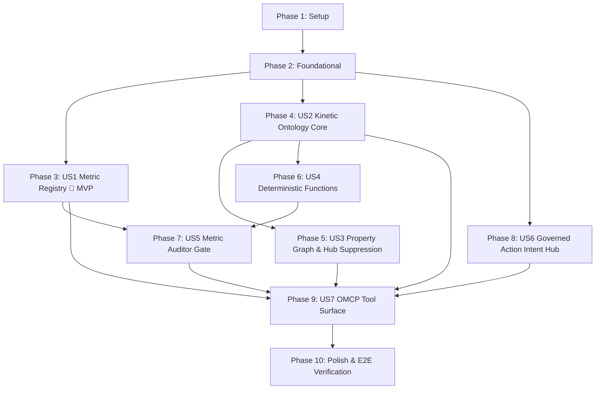

# Tasks: Layer 2 Kinetic Ontology & Semantic Metric Layer (F03)

**Input**: Design documents from `/specs/004-ontology-metrics/`  
**Path convention**: Every code, config, docs, infra, and test path in this file is relative to `FEIOS/` (the platform package root). Planning documents (`specs/`, `initial_plan.md`, `docs/`) stay at the workspace root.  
**Prerequisites**: [plan.md](./plan.md), [spec.md](./spec.md), [research.md](./research.md), [data-model.md](./data-model.md), [contracts/](./contracts/), [quickstart.md](./quickstart.md) (all present and verified)  
**Tests**: MANDATORY. Constitution Principle VI requires test-first (RED $\rightarrow$ GREEN $\rightarrow$ refactor). Every implementation task is preceded by a test task that must fail first. Coverage gate is $\ge 80\%$ line and branch coverage `[TARGET]`.  
**Organisation**: Grouped by user story (US1..US7) following priority order, enabling independent implementation and testing of each story.

## Format: `- [ ] T### [P?] [US#?] Description with file path`

- `[P]`: Can run in parallel (different files, no unmet dependencies).
- `[US#]`: User story label. Present only in story phases (Phases 3 to 9). Absent in Setup, Foundational, and Polish.
- "RED" in a test task means: write the test, run it, and confirm it fails for the right reason before starting the matching implementation task.

---

## Phase 1: Setup (Layer 2 Ontology & Metric Layer Skeleton)

**Purpose**: Initialize the Layer 2 module directory structure, schemas, and public exports.

- [X] T001 Create directory skeleton for Layer 2: `src/eios/ontology/`, `src/eios/ontology/core/`, `src/eios/ontology/metrics/`, `src/eios/ontology/graph/`, `src/eios/ontology/functions/`, `src/eios/ontology/auditor/`, `src/eios/ontology/actions/`, `src/eios/ontology/omcp/`, and `tests/ontology/`.
- [X] T002 Copy contract schemas from `specs/004-ontology-metrics/contracts/` into `schemas/ontology/` (`omcp-tools.json`, `action-intent-token.schema.json`).
- [X] T003 [P] Configure module exports in `src/eios/ontology/__init__.py`.
- [X] T004 [P] Configure mock Cloud KMS key and security marking definitions in `src/eios/ontology/config.py`.

---

## Phase 2: Foundational (Core Config, Base Object Types, and Shared Fixtures)

**Purpose**: Shared infrastructure and base models required across all ontology objects, metrics, graphs, and action types.

### Tests first (RED)

- [X] T005 [P] Write `tests/ontology/conftest.py`: pytest fixtures for seeded hot-state DuckDB (`:memory:eios_hot_state`), synthetic client/partner/device tables, mock Cloud KMS key pair, and sample OMCP call traces.
- [X] T006 [P] Write `tests/ontology/test_base_models.py`: test serialization, primary key constraints, property type enforcement, and security marking attachments (`Marking.PII`, `Marking.SENSITIVE_COMPLIANCE`, `Marking.PARTNER_COMMERCIAL`). RED.

### Implementation (GREEN)

- [X] T007 [P] Implement `src/eios/ontology/core/base.py`: base `OntologyObject`, `OntologyLink`, `SecurityMarking` enum, and property descriptor framework. Makes T006 pass.
- [X] T008 [P] Implement `src/eios/ontology/core/interfaces.py`: polymorphic interfaces (`TransactingEntity`, `AuditableEntity`) with typed contract protocols.
- [X] T009 Run `uv run pytest tests/ontology/test_base_models.py -q` to verify foundational ontology types pass.

**Checkpoint**: Foundational layer green. User Story implementation can begin.

---

## Phase 3: User Story 1 - Governed Semantic Metric Registry (Priority: P1) 🎯 MVP

**Goal**: Deliver in-process DuckDB Governed Metric Registry (`eios.ontology.metrics`) executing versioned KPI calculations against `:memory:eios_hot_state` in $\le 10\text{ms}$ p95 (`FR-001`–`FR-005`, `SC-001`, ADR-003).

**Independent Test**: Register 10 canonical enterprise metrics (`net_deposit_volume_usd`, `ftd_count_28d`, `partner_churn_rate`, etc.). Execute 500 concurrent metric queries with variable date filters and dimension slicers against 100,000 records. Assert that all 500 queries return mathematically exact results with formula version metadata in $< 10\text{ms}$ `[TARGET]`.

### Tests first (RED)

- [X] T010 [P] [US1] Write `tests/ontology/test_metric_registry.py`: test metric registration, retrieval of metric metadata, validation of unknown metric IDs (`MetricNotFoundError`), definition versioning (`semantic_version`), and dimension rollups. RED.
- [X] T011 [P] [US1] Write `tests/ontology/test_metric_engine.py`: test vectorized DuckDB aggregation query compiler, parameterized filter injection, time window parsing (`last_24h`, `last_7d`, `last_28d`), and query latency benchmark against 100,000 hot-state rows ($\le 10\text{ms}$ p95). RED.

### Implementation (GREEN)

- [X] T012 [US1] Implement `src/eios/ontology/metrics/registry.py`: declarative Metric Registry catalog, `MetricDefinition` model, schema validation, and catalog persistence per `contracts/metric-registry-catalog.md`. Makes T010 pass.
- [X] T013 [US1] Implement `src/eios/ontology/metrics/engine.py`: vectorized query compiler translating `MetricQuery` to parameterized DuckDB SQL over `:memory:eios_hot_state`, returning typed `MetricResult` envelopes with duration telemetry. Makes T011 pass.
- [X] T014 [US1] Register all 10 canonical governed business metrics in `src/eios/ontology/metrics/catalog.py` per `contracts/metric-registry-catalog.md`.
- [X] T015 [US1] Run `uv run pytest tests/ontology/test_metric_registry.py tests/ontology/test_metric_engine.py -q` to verify User Story 1 MVP passes.

**Checkpoint**: User Story 1 MVP is fully testable and operational.

---

## Phase 4: User Story 2 - Kinetic Ontology Core & Polymorphic Interfaces (Priority: P1)

**Goal**: Model the 13 canonical Object Types and 9 Link Types with bidirectional navigation, referential integrity, and polymorphic interface dispatch (`FR-006`–`FR-010`).

**Independent Test**: Instantiate instances of all 13 Object Types populated from hot-state tables, link them across the 9 Link Types, and verify that navigating bidirectional relationships (e.g. `ClientAccount` $\rightarrow$ `Device` $\rightarrow$ other `ClientAccount`s) maintains referential integrity, schema typing, and interface polymorphism.

### Tests first (RED)

- [X] T016 [P] [US2] Write `tests/ontology/test_objects_and_links.py`: test typed instantiation of 13 Object Types (`ClientAccount`, `Device`, `IPAddress`, `PaymentMethod`, `Partner`, `SubAffiliate`, `Competitor`, `Product`, `Region`, `Case`, `Alert`, `Decision`, `MacroEvent`) and bidirectional link traversal over 9 Link Types. RED.
- [X] T017 [P] [US2] Write `tests/ontology/test_interfaces.py`: test polymorphic dispatch on `TransactingEntity` (`ClientAccount` and `Partner`) and `AuditableEntity` (`Case`, `Alert`, `Decision`). RED.

### Implementation (GREEN)

- [X] T018 [US2] Implement `src/eios/ontology/core/objects.py`: Pydantic v2 schemas and entity classes for the 13 canonical Object Types with primary keys, security markings, and typed property accessors. Makes T016 pass.
- [X] T019 [US2] Implement `src/eios/ontology/core/links.py`: 9 canonical Link Types with cardinality constraints, foreign key mappings, and object-backed relationship metadata (`first_seen`, `last_seen`, `attribution_layer`).
- [X] T020 [US2] Implement `src/eios/ontology/core/hydrator.py`: hot-state table-to-ontology hydrator converting DuckDB rows into strongly-typed Object instances. Makes T017 pass.
- [X] T021 [US2] Run `uv run pytest tests/ontology/test_objects_and_links.py tests/ontology/test_interfaces.py -q`.

**Checkpoint**: Kinetic Ontology Core and Polymorphic Interfaces green.

---

## Phase 5: User Story 3 - In-Memory Property Graph with Hub Suppression (Priority: P1)

**Goal**: Deliver in-memory NetworkX property graph (`eios.ontology.graph`) rehydrating from hot state in $< 1.5\text{s}$, with degree-based Hub Suppression (degree $\ge 5$, `is_shared_context=True`) capping false merges at $\le 0.1\%$ (`FR-011`–`FR-015`, `SC-004`, `SC-005`, `SC-006`, ADR-004, ADR-008).

**Independent Test**: Construct a graph with 200 nodes including 5 distinct fraud rings (cliques of size 3–6) and 2 hub nodes (one campus Wi-Fi IP with degree 25, one family tablet with degree 6). Execute community detection and ego-graph traversals with hub suppression enabled. Assert that the 5 fraud rings are correctly isolated, the hub nodes are tagged `is_shared_context=True`, and false-positive ring merges drop to $\le 0.1\%$ `[TARGET]`.

### Tests first (RED)

- [X] T022 [P] [US3] Write `tests/ontology/test_property_graph.py`: test graph initialization from hot-state tables, multi-hop ego-graph traversal (up to 3 hops), Louvain community detection, and cold-boot rehydration SLA ($< 1.5\text{s}$ for 50,000 nodes). RED.
- [X] T023 [P] [US3] Write `tests/ontology/test_graph_hub_suppression.py`: test automatic tagging of `is_shared_context=True` on context nodes (`IPAddress`, `Device`) with degree $\ge 5$, and verification of edge masking during automated ring clustering (`suppress_hubs=True`). RED.

### Implementation (GREEN)

- [X] T024 [US3] Implement `src/eios/ontology/graph/property_graph.py`: NetworkX property graph wrapper, node/edge indexers, cold-boot batch loader from `:memory:eios_hot_state`, and multi-hop ego-graph extractor with max depth and latency bounding ($\le 25\text{ms}$ p95). Makes T022 pass.
- [X] T025 [US3] Implement `src/eios/ontology/graph/hub_suppression.py`: degree calculation, dynamic and batch Hub Suppression filters, and masking iterator for automated ring traversals per ADR-008. Makes T023 pass.
- [X] T026 [US3] Run `uv run pytest tests/ontology/test_property_graph.py tests/ontology/test_graph_hub_suppression.py -q`.

**Checkpoint**: In-Memory Property Graph with Hub Suppression green.

---

## Phase 6: User Story 4 - Deterministic Server-Side Functions on Objects (Priority: P1)

**Goal**: Implement pure, stateless deterministic server-side functions on objects (`partner_value_at_risk`, `ring_membership`, `client_quality_score`, `churn_priority`, `scenario_propagate`) executing in $\le 5\text{ms}$ per object evaluation (`FR-016`–`FR-018`).

**Independent Test**: Execute each registered ontology function with identical object sets across 100 iterations. Assert 100% deterministic reproducibility, zero floating-point drift, and sub-5ms per-object computation latency.

### Tests first (RED)

- [X] T027 [P] [US4] Write `tests/ontology/test_deterministic_fn.py`: test mathematical determinism, boundary handling, and latency benchmarks for `partner_value_at_risk`, `ring_membership`, `client_quality_score`, `churn_priority`, and `scenario_propagate`. RED.

### Implementation (GREEN)

- [X] T028 [US4] Implement `src/eios/ontology/functions/partner.py`: `partner_value_at_risk` (90-day commission run rate $\times$ hazard score) and `churn_priority` (disengagement probability $\times$ partner value tier).
- [X] T029 [US4] Implement `src/eios/ontology/functions/fraud.py`: `ring_membership` (clique density, turnover symmetry, shared context attribute weighting) and `client_quality_score` (tenure, deposit/withdrawal ratio, chargebacks).
- [X] T030 [US4] Implement `src/eios/ontology/functions/scenario.py`: `scenario_propagate` (parametric shock propagation across causal DAG edges). Makes T027 pass.
- [X] T031 [US4] Run `uv run pytest tests/ontology/test_deterministic_fn.py -q`.

**Checkpoint**: Deterministic server-side functions green.

---

## Phase 7: User Story 5 - Metric Auditor Gate & Red-Line RL-1 Firewall (Priority: P1)

**Goal**: Deliver a deterministic egress firewall (`eios.ontology.auditor`) that parses all numeric tokens from agent text, verifies exact mathematical provenance against session tool execution traces, and blocks 100% of unanchored numbers per Constitution Principle I and Red-Line test RL-1 (`FR-019`–`FR-023`, `SC-002`).

**Independent Test**: Pass 50 agent responses through the Auditor Gate: 25 compliant responses (where every number matches tool execution outputs) and 25 adversarial responses containing unanchored figures (e.g. invented churn rates, altered dollar values, hallucinated account counts). Assert that 100% of compliant responses pass and 100% of unanchored responses are blocked (0% false acceptance rate) `[TARGET]`.

### Tests first (RED)

- [X] T032 [P] [US5] Write `tests/ontology/test_auditor_normalizer.py`: test numeric extraction regex, currency prefix stripping (`$`, `€`, `£`), percentage scaling (`15%` $\leftrightarrow$ `0.15`), and magnitude suffix parsing (`1.5M`, `142.5k`, `10B`). RED.
- [X] T033 [P] [US5] Write `tests/ontology/test_auditor_gate.py`: Red-Line test RL-1. Test Auditor Gate verifies compliant text against tool traces, blocks unanchored figures, permits honest uncertainty strings ("insufficient data"), and returns structured `AuditVerificationRecord`. RED.

### Implementation (GREEN)

- [X] T034 [US5] Implement `src/eios/ontology/auditor/normalizer.py`: deterministic regex number extractor, localized formatting normalizer, and numeric span locator. Makes T032 pass.
- [X] T035 [US5] Implement `src/eios/ontology/auditor/gate.py`: `MetricAuditorGate` egress firewall with tool trace matcher, relative tolerance ($\le 1.0\%$) evaluator, and audit failure recorder. Makes T033 pass.
- [X] T036 [US5] Run `uv run pytest tests/ontology/test_auditor_normalizer.py tests/ontology/test_auditor_gate.py -q`.

**Checkpoint**: Metric Auditor Gate and Red-Line RL-1 firewall green.

---

## Phase 8: User Story 6 - Governed Action Intent Hub & KMS Signing (Priority: P1)

**Goal**: Deliver non-autonomous Action Intent Hub (`eios.ontology.actions`) implementing Constitution Principle II, emitting Cloud KMS ECDSA P-256 signed `ActionIntentToken`s with 15-minute validity, nonce replay protection, and four-eyes human approval for High severity (`FR-024`–`FR-028`, `SC-003`).

**Independent Test**: Attempt to invoke mutations without human approval; verify that no execute tool exists in the ontology. Generate 50 Action Intents via `propose_action`, verify their ECDSA P-256 digital signatures, assert replay protection on expired nonces, and enforce four-eyes approval logic on High-severity actions.

### Tests first (RED)

- [X] T037 [P] [US6] Write `tests/ontology/test_action_signer.py`: test Cloud KMS ECDSA P-256 signing of canonical JSON, cryptographic signature verification with public key (`kid`), and tamper detection. RED.
- [X] T038 [P] [US6] Write `tests/ontology/test_action_intents.py`: test `propose_action` lifecycle for 7 canonical Action Types, nonce replay detection, 15-minute expiration enforcement, and four-eyes approval state machine. RED.

### Implementation (GREEN)

- [X] T039 [US6] Implement `src/eios/ontology/actions/signer.py`: canonical JSON serializer, Cloud KMS ECDSA P-256 signer, public key verifier, and local development cryptography mock. Makes T037 pass.
- [X] T040 [US6] Implement `src/eios/ontology/actions/intent_hub.py`: `ActionIntentHub` with action type parameter validation, severity determination, nonce store, and approval transition state machine (`PENDING` $\rightarrow$ `APPROVED`/`REJECTED` $\rightarrow$ `EXECUTED`). Makes T038 pass.
- [X] T041 [US6] Run `uv run pytest tests/ontology/test_action_signer.py tests/ontology/test_action_intents.py -q`.

**Checkpoint**: Governed Action Intent Hub green.

---

## Phase 9: User Story 7 - OMCP Tool Surface & Security Marking Enforcement (Priority: P1)

**Goal**: Expose the 13 canonical OMCP tools with server-side enforcement of `PII`, `SENSITIVE_COMPLIANCE`, and `PARTNER_COMMERCIAL` security markings, preserving Layer 1 token vault pseudonymization (`FR-029`–`FR-031`, `SC-007`).

**Independent Test**: Call OMCP tools across three distinct security roles (`PartnerManager`, `AMLInvestigator`, `PublicAgent`). Assert that `AMLInvestigator` can access `SENSITIVE_COMPLIANCE` cases but receives pseudonymized PII, while `PartnerManager` is blocked from compliance cases, and `PublicAgent` receives strictly filtered public metadata.

### Tests first (RED)

- [X] T042 [P] [US7] Write `tests/ontology/test_omcp_markings.py`: test role-to-marking access matrix, property-level redaction, and `InsufficientMarkingError` enforcement. RED.
- [X] T043 [P] [US7] Write `tests/ontology/test_omcp_tools.py`: test 13 canonical OMCP tool endpoints (`get_metric`, `list_metrics`, `get_entity`, `traverse_graph`, `propose_action`, etc.) conform strictly to `contracts/omcp-tools.json` JSON Schema. RED.

### Implementation (GREEN)

- [X] T044 [US7] Implement `src/eios/ontology/omcp/markings.py`: security marking filter inspecting caller role context, redacting restricted attributes, and verifying zero plaintext PII egress. Makes T042 pass.
- [X] T045 [US7] Implement `src/eios/ontology/omcp/server.py`: OMCP tool router and dispatcher implementing all 13 canonical tool endpoints with JSON Schema validation and typed error handling. Makes T043 pass.
- [X] T046 [US7] Run `uv run pytest tests/ontology/test_omcp_markings.py tests/ontology/test_omcp_tools.py -q`.

**Checkpoint**: OMCP Tool Surface and Security Marking Gateway green.

---

## Phase 10: Polish, Integration & System Verification

**Purpose**: End-to-end layer integration, cold-boot warm-start benchmarks, and test coverage gate verification.

### Tests & Benchmarks (GREEN)

- [X] T047 [P] Write `tests/ontology/test_e2e_layer2.py`: end-to-end integration test executing full lifecycle: ingest event $\rightarrow$ query metric $\rightarrow$ traverse graph with hub suppression $\rightarrow$ evaluate deterministic function $\rightarrow$ propose action intent $\rightarrow$ verify response through Auditor Gate.
- [X] T048 [P] Implement cold-boot benchmark script in `src/eios/ontology/benchmark.py` testing graph rebuild ($< 1.5\text{s}$) and 500 concurrent metric queries ($\le 10\text{ms}$ p95).
- [X] T049 Add Layer 2 CLI commands (`eios ontology benchmark`, `eios ontology audit`) in `src/eios/cli.py`.
- [X] T050 Run full test suite and verify test coverage gate ($\ge 80\%$ line and branch coverage): `uv run pytest tests/ontology/ --cov=eios.ontology --cov-report=term-missing --cov-fail-under=80`.

---

## Dependencies & Completion Order

### Parallel Execution Opportunities
- **Setup & Foundational**: T003, T004, T005, T006, T007, T008 can all run in parallel.
- **User Story 1 vs User Story 2**: US1 (Metric Registry) and US2 (Ontology Core) can execute independently once Phase 2 is green.
- **User Story 3 vs User Story 4**: Graph engine (US3) and Deterministic functions (US4) can execute in parallel.
- **Test Authorship**: All test tasks marked `[P]` (T010, T011, T016, T017, T022, T023, T027, T032, T033, T037, T038, T042, T043, T047) can be authored in parallel before implementation.

---

## Implementation Strategy & MVP Delivery

1. **MVP Increment (Phases 1–3)**: Setup, foundational contracts, and User Story 1 (Governed Semantic Metric Registry). Delivers immediate business value: deterministic $\le 10\text{ms}$ metric calculations directly over hot-state DuckDB, solving Constitution Principle I.
2. **Core Operational Twin (Phases 4–6)**: Kinetic Ontology Core, In-Memory Property Graph with Hub Suppression, and Deterministic Functions. Provides the rich topological and relational model for anti-fraud and partner intelligence.
3. **Governance & Egress Firewall (Phases 7–8)**: Metric Auditor Gate (Red-Line RL-1) and Cloud KMS signed Action Intent Hub. Prevents hallucinated numbers and autonomous mutations.
4. **Agent Integration & Delivery (Phases 9–10)**: OMCP tool surface exposing all 13 tools with security markings, followed by end-to-end verification and the $\ge 80\%$ test coverage gate.
