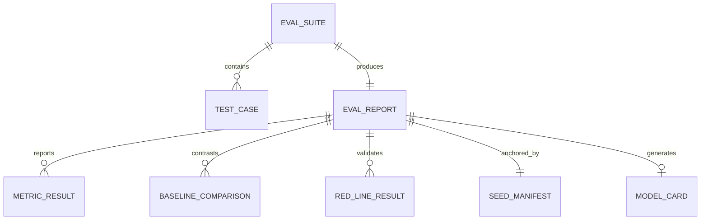

# Data Model: Evaluation Harness & Anti-Circularity Benchmark Framework (F04)

**Feature**: `005-eval-harness` (F04)  
**Date**: 2026-10-06  
**Status**: Completed  
**Context**: Defines data models, report schemas, metric comparison structures, and seed split topologies for the evaluation harness.

---

## 1. Entity Relationship Diagram



---

## 2. Core Entities & Schemas

### 2.1 EvalSuite (`evals/registry.yaml`)
A registered evaluation suite managed by the gate hook runner:

```python
class Tier(StrEnum):
    CONTRACT = "contract"
    EVAL_SMOKE = "eval_smoke"
    RED_LINE = "red_line"
    VALIDATION = "validation"
    SEALED = "sealed"

class EvalSuiteEntry(BaseModel):
    id: str = Field(description="Unique suite identifier, kebab-case (e.g. redline-hallucination)")
    tier: Tier = Field(description="Execution tier deciding workflow invocation")
    command: str | list[str] = Field(description="Shell command or argument vector run from repo root")
    owner_feature: str = Field(pattern=r"^F[0-9]{2}$", description="Feature ID owning the suite (e.g. F04)")
    report: str = Field(description="Output report path relative to repo root (e.g. evals/reports/rl_hallucination.json)")
    description: str = Field(default="", description="Human-readable description of suite objectives")
```

---

### 2.2 Red-Line Test Result
Captures the execution outcome of non-negotiable blocking tests:

```python
class RedLineID(StrEnum):
    RL_1 = "RL-1"  # Metric Hallucination Gate
    RL_2 = "RL-2"  # Citation & Provenance Coverage
    RL_3 = "RL-3"  # Causal Gate Compliance
    RL_4 = "RL-4"  # No Autonomous Write-Back
    RL_5 = "RL-5"  # PII Leakage Scanner
    RL_6 = "RL-6"  # Prompt Injection Corpus
    RL_7 = "RL-7"  # Action Intent Signing & Replay

class RedLineResult(BaseModel):
    test_id: RedLineID
    name: str
    passed: bool
    total_evaluated: int
    violations_detected: int = 0
    tolerance: int = 0  # Zero tolerance on Red-Line tests
    violation_samples: list[dict[str, Any]] = Field(default_factory=list)
    execution_time_ms: float
```

---

### 2.3 Baseline Comparison Record
Quantifies performance deltas against naive baselines:

```python
class MetricConfidenceInterval(BaseModel):
    lower: float = Field(description="2.5th percentile of bootstrap distribution")
    median: float = Field(description="50th percentile of bootstrap distribution")
    upper: float = Field(description="97.5th percentile of bootstrap distribution")
    confidence_level: float = 0.95

class BaselineComparison(BaseModel):
    module: str = Field(description="Target capability (Module A, B, C, Synthesis)")
    metric_name: str = Field(description="Name of evaluated metric (PR-AUC, FPR, Lead Time, MASE)")
    baseline_method: str = Field(description="Name of naive baseline (e.g. Static Threshold Rule)")
    candidate_model: str = Field(description="Name of evaluated model (e.g. LightGBM Alert Scorer)")
    baseline_value: float = Field(description="Baseline performance score")
    candidate_value: float = Field(description="Candidate model performance score")
    absolute_delta: float = Field(description="Candidate - Baseline")
    relative_lift_pct: float = Field(description="((Candidate - Baseline) / Baseline) * 100")
    pre_registered_target: str = Field(description="Target delta commitment from docs/models_and_evals.md")
    target_met: bool = Field(description="True if delta meets or exceeds commitment")
    confidence_interval: MetricConfidenceInterval | None = None
```

---

### 2.4 Seed Manifest
Anchors evaluation datasets to ensure mathematical reproducibility (Constitution Principle V):

```python
class SeedManifest(BaseModel):
    tier: Tier
    seeds: list[int] = Field(description="List of integer seeds used for generation")
    git_sha: str = Field(description="Git commit SHA of the evaluated codebase")
    dataset_hash: str = Field(description="SHA-256 hash of the evaluation dataset files")
    spec_version: str = Field(default="1.0.0")
    generated_at: datetime
```

---

### 2.5 Golden Dialogue Scenario
Defines structured multi-turn test conversations for conversational analytics:

```python
class ExpectedToolCall(BaseModel):
    tool_name: str
    required_arguments: dict[str, Any] = Field(default_factory=dict)
    order_index: int

class GoldenDialogueTurn(BaseModel):
    turn_index: int
    user_query: str
    expected_route: str = Field(description="Expected specialist agent ID (e.g. SentinelAML, Synthesis)")
    expected_tool_calls: list[ExpectedToolCall] = Field(default_factory=list)
    forbidden_tool_calls: list[str] = Field(default_factory=list)
    expected_citations: list[str] = Field(default_factory=list)
    refusal_required: bool = False  # True for unanswerable queries ("insufficient data")
    expected_substrings: list[str] = Field(default_factory=list)

class GoldenDialogueScenario(BaseModel):
    scenario_id: str
    domain: str
    description: str
    turns: list[GoldenDialogueTurn]
```

---

### 2.6 EvalReport Schema (`evals/reports/<suite_id>.json`)
Full schema of the emitted report:

```python
class EvalReport(BaseModel):
    suite_id: str
    timestamp: datetime
    git_sha: str
    tier: Tier
    passed: bool
    summary: str
    seed_manifest: SeedManifest
    red_line_results: list[RedLineResult] = Field(default_factory=list)
    baseline_comparisons: list[BaselineComparison] = Field(default_factory=list)
    dialogue_eval_results: list[dict[str, Any]] = Field(default_factory=list)
    latency_metrics: dict[str, float] = Field(
        default_factory=dict,
        description="p50, p95, and max turn latency in milliseconds"
    )
    hardware_and_cost: dict[str, Any] = Field(
        default_factory=dict,
        description="CPU, memory peak, token count, and estimated cost USD"
    )
```

---

### 2.7 Model Card Schema (`evals/reports/model_cards/<model_id>.md`)
Structured documentation accompanying every production candidate model:

```markdown
# Model Card: [Model Name] (Version: [X.Y.Z])

## 1. Model Details
- **Developer**: EIOS Engineering Team
- **Model Date**: YYYY-MM-DD
- **Model Type**: [LightGBM / Discrete-Time Hazard / Causal DAG / SentenceTransformer]
- **Owner Role**: [MLRO / Head of Partnerships / CFO]

## 2. Intended Use
- **Primary Use**: [Operational decision support, alert triage, churn early warning]
- **Out of Scope**: Direct autonomous execution without human approval (Constitution Principle II)

## 3. Training & Evaluation Data
- **Training Seeds**: [dev seeds: 42, ...]
- **Validation Seeds**: [validation seeds: 101–110]
- **Sealed Seeds**: [sealed holdout: 901–905]
- **Anti-Circularity Controls**: Hard negatives, 5% label noise, unplanted typologies

## 4. Evaluation vs Naive Baseline
| Metric | Naive Baseline | Candidate Model | Delta (Δ) | Target | Target Met |
|---|---|---|---|---|---|
| PR-AUC | 0.62 | 0.78 | +0.16 | ≥ +0.10 | PASS |
| Lead Time | 14 days | 23 days | +9 days | ≥ +7 days | PASS |

## 5. Calibration & Fairness
- **Brier Score**: [Score]
- **Reliability Curve**: [Calibration slope / intercept]
- **Hard-Negative Performance**: FPR on legitimate hedgers/traders bounded to ≤ 2.5%

## 6. Known Failure Modes & Limitations
- [Identified data edge cases, latency boundaries]

## 7. Rollback & Fallback Procedure
- Immediate fallback to documented naive baseline (`[FallbackClass]`) with UI badge `[REPLAY/FALLBACK]`.
```
