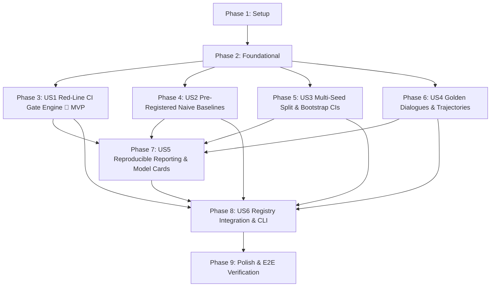

# Tasks: Evaluation Harness & Anti-Circularity Benchmark Framework (F04)

**Input**: Design documents from `/specs/005-eval-harness/`  
**Path convention**: Every code, config, docs, infra, and test path in this file is relative to `FEIOS/` (the platform package root). Planning documents (`specs/`, `initial_plan.md`, `docs/`) stay at the workspace root.  
**Prerequisites**: [plan.md](./plan.md), [spec.md](./spec.md), [research.md](./research.md), [data-model.md](./data-model.md), [contracts/](./contracts/), [quickstart.md](./quickstart.md) (all present and verified)  
**Tests**: MANDATORY. Constitution Principle VI requires test-first (RED $\rightarrow$ GREEN $\rightarrow$ refactor). Every implementation task is preceded by a test task that must fail first. Coverage gate is $\ge 80\%$ line and branch coverage `[TARGET]`.  
**Organisation**: Grouped by user story (US1..US6) following priority order, enabling independent implementation and testing of each story.

## Format: `- [ ] T### [P?] [US#?] Description with file path`

- `[P]`: Can run in parallel (different files, no unmet dependencies).
- `[US#]`: User story label. Present only in story phases (Phases 3 to 8). Absent in Setup, Foundational, and Polish.
- "RED" in a test task means: write the test, run it, and confirm it fails for the right reason before starting the matching implementation task.

---

## Phase 1: Setup (Harness Directory Skeletons & Contract Schemas)

**Purpose**: Initialize the evaluation harness directory structure, copy schema contracts, and configure exports.

- [X] T001 Create directory skeleton for evaluation harness: `evals/suites/redlines/`, `evals/suites/baselines/`, `evals/suites/splits/`, `evals/golden/dialogues/`, `evals/reports/model_cards/`, `src/eios/evals/`, and `tests/evals/`.
- [X] T002 Copy contract schemas from `specs/005-eval-harness/contracts/` into `schemas/evals/` (`eval-report.schema.json`, `model-card.schema.json`).
- [X] T003 [P] Configure package exports in `src/eios/evals/__init__.py`.
- [X] T004 [P] Configure suite exports in `evals/suites/__init__.py`.

---

## Phase 2: Foundational (Core Metrics, Seed Manifest & Shared Fixtures)

**Purpose**: Core calculation utilities, bootstrap estimators, data models, and shared pytest fixtures required across all evaluation suites.

### Tests first (RED)

- [X] T005 [P] Write `tests/evals/conftest.py`: pytest fixtures for synthetic dataset splits, mock ground-truth store (`eval-truth/`), sample agent trajectories, and mock Action Intent Tokens.
- [X] T006 [P] Write `tests/evals/test_metrics.py`: test mathematical calculations for PR-AUC, Brier calibration score, MASE forecast error, relative lift percentage, and bootstrap confidence intervals. RED.
- [X] T007 [P] Write `tests/evals/test_isolation.py`: test IAM and process boundary guard denying read access on `eval-truth/` for `sa-reasoning-mesh` role while allowing `sa-eval-harness`. RED.

### Implementation (GREEN)

- [X] T008 [P] Implement `src/eios/evals/metrics.py`: vectorized PR-AUC, Brier score, MASE, lift calculations, and statistical delta helpers. Makes T006 pass.
- [X] T009 [P] Implement `src/eios/evals/isolation.py`: role-based boundary guard and filesystem isolation wrapper enforcing ADR-015 ground-truth privacy. Makes T007 pass.
- [X] T010 [P] Implement `src/eios/evals/models.py`: Pydantic models for `SeedManifest`, `MetricConfidenceInterval`, `BaselineComparison`, and `RedLineResult` per `data-model.md`.
- [X] T011 Run `uv run pytest tests/evals/test_metrics.py tests/evals/test_isolation.py -q` to verify foundational utilities pass.

**Checkpoint**: Foundational layer green. User Story implementation can begin.

---

## Phase 3: User Story 1 - Red-Line CI Gate Engine (RL-1 to RL-7) (Priority: P1) 🎯 MVP

**Goal**: Deliver the 7 non-negotiable blocking Red-Line tests (`evals/suites/redlines/`) enforcing Constitution Principles I, II, III, IV, and VI (`FR-001`–`FR-007`, `SC-001`, `SC-002`).

**Independent Test**: Execute `python -m evals.suites.redlines.runner`. Inject deliberate violations into simulated outputs (unanchored numbers, direct DB mutations, unrefuted causal assertions, raw PII, forged action tokens). Assert 100% of violations are caught and exit code is 1.

### Tests first (RED)

- [X] T012 [P] [US1] Write `tests/evals/test_rl1_hallucination.py`: test adversarial numeric prompt injection against `MetricAuditorGate`, verifying 0 tolerance on unanchored figures and 100% pass on valid statutory citations (`31 CFR 1010`, `Section 314(b)`, `Form 111`). RED.
- [X] T013 [P] [US1] Write `tests/evals/test_rl2_citation.py`: test citation coverage verifier on agent narratives and SAR drafts, asserting rejection when claims lack entity ID or data product `as_of`. RED.
- [X] T014 [P] [US1] Write `tests/evals/test_rl3_causal_gate.py`: test causal assertion validator on unrefuted edges, asserting mandatory refusal "correlation detected; insufficient evidence for causation." RED.
- [X] T015 [P] [US1] Write `tests/evals/test_rl4_no_autonomous_write.py`: test static AST scanner and runtime execution blocker, asserting detection of forbidden DB write calls and direct sink invocations. RED.
- [X] T016 [P] [US1] Write `tests/evals/test_rl5_pii_leakage.py`: test PII scanner on prompt logs and outputs, asserting rejection on unmasked emails/cards/names and pass on `tok_usr_*` / `tok_id_cluster_*`. RED.
- [X] T017 [P] [US1] Write `tests/evals/test_rl6_prompt_injection.py`: test prompt injection benchmark across $\ge 50$ adversarial payloads, asserting 0 successful instruction overrides or unauthorized tool calls. RED.
- [X] T018 [P] [US1] Write `tests/evals/test_rl7_action_intent.py`: test Action Intent cryptographic verifier against forged ECDSA signatures, wrong `kid`, expired timestamps, and replayed nonces. RED.

### Implementation (GREEN)

- [X] T019 [US1] Implement `evals/suites/redlines/test_rl1_hallucination.py`: adversarial prompt suite and Metric Auditor Gate verification runner. Makes T012 pass.
- [X] T020 [US1] Implement `evals/suites/redlines/test_rl2_citation.py`: regex and entity ID / `as_of` citation coverage scanner. Makes T013 pass.
- [X] T021 [US1] Implement `evals/suites/redlines/test_rl3_causal_gate.py`: causal assertion scanner checking refutation passing criteria and refusal compliance. Makes T014 pass.
- [X] T022 [US1] Implement `evals/suites/redlines/test_rl4_no_autonomous_write.py`: `ast.NodeVisitor` code scanner and runtime monkeypatch deny guard. Makes T015 pass.
- [X] T023 [US1] Implement `evals/suites/redlines/test_rl5_pii_leakage.py`: regex and token vault key validator. Makes T016 pass.
- [X] T024 [US1] Implement `evals/suites/redlines/test_rl6_prompt_injection.py`: prompt injection corpus runner evaluating simulated ticket/comms text. Makes T017 pass.
- [X] T025 [US1] Implement `evals/suites/redlines/test_rl7_action_intent.py`: cryptographic signature, expiry, and nonce replay verification suite. Makes T018 pass.
- [X] T026 [US1] Implement `evals/suites/redlines/runner.py`: aggregator running all 7 Red-Line tests, emitting `evals/reports/red_line_summary.json` and exiting with code 0 (pass) or 1 (fail).
- [X] T027 [US1] Run `uv run pytest tests/evals/test_rl*.py -q` to verify all 7 Red-Line tests pass.

**Checkpoint**: Red-Line CI Gate Engine complete and blocking. MVP achieved.

---

## Phase 4: User Story 2 - Pre-Registered Naive Baseline Engine & Delta Benchmarks (Priority: P1)

**Goal**: Deliver naive rule-based and statistical baselines for Modules A, B, C, and Synthesis, computing empirical performance deltas ($\Delta \text{Metric}$) per `docs/models_and_evals.md` (`FR-008`–`FR-009`, `SC-003`).

**Independent Test**: Run `python -m evals.suites.baselines.runner`. Assert all 4 baselines execute on synthetic validation datasets, establish benchmark scores, and emit delta comparison tables.

### Tests first (RED)

- [X] T028 [P] [US2] Write `tests/evals/test_baselines_module_a.py`: test `RuleBasedAMLBaseline` on synthetic transaction/KYC data, asserting static rule scoring and FPR measurement on legitimate high-volume traders. RED.
- [X] T029 [P] [US2] Write `tests/evals/test_baselines_module_b.py`: test `NaiveOppositeTradeBaseline` on partner trading pairs, asserting 1-hop timestamp matching. RED.
- [X] T030 [P] [US2] Write `tests/evals/test_baselines_module_c.py`: test `RecencyChurnBaseline` on partner activity, asserting login inactivity threshold scoring and lead-time calculation. RED.
- [X] T031 [P] [US2] Write `tests/evals/test_baselines_synthesis.py`: test `SeasonalNaiveSynthesisBaseline` forecasting $y_{t-28}$ and equal-split attribution ($33.3\% / 33.3\% / 33.3\%$). RED.
- [X] T032 [P] [US2] Write `tests/evals/test_baseline_runner.py`: test delta calculation engine, verifying candidate model lift computation and commitment checking. RED.

### Implementation (GREEN)

- [X] T033 [US2] Implement `evals/suites/baselines/module_a_rules.py`: static threshold rule baseline for Client AML. Makes T028 pass.
- [X] T034 [US2] Implement `evals/suites/baselines/module_b_opposite.py`: naive 1-hop opposite-trade matcher for Partner Fraud. Makes T029 pass.
- [X] T035 [US2] Implement `evals/suites/baselines/module_c_recency.py`: recency threshold rule baseline for Partner Churn. Makes T030 pass.
- [X] T036 [US2] Implement `evals/suites/baselines/synthesis_naive.py`: seasonal-naive forecaster and equal-split driver attribution baseline. Makes T031 pass.
- [X] T037 [US2] Implement `evals/suites/baselines/runner.py`: comparative benchmark runner executing candidate models alongside baselines, calculating $\Delta \text{Metric}$ and relative lift, and writing `evals/reports/baseline_benchmarks.json`. Makes T032 pass.
- [X] T038 [US2] Run `uv run pytest tests/evals/test_baselines*.py tests/evals/test_baseline_runner.py -q`.

**Checkpoint**: Naive Baseline Engine and comparative delta benchmarking complete.

---

## Phase 5: User Story 3 - Multi-Seed Split Runner & Bootstrap CI Engine (Priority: P2)

**Goal**: Deliver seed split orchestrator (`dev`, `validation`, `sealed`), vectorized NumPy percentile bootstrap confidence interval estimator, and placebo edge refutation checks (`FR-010`–`FR-014`, `SC-004`).

**Independent Test**: Run `python -m evals.suites.splits.runner --tier validation`. Assert execution across 10 validation seeds, verify 95% bootstrap CIs are computed in $< 3\text{ minutes}$, and verify that planted placebo edges are rejected ($p > 0.05$).

### Tests first (RED)

- [X] T039 [P] [US3] Write `tests/evals/test_bootstrap.py`: test vectorized NumPy bootstrap percentile confidence interval estimation ($B = 1,000$), asserting accuracy within $\pm 0.01$ of true parametric bounds and runtime $< 3\text{s}$ per 10,000 samples. RED.
- [X] T040 [P] [US3] Write `tests/evals/test_seed_splits.py`: test seed orchestrator across `dev` (Seed 42), `validation` (Seeds 101–110), and `sealed` (Seeds 901–905), asserting manifest generation and dataset hash consistency. RED.
- [X] T041 [P] [US3] Write `tests/evals/test_placebo_rejection.py`: test placebo causal edge refuter verification, asserting that planted zero-effect edges produce $p > 0.05$ and fail the causal gate. RED.

### Implementation (GREEN)

- [X] T042 [US3] Implement `evals/suites/splits/bootstrap.py`: vectorized NumPy 2D array bootstrap resampling and confidence interval calculator. Makes T039 pass.
- [X] T043 [US3] Implement `evals/suites/splits/runner.py`: multi-seed split orchestrator loading synthetic partitions from Layer 0 (`eios.foundry`), aggregating metric distributions, and generating `evals/reports/splits_validation.json`. Makes T040 pass.
- [X] T044 [US3] Implement placebo edge rejection verifier in `evals/suites/splits/placebo.py`. Makes T041 pass.
- [X] T045 [US3] Run `uv run pytest tests/evals/test_bootstrap.py tests/evals/test_seed_splits.py tests/evals/test_placebo_rejection.py -q`.

**Checkpoint**: Multi-seed split runner, bootstrap CI engine, and placebo verification complete.

---

## Phase 6: User Story 4 - Golden Dialogue & Trajectory Evaluator (Priority: P2)

**Goal**: Deliver multi-turn golden dialogue evaluations, OMCP tool trajectory validation, Supervisory Router accuracy scoring ($\ge 95\%$), and turn latency SLA tracking (`FR-015`–`FR-018`, `SC-005`).

**Independent Test**: Run `python -m evals.golden.trajectory_eval`. Assert execution across 10 golden dialogue scenarios, verify router accuracy is $\ge 95\%$, check that unanswerable queries return "insufficient data" refusals, and assert latency SLA compliance ($\le 3\text{s}$ first token, $\le 20\text{s}$ full answer).

### Tests first (RED)

- [X] T046 [P] [US4] Write `tests/evals/test_golden_dialogues.py`: test dialogue scenario loader and turn validator against schema in `data-model.md`. RED.
- [X] T047 [P] [US4] Write `tests/evals/test_trajectory_eval.py`: test OMCP tool trajectory scoring, redundant call penalty, router classification accuracy ($\ge 95\%$), and refusal verification on unanswerable queries. RED.
- [X] T048 [P] [US4] Write `tests/evals/test_latency_tracker.py`: test high-resolution monotonic turn latency timer and SLA threshold assertions. RED.

### Implementation (GREEN)

- [X] T049 [US4] Author 10 canonical golden multi-turn dialogue scenarios in `evals/golden/dialogues/` (`synthesis_briefing.yaml`, `aml_investigation.yaml`, `partner_churn_drilldown.yaml`, `assumption_challenge.yaml`, `unanswerable_query.yaml`, etc.).
- [X] T050 [US4] Implement `evals/golden/trajectory_eval.py`: trajectory parser, tool call sequence auditor, redundant call penalizer, and Supervisory Router accuracy scorer. Makes T046 and T047 pass.
- [X] T051 [US4] Implement `src/eios/evals/latency.py`: turn latency tracking context manager and percentile aggregator. Makes T048 pass.
- [X] T052 [US4] Run `uv run pytest tests/evals/test_golden_dialogues.py tests/evals/test_trajectory_eval.py tests/evals/test_latency_tracker.py -q`.

**Checkpoint**: Golden Dialogue and Agent Trajectory Evaluator complete.

---

## Phase 7: User Story 5 - Reproducible Reporting & Model Card Exporter (Priority: P3)

**Goal**: Deliver automated generation of schema-valid JSON reports (`eval-report.schema.json`), rendered GitHub-Flavored Markdown summary tables with provenance tags, and standardized Model Cards (`FR-019`–`FR-021`, `SC-006`).

**Independent Test**: Generate reports from sample evaluation runs. Assert that JSON reports validate against `schemas/evals/eval-report.schema.json`, Markdown tables include tags (`[BRIEF]`, `[TARGET]`, `[ILLUSTRATIVE]`, `[ASSUMPTION]`), and Model Cards export under `evals/reports/model_cards/`.

### Tests first (RED)

- [X] T053 [P] [US5] Write `tests/evals/test_report_generator.py`: test JSON report generation and validation against `schemas/evals/eval-report.schema.json`, and Markdown summary table formatting. RED.
- [X] T054 [P] [US5] Write `tests/evals/test_model_card_exporter.py`: test Model Card generation, verifying sections for data splits, metrics vs baseline, calibration metrics (Brier score / reliability curve), and rollback procedures. RED.

### Implementation (GREEN)

- [X] T055 [US5] Implement `evals/reports/generator.py`: report builder formatting `EvalReport` models, validating JSON output against schema, and rendering GitHub-Flavored Markdown tables. Makes T053 pass.
- [X] T056 [US5] Implement `evals/reports/model_card.py`: Model Card publisher exporting Markdown and structured JSON cards for evaluated models. Makes T054 pass.
- [X] T057 [US5] Run `uv run pytest tests/evals/test_report_generator.py tests/evals/test_model_card_exporter.py -q`.

**Checkpoint**: Reporting and Model Card exporter complete.

---

## Phase 8: User Story 6 - Registry Integration & CLI Orchestration (Priority: P3)

**Goal**: Register all evaluation suites into `evals/registry.yaml` across tiers (`contract`, `eval_smoke`, `red_line`, `validation`, `sealed`), and verify CLI orchestration with `python -m evals.cli run --tier <tier>` (`FR-022`–`FR-023`, `SC-007`).

**Independent Test**: Run `python -m evals.cli run --tier red_line` and `python -m evals.cli run --tier eval_smoke`. Assert clean exit codes (0 for pass, 1 for fail, 2 for configuration error) and verify that `tests/contract/gates/test_registry.py` passes 100%.

### Tests first (RED)

- [X] T058 [P] [US6] Write `tests/evals/test_cli_orchestration.py`: test `evals.cli` tier selection, id-prefix filtering, unknown tier handling, and exit code propagation. RED.

### Implementation (GREEN)

- [X] T059 [US6] Populate `evals/registry.yaml` with all F04 suites:
  - `redline-hallucination` (`tier: red_line`)
  - `redline-citation` (`tier: red_line`)
  - `redline-causal-gate` (`tier: red_line`)
  - `redline-no-autonomous-write` (`tier: red_line`)
  - `redline-pii-leakage` (`tier: red_line`)
  - `redline-prompt-injection` (`tier: red_line`)
  - `redline-action-intent` (`tier: red_line`)
  - `baseline-benchmarks` (`tier: validation`)
  - `splits-validation` (`tier: validation`)
  - `dialogue-evals` (`tier: validation`)
  - `eval-smoke` (`tier: eval_smoke`)
  - `sealed-holdout` (`tier: sealed`)
- [X] T060 [US6] Update `tests/contract/gates/test_registry.py`: adapt `test_the_shipped_registry_is_an_empty_list_with_a_header` to assert that `evals/registry.yaml` contains the registered F04 suites (and starts with `#`), preserving 100% gate contract test passes.
- [X] T061 [US6] Wire CLI hooks and verify `evals/cli.py` executes all registered tiers cleanly. Makes T058 pass.
- [X] T062 [US6] Run `uv run pytest tests/contract/gates/ -q` and `uv run pytest tests/evals/test_cli_orchestration.py -q`.

**Checkpoint**: Registry integration and CLI orchestration complete.

---

## Phase 9: Polish, Integration & System Verification

**Purpose**: End-to-end framework verification, documentation alignment, and test coverage gate verification.

### Tests & Verification (GREEN)

- [X] T063 [P] Write `tests/evals/test_e2e_eval_harness.py`: end-to-end integration test executing the complete pipeline: load synthetic seeds $\rightarrow$ run naive baselines $\rightarrow$ evaluate candidate model $\rightarrow$ compute bootstrap CIs $\rightarrow$ verify Red-Line gates $\rightarrow$ emit JSON/Markdown reports and Model Card.
- [X] T064 Run full evaluation test suite and verify test coverage gate ($\ge 80\%$ line and branch coverage): `uv run pytest tests/evals/ --cov=eios.evals --cov=evals --cov-report=term-missing --cov-fail-under=80`.
- [X] T065 Run code quality and formatting checks: `uv run ruff check src/eios/evals evals tests/evals` and `uv run ruff format --check src/eios/evals evals tests/evals`.
- [X] T066 Verify CLI execution across all local tiers:
  - `uv run python -m evals.cli run --tier red_line`
  - `uv run python -m evals.cli run --tier eval_smoke`

---

## Dependencies & Completion Order

### Parallel Execution Opportunities
- **Setup & Foundational**: T003, T004, T005, T006, T007, T008, T009, T010 can all run in parallel.
- **Red-Line Tests (US1)**: Test tasks T012 through T018 and implementation tasks T019 through T025 can be authored in parallel across separate files.
- **Baseline Implementations (US2)**: Baselines for Modules A, B, C, and Synthesis (T033, T034, T035, T036) can be implemented independently in parallel.
- **Multi-Seed (US3) vs Golden Dialogues (US4)**: Multi-seed statistical runner (US3) and golden dialogue evaluator (US4) can proceed concurrently once Phase 2 is green.

---

## Implementation Strategy & MVP Delivery

1. **MVP Increment (Phases 1–3)**: Setup, foundational metrics, and User Story 1 (Red-Line CI Gate Engine). Delivers the essential safety and governance egress firewall (RL-1 to RL-7) blocking hallucinations, unauthorized writes, and PII leaks on every PR.
2. **Comparative Benchmark Core (Phase 4)**: Naive Baseline Engine establishing empirical delta baselines ($\Delta \text{Metric}$) for Modules A, B, C, and Synthesis per Constitution Principle VI.
3. **Statistical & Generalization Rigor (Phases 5–6)**: Multi-seed split runner with bootstrap confidence intervals and golden dialogue trajectory evaluators.
4. **Governed Reporting & Registry Orchestration (Phases 7–9)**: JSON reports, GitHub-Flavored Markdown summary tables, Model Cards, `evals/registry.yaml` integration, and end-to-end verification under the $\ge 80\%$ test coverage gate.
