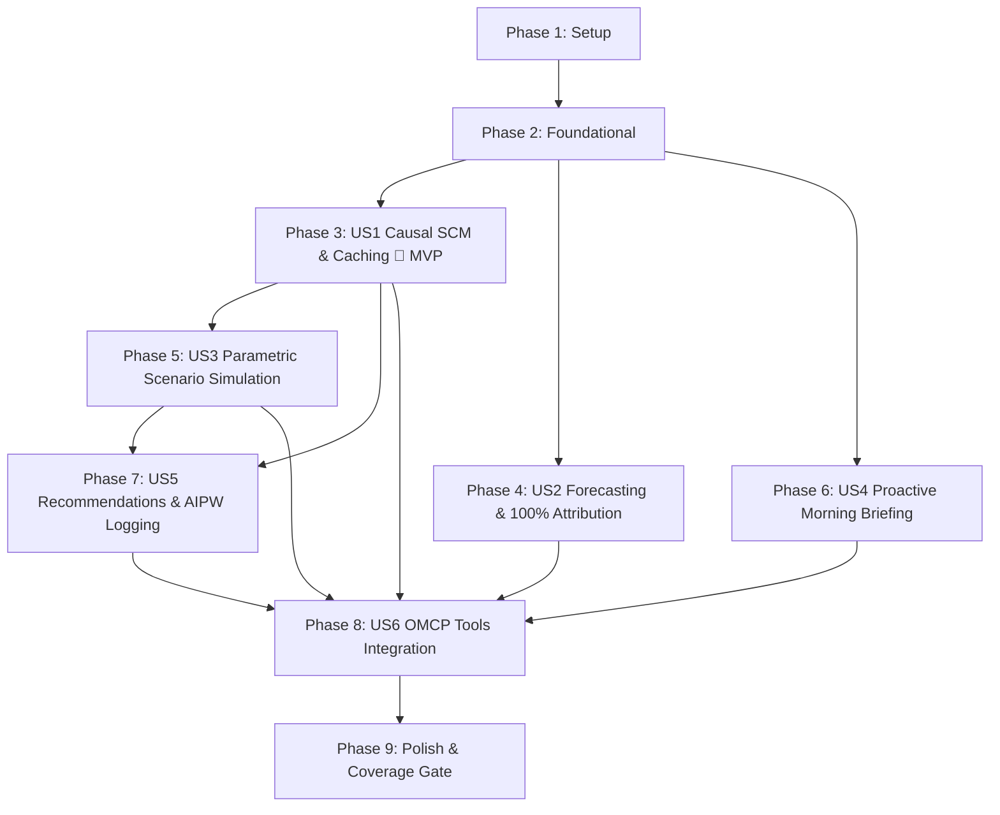

# Tasks: Executive Synthesis Engine (F05)

**Feature Branch**: `006-synthesis-engine`  
**Date**: 2026-10-06  
**Spec**: [specs/006-synthesis-engine/spec.md](spec.md)  
**Plan**: [specs/006-synthesis-engine/plan.md](plan.md)  

**Prerequisites**: `plan.md` (required), `spec.md` (required for user stories), `research.md`, `data-model.md`, `contracts/`

**Tests**: Test-Driven Development (TDD) mandatory per Constitution Principle VI (red $\rightarrow$ green $\rightarrow$ refactor). Each user story has test tasks written and failing before implementation tasks.

**Organization**: Tasks are strictly grouped by user story to enable independent implementation, testing, and delivery.

---

## Format: `[ID] [P?] [Story] Description`

- **[P]**: Can run in parallel (different files, no dependencies)
- **[Story]**: User story label (`[US1]`, `[US2]`, `[US3]`, `[US4]`, `[US5]`, `[US6]`)
- Every task includes exact file paths

---

## Phase 1: Setup (Shared Infrastructure)

**Purpose**: Project initialization, directory structure, schemas, and package exports.

- [X] T001 Create synthesis package and test directory skeleton: `FEIOS/src/eios/synthesis/`, `FEIOS/tests/synthesis/`, `FEIOS/schemas/synthesis/`
- [X] T002 Copy JSON schema contracts (`synthesis-briefing.schema.json`, `synthesis-forecast.schema.json`, `synthesis-scenario.schema.json`) into `FEIOS/schemas/synthesis/`
- [X] T003 [P] Initialize package exports in `FEIOS/src/eios/synthesis/__init__.py` for `SynthesisEngine`, `SCMRunner`, `Forecaster`, `ScenarioSimulator`, and `BriefingGenerator`

---

## Phase 2: Foundational (Domain Models, SCM Data Structures & Fixtures)

**Purpose**: Core data models, exceptions, and synthetic multi-domain time-series fixtures required by all user stories.

**⚠️ CRITICAL**: Blocking prerequisites for all downstream user story implementations.

- [X] T004 [P] Create synthetic multi-domain 90-day time-series fixture in `FEIOS/tests/synthesis/conftest.py` loading history for `competitor_payout_rate`, `partner_churn_rate`, `ftd_count_28d`, `net_deposit_volume_usd`, and planted placebo edges
- [X] T005 [P] Implement Pydantic v2 domain models in `FEIOS/src/eios/synthesis/models.py` (`CausalEdge`, `RefutationReport`, `SCMCacheManifest`, `DriverAttribution`, `ForecastResult`, `ScenarioShockSpec`, `MitigationOption`, `ScenarioSimulationResult`, `BriefingItem`, `BriefingObject`, `RecommendationCard`, `AIPWPropensityRecord`)
- [X] T006 [P] Implement domain exceptions in `FEIOS/src/eios/synthesis/exceptions.py` (`CausalCycleError`, `CausalGateViolationError`, `SingularMatrixError`, `AttributionSumError`, `ExtrapolationWarning`)

**Checkpoint**: Foundational models and fixtures ready. User story implementation can now begin.

---

## Phase 3: User Story 1 - Cross-Domain Causal SCM & Offline/Online Caching Engine (Priority: P1) 🎯 MVP

**Goal**: Deliver the 4-domain Causal DAG, Ridge structural equation fitting, DoWhy-style refutation tests (placebo treatment, random common cause, data subset stability), Causal-Evidence Gate verification, and offline cache serialization (`SCMCache`) with sub-second online retrieval ($< 100\text{ms}$ p95 `[TARGET]`).

**Independent Test**: Run `python -m eios.synthesis.scm_runner --fit-cache`. Assert all valid edges pass refutation, planted placebo edges are rejected ($p \le 0.05$ `[TARGET]`), cache manifest is written, and online retrieval takes $< 100\text{ms}$ `[TARGET]`.

### Tests first (RED)

- [X] T007 [P] [US1] Write `FEIOS/tests/synthesis/test_scm_dag.py`: test NetworkX Causal DAG creation, edge weights, directed cycle detection (`CausalCycleError`), and topological sort ordering. RED.
- [X] T008 [P] [US1] Write `FEIOS/tests/synthesis/test_refutation.py`: test placebo-treatment refuter ($p > 0.05$ pass `[TARGET]`), random common cause stability ($\Delta \le 0.20$ `[TARGET]`), and data subset stability ($\Delta \le 0.20$ `[TARGET]`). Assert planted placebo edge fails gate ($p \le 0.05$). RED.
- [X] T009 [P] [US1] Write `FEIOS/tests/synthesis/test_scm_runner.py`: test offline fitting, `SCMCache` serialization/deserialization, and assertion that unverified/failed edges emit `"correlation detected; insufficient evidence for causation."`. RED.

### Implementation (GREEN)

- [X] T010 [US1] Implement refutation algorithms in `FEIOS/src/eios/synthesis/refutation.py`: placebo treatment permuter with Student's $t$-test / bootstrap $p$-value, random normal confounder refuter, and bootstrap subset resampler. Makes T008 pass.
- [X] T011 [US1] Implement Causal DAG and cache engine in `FEIOS/src/eios/synthesis/scm.py`: NetworkX DAG manager, structural Ridge equation fitter with $L_2$ regularization ($\alpha = 1.0$), cycle validator, and `SCMCache` reader/writer. Makes T007 pass.
- [X] T012 [US1] Implement batch/offline runner in `FEIOS/src/eios/synthesis/scm_runner.py`: fits equations on historical metrics, executes refuters, enforces Causal-Evidence Gate (confidence $\ge 0.80$, CI excludes zero, placebo $p > 0.05$), and writes `evals/reports/synthesis_scm_cache.json`. Makes T009 pass.
- [X] T013 [US1] Run `uv run pytest tests/synthesis/test_scm_*.py tests/synthesis/test_refutation.py -q`.

**Checkpoint**: SCM DAG, refutation engine, and offline/online caching complete. MVP achieved.

---

## Phase 4: User Story 2 - Predictive Forecasting Engine & Additive Driver Attribution (Priority: P1)

**Goal**: Deliver a multivariate forecasting model incorporating upstream DAG leading indicators that beats the seasonal-naive $y_{t-28}$ baseline with $\text{MASE} < 1.0$ `[TARGET]` and decomposes forecast variances into additive driver attributions summing strictly to $100.0\% \pm 0.001\%$ `[TARGET]`.

**Independent Test**: Run `python -m eios.synthesis.forecast_runner --metric net_deposit_volume_usd --horizon 28`. Assert out-of-sample $\text{MASE} < 1.0$, calibrated 95% empirical prediction intervals, and driver attributions summing strictly to $100.0\% \pm 0.001\%$.

### Tests first (RED)

- [X] T014 [P] [US2] Write `FEIOS/tests/synthesis/test_forecast_engine.py`: test `MultivariateRidgeForecaster` on 28-day horizon, comparing out-of-sample MASE against `SeasonalNaiveSynthesisBaseline` and asserting 95% prediction interval coverage. RED.
- [X] T015 [P] [US2] Write `FEIOS/tests/synthesis/test_driver_attribution.py`: test path-based counterfactual decomposition, testing Hare-Niemeyer largest-remainder rounding guaranteeing $\sum \text{pct} \equiv 100.0\% \pm 0.001\%$, rank accuracy $\ge 90\%$, and zero-delta fallback. RED.

### Implementation (GREEN)

- [X] T016 [US2] Implement forecaster in `FEIOS/src/eios/synthesis/forecast.py`: multi-step autoregressive Ridge model using lag vector $[y_{t-1}, y_{t-7}, y_{t-14}, y_{t-28}]$ and upstream leading indicators (`competitor_payout_rate`, `latency_p95`), residual variance bootstrap prediction intervals, and out-of-sample MASE calculation. Makes T014 pass.
- [X] T017 [US2] Implement driver attribution engine in `FEIOS/src/eios/synthesis/attribution.py`: path-wise structural effect decomposition, Hare-Niemeyer largest-remainder rounding guaranteeing exact 100.0% summation, and balanced uniform fallback ($100 / K \%$ each) on zero deltas. Makes T015 pass.
- [X] T018 [US2] Run `uv run pytest tests/synthesis/test_forecast_engine.py tests/synthesis/test_driver_attribution.py -q`.

**Checkpoint**: Predictive forecasting and 100% additive driver attribution complete.

---

## Phase 5: User Story 3 - Parametric Scenario Shock Simulation Engine (Priority: P2)

**Goal**: Deliver parametric shock injection traversing the SCM DAG in topological order in $< 200\text{ms}$ p95 `[TARGET]`, computing propagated deltas, confidence intervals, explicit assumption listings, and ranked defensive mitigation options.

**Independent Test**: Run `python -m eios.synthesis.scenario_runner --shock competitor_payout_rate=0.15`. Assert downstream metric impacts computed in $< 200\text{ms}$ with directional accuracy $\ge 95\%$, 95% confidence intervals, and ranked mitigation actions.

### Tests first (RED)

- [X] T019 [P] [US3] Write `FEIOS/tests/synthesis/test_scenario_simulation.py`: test `run_scenario` on single and multi-node shocks, testing topological propagation order, confidence intervals, assumption tracking, and mitigation option ranking. RED.
- [X] T020 [P] [US3] Write `FEIOS/tests/synthesis/test_scenario_edge_cases.py`: test unlinked target metrics (delta = 0.0), extreme shock extrapolation warnings (`ExtrapolationWarning`), and non-linear interval expansion. RED.

### Implementation (GREEN)

- [X] T021 [US3] Implement parametric scenario simulator in `FEIOS/src/eios/synthesis/scenario.py`: topological traversal, error propagation for 95% confidence intervals, explicit modeling assumption tagging, and mitigation option ranking with estimated ROI ranges. Makes T019 and T020 pass.
- [X] T022 [US3] Run `uv run pytest tests/synthesis/test_scenario_*.py -q`.

**Checkpoint**: Parametric scenario shock simulation and mitigation ranking complete.

---

## Phase 6: User Story 4 - Proactive Morning Briefing Generator & Streaming Narrative (Priority: P2)

**Goal**: Deliver automated daily Morning Briefing synthesis categorizing $\ge 3$ insights `[BRIEF]`, $\ge 2$ risks `[BRIEF]`, and $\ge 1$ opportunity `[BRIEF]` with drill-down prompts, validated against the Metric Auditor Gate (0 untraceable numbers `[TARGET]`), and cached replay fallback with `[REPLAY]` badges.

**Independent Test**: Run `python -m eios.synthesis.briefing_runner --date 2026-10-06`. Assert generation of `BriefingObject` matching schema, verifying 100% citation coverage and metric audit pass.

### Tests first (RED)

- [X] T023 [P] [US4] Write `FEIOS/tests/synthesis/test_morning_briefing.py`: test metric delta aggregation, insight/risk/opportunity ranking logic, conversational follow-up prompt generation, and JSON schema validation against `schemas/synthesis/synthesis-briefing.schema.json`. RED.
- [X] T024 [P] [US4] Write `FEIOS/tests/synthesis/test_briefing_fallback_audit.py`: test `MetricAuditorGate` scanning on briefing narrative, verifying circuit-breaker template fallback on ungrounded figures, and cached replay fallback with `[REPLAY]` metadata during simulated LLM provider timeouts. RED.

### Implementation (GREEN)

- [X] T025 [US4] Implement morning briefing generator in `FEIOS/src/eios/synthesis/briefing.py`: queries Semantic Metric Layer for 24-hour and 28-day deltas, computes risk scores ($P \times \text{VaR}$), formats `BriefingObject`, routes through `llm_gateway` with `MetricAuditorGate` enforcement, and provides cached replay fallback. Makes T023 and T024 pass.
- [X] T026 [US4] Run `uv run pytest tests/synthesis/test_morning_briefing*.py tests/synthesis/test_briefing_fallback_audit.py -q`.

**Checkpoint**: Morning briefing generator, Metric Auditor Gate enforcement, and replay fallback complete.

---

## Phase 7: User Story 5 - Governed Recommendation Composer & Doubly Robust AIPW Propensity Logging (Priority: P3)

**Goal**: Deliver structured recommendation cards with multi-factor trade-offs, confidence levels ($\ge 0.80$ `[TARGET]`), KMS-signed draft action intent proposals, proposal propensity score $e(X)$ logging, and Doubly Robust AIPW offline causal flywheel recalibration.

**Independent Test**: Run `python -m eios.synthesis.recommendation_runner`. Assert recommendation card composition, verify propensity score $e(X) \in [0.01, 0.99]$ `[ASSUMPTION]` and context $X$ logged, and execute AIPW recalibration proving $\ge 50\%$ lower bias than naive averages `[TARGET]`.

### Tests first (RED)

- [X] T027 [P] [US5] Write `FEIOS/tests/synthesis/test_recommendation_composer.py`: test decision card formatting (impact range, pros/cons, confidence, citations), linked Action Types (`AdjustPartnerTier`, etc.), and draft `ActionIntentToken` formatting without direct write execution. RED.
- [X] T028 [P] [US5] Write `FEIOS/tests/synthesis/test_aipw_flywheel.py`: test propensity score calculation $e(X) = \sigma(w^T X)$ with $[0.01, 0.99]$ clipping, and test `AIPWEstimator` on synthetic confounded decision outcome logs, asserting $\ge 50\%$ bias reduction against naive observational averages. RED.

### Implementation (GREEN)

- [X] T029 [US5] Implement recommendation composer in `FEIOS/src/eios/synthesis/recommendations.py`: builds structured decision cards, links Action Types, calculates propensity scores $e(X)$, and integrates with `ActionIntentHub`. Makes T027 pass.
- [X] T030 [US5] Implement Doubly Robust AIPW estimator in `FEIOS/src/eios/synthesis/aipw.py`: combines logistic propensity model with Ridge outcome regression model for unbiased treatment effect estimation on logged decision outcomes. Makes T028 pass.
- [X] T031 [US5] Run `uv run pytest tests/synthesis/test_recommendation_composer.py tests/synthesis/test_aipw_flywheel.py -q`.

**Checkpoint**: Governed recommendation composer and AIPW causal flywheel complete.

---

## Phase 8: User Story 6 - Canonical OMCP Synthesis Tools & Router Integration (Priority: P3)

**Goal**: Wire all 5 synthesis handlers (`get_causal_chain`, `run_scenario`, `get_forecast`, `get_briefing`, `propose_action`) into `OMCPServer`, enforcing security markings, schema compliance, and Metric Auditor Gate passes with 0 untraceable numbers.

**Independent Test**: Run `python -m pytest tests/synthesis/test_omcp_synthesis_integration.py`. Assert that `OMCPServer` dispatches all 5 synthesis tools cleanly in $< 100\text{ms}$ `[TARGET]` and conforms to `contracts/omcp-tools.json`.

### Tests first (RED)

- [X] T032 [P] [US6] Write `FEIOS/tests/synthesis/test_omcp_synthesis_integration.py`: test `OMCPServer.call_tool` dispatch across `get_causal_chain`, `run_scenario`, `get_forecast`, `get_briefing`, and `propose_action`, asserting schema contracts, marking enforcement, and error propagation. RED.

### Implementation (GREEN)

- [X] T033 [US6] Wire synthesis tool dispatch handlers in `FEIOS/src/eios/ontology/omcp/server.py`:
  - `_handle_get_causal_chain`: connects to `scm.py` / `SCMCache`.
  - `_handle_run_scenario`: connects to `scenario.py`.
  - `_handle_get_forecast`: connects to `forecast.py` and `attribution.py`.
  - `_handle_get_briefing`: connects to `briefing.py`.
  - `_handle_propose_action`: accepts and records `propensity_score` and `causal_context` for AIPW. Makes T032 pass.
- [X] T034 [US6] Run `uv run pytest tests/ontology/test_omcp_tools.py tests/synthesis/test_omcp_synthesis_integration.py -q`.

**Checkpoint**: OMCP server integration complete and verified against canonical tool contracts.

---

## Phase 9: Polish, Coverage & System Verification

**Purpose**: End-to-end framework verification, documentation alignment, eval harness suite registration, and test coverage gate verification ($\ge 80\%$ line and branch coverage `[TARGET]`).

### Tests & Verification (GREEN)

- [X] T035 [P] Write `FEIOS/tests/synthesis/test_e2e_synthesis.py`: end-to-end integration test executing the complete synthesis pipeline: load synthetic domain data $\rightarrow$ fit/refute SCM $\rightarrow$ serialize cache $\rightarrow$ run forecast with 100% attribution $\rightarrow$ simulate scenario shock $\rightarrow$ generate morning briefing $\rightarrow$ compose recommendation with AIPW logging $\rightarrow$ verify Metric Auditor Gate pass.
- [X] T036 [P] Register `synthesis-validation` suite in `FEIOS/evals/registry.yaml` under `tier: validation` and update gate contract tests in `FEIOS/tests/contract/gates/test_registry.py`.
- [X] T037 Run full synthesis test suite and verify test coverage gate ($\ge 80\%$ line and branch coverage `[TARGET]`): `uv run pytest tests/synthesis/ --cov=eios.synthesis --cov-report=term-missing --cov-fail-under=80`.
- [X] T038 Run code quality and formatting checks: `uv run ruff check src/eios/synthesis tests/synthesis` and `uv run ruff format --check src/eios/synthesis tests/synthesis`.
- [X] T039 Verify OMCP synthesis tool benchmarks: run `uv run python -m eios.ontology.benchmark` and verify p95 latency targets ($< 100\text{ms}$ for `get_causal_chain`, $< 200\text{ms}$ for `run_scenario`).

---

## Dependencies & Completion Order

### Parallel Execution Opportunities
- **Setup & Foundational**: T003, T004, T005, and T006 can all be authored concurrently.
- **US1 & US2 Concurrency**: Once Phase 2 is green, Causal SCM (US1) and Time-Series Forecasting (US2) can proceed in parallel across separate files (`scm.py` vs `forecast.py`).
- **Tests-First Parallelism**: All test tasks marked `[P]` (T007, T008, T009, T014, T015, T019, T020, T023, T024, T027, T028, T032) can be created in parallel across their respective test files.

---

## Implementation Strategy & MVP Delivery

1. **MVP Increment (Phases 1–3)**: Setup, foundational domain models, and User Story 1 (Causal SCM & Offline/Online Caching Engine). Delivers the 4-domain causal DAG with DoWhy-style refutation and instant sub-second lookup via `SCMCache`.
2. **Forecasting & Attribution (Phase 4)**: Multivariate Ridge forecaster beating the seasonal-naive $y_{t-28}$ baseline ($\text{MASE} < 1.0$) with strictly $100.0\%$ additive driver attribution.
3. **Scenario Modeling & Briefings (Phases 5–6)**: Sub-200ms parametric shock injection, defensive mitigation ranking, and daily Morning Briefing synthesis audited by `MetricAuditorGate`.
4. **Governed Decision Flywheel (Phase 7)**: Recommendation composition with propensity score $e(X)$ logging and Doubly Robust AIPW recalibration.
5. **OMCP Server & Production Verification (Phases 8–9)**: Standardized OMCP tool dispatch, end-to-end pipeline validation, and enforcement of the $\ge 80\%$ test coverage gate.
