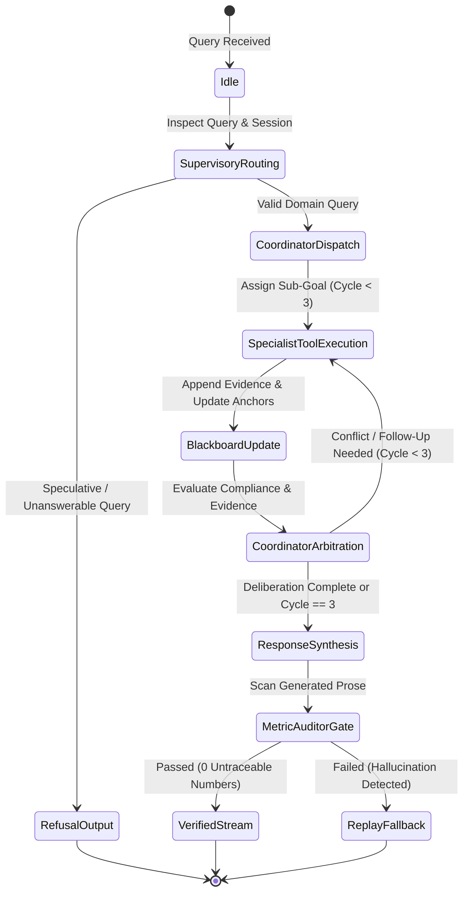

# Data Model: Conversational Analytics & Multi-Agent Reasoning Mesh (F06)

**Feature**: `007-conversational-analytics` | **Date**: 2026-10-07  
**Status**: Completed  
**References**: `specs/007-conversational-analytics/spec.md`, `specs/007-conversational-analytics/research.md`, `evals/models.py`.

---

## 1. Domain Entities & Schemas

### `RouteDecision`
Captures the output of the Supervisory Router before invoking specialist deliberation.
```python
from enum import StrEnum
from pydantic import BaseModel, Field

class SpecialistDomain(StrEnum):
    SYNTHESIS = "Synthesis"
    SENTINEL_AML = "SentinelAML"
    CHURN_RADAR = "ChurnRadar"
    PARTNER_FRAUD = "PartnerFraud"

class RouteDecision(BaseModel):
    route: SpecialistDomain
    confidence: float = Field(ge=0.0, le=1.0, description="Routing certainty score")
    rationale: str = Field(description="Explanation for selected specialist assignment")
    refusal_required: bool = Field(default=False, description="True if query lacks data or is speculative")
    refusal_reason: str | None = None
    extracted_entities: dict[str, str] = Field(default_factory=dict, description="Extracted account, partner, or metric keys")
```

### `EvidenceItem`
A single unit of factual truth retrieved from deterministic OMCP tools, recorded in the Evidence Ledger.
```python
class EvidenceItem(BaseModel):
    tool_name: str
    entity_id: str | None = None          # e.g., "CR84920", "P-102"
    metric_name: str                      # e.g., "net_deposit_volume_usd", "risk_score"
    value: float | str                    # e.g., 42500.0, "ANOMALOUS"
    unit: str | None = None               # e.g., "USD", "%", "count"
    as_of: str                            # ISO 8601 timestamp string
    definition_version: str               # e.g., "def_v1.0"
```

### `ConversationalTurn`
An atomic turn record within a session, tracking queries, evidence, citations, and execution telemetry.
```python
class ConversationalTurn(BaseModel):
    turn_index: int = Field(ge=1)
    user_query: str
    route_decision: RouteDecision
    executed_tools: list[str] = Field(default_factory=list)
    evidence_collected: list[EvidenceItem] = Field(default_factory=list)
    assistant_response: str
    citations: list[str] = Field(default_factory=list)
    auditor_passed: bool = True
    is_replay_fallback: bool = False
    turn_latency_ms: float = 0.0
    prompt_tokens: int = 0
    completion_tokens: int = 0
```

### `BlackboardState`
The centralized shared memory state manipulated by the Coordinator and domain specialists across deliberation cycles.
```python
class BlackboardState(BaseModel):
    session_id: str
    user_role: str = Field(default="Executive", description="RBAC caller identity")
    turns: list[ConversationalTurn] = Field(default_factory=list)
    entity_anchors: dict[str, str] = Field(default_factory=dict, description="Active entity context")
    evidence_ledger: list[EvidenceItem] = Field(default_factory=list)
    active_hypotheses: list[str] = Field(default_factory=list)
    reflection_cycle: int = Field(default=0, ge=0, le=3, description="Hard-capped at 3 cycles")
    compliance_hold: bool = Field(default=False, description="True if active AML/sanctions alert blocks commercial actions")
    pending_action_proposals: list[dict[str, Any]] = Field(default_factory=list)
```

---

## 2. API & Inter-Service Message Payloads

### `ConversationQueryRequest`
Payload submitted by the user interface or API gateway to initiate a turn.
```python
class ConversationQueryRequest(BaseModel):
    session_id: str | None = None         # None generates new session
    user_query: str
    user_role: str = "Executive"
    context_filters: dict[str, Any] = Field(default_factory=dict)
```

### `ConversationQueryResponse`
Audited response returned to the client, providing the text narrative, evidence ledger, citations, and telemetry.
```python
class ConversationQueryResponse(BaseModel):
    session_id: str
    turn_index: int
    route: SpecialistDomain
    response_markdown: str
    citations: list[str]
    evidence_ledger: list[EvidenceItem]
    staged_recommendation: dict[str, Any] | None = None
    is_replay_fallback: bool
    turn_latency_ms: float
    reflection_cycles_used: int
```

---

## 3. State Transitions & Deliberation Lifecycle


