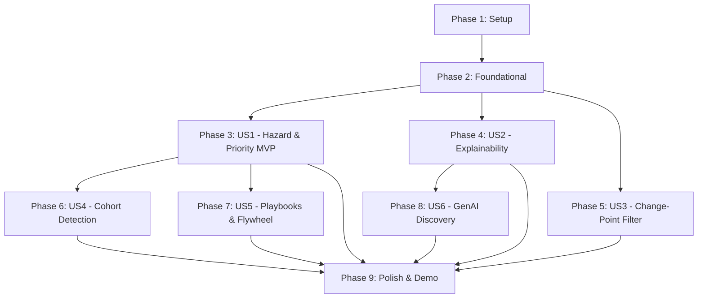

# Tasks: Partner Churn Radar (Module C / Slice S2)

**Input**: Design documents from `/specs/008-churn-radar/` (`spec.md`, `plan.md`, `research.md`, `data-model.md`, `contracts/`, `quickstart.md`)  
**Standard**: QuantumBlack Horizon Architecture × Palantir Foundry Kinetic Ontology × Google Cloud Reference Architecture  
**Authoritative References**: `initial_plan.md` §5.2, `docs/brief/churn` `[BRIEF churn]`, `docs/models_and_evals.md` §4

---

## Format: `- [ ] [ID] [P?] [Story?] Description with file path`

- **[P]**: Can run in parallel (different files, no dependencies on incomplete tasks)
- **[Story]**: User Story label (`[US1]`, `[US2]`, `[US3]`, `[US4]`, `[US5]`, `[US6]`)
- Exact file paths included in every task description

---

## Phase 1: Setup (Shared Infrastructure)

**Purpose**: Project initialization and basic structure

- [X] T001 Initialize package structure and exports in `FEIOS/src/eios/churn/__init__.py`
- [X] T002 [P] Implement Pydantic v2 domain schemas and data contracts in `FEIOS/src/eios/churn/models.py`
- [X] T003 [P] Initialize test suite structure and golden fixtures in `FEIOS/tests/churn/conftest.py`

---

## Phase 2: Foundational (Blocking Prerequisites)

**Purpose**: Core infrastructure and data model extensions that MUST be complete before ANY user story can be implemented

**⚠️ CRITICAL**: No user story work can begin until this phase is complete

- [X] T004 Extend `Partner` ontology object with dynamic Churn Radar kinetic properties in `FEIOS/src/eios/ontology/core/objects.py`
- [X] T005 [P] Create DuckDB DDL and table initialization for `churn_radar_scores`, `churn_cohort_alerts`, and `decision_outcomes_ledger` in `FEIOS/src/eios/ingestion/hot_state.py`
- [X] T006 [P] Implement baseline "no login > 14 days" rule scorer in `FEIOS/src/eios/churn/baseline.py`
- [X] T007 Implement feature extraction pipeline converting L1 Data Products (DP6-DP12) into person-period matrices in `FEIOS/src/eios/churn/features.py`

**Checkpoint**: Foundation ready - user story implementation can now begin in parallel

---

## Phase 3: User Story 1 - Value-at-Risk Operational Prioritization (Priority: P1) 🎯 MVP

**Goal**: Build discrete-time logistic hazard model via `lifelines` and calculate `priority_score = hazard_probability_30d * value_at_risk_usd`, ordering partners by revenue preservation in DuckDB hot state.

**Independent Test**: Query OMCP tool `get_partner_signals` across the partner universe; verify Workshop queue orders partners monotonically by `priority_score` with high/medium/low tier designations.

### Tests for User Story 1

> **NOTE: Write these tests FIRST, ensure they FAIL before implementation**

- [X] T008 [P] [US1] Create unit tests for person-period expansion and logistic hazard fitting in `FEIOS/tests/churn/test_hazard_model.py`
- [X] T009 [P] [US1] Create blocking eval-first test verifying hazard model beats baseline by $\ge 0.10$ PR-AUC on sealed seeds in `FEIOS/tests/churn/test_churn_radar_eval.py`

### Implementation for User Story 1

- [X] T010 [US1] Implement discrete-time hazard model training and inference engine using `lifelines` in `FEIOS/src/eios/churn/hazard_model.py`
- [X] T011 [US1] Implement deterministic priority scoring and risk tier categorization in `FEIOS/src/eios/ontology/functions/partner.py`
- [X] T012 [US1] Implement batch scoring coordinator persisting scores to DuckDB `churn_radar_scores` in `FEIOS/src/eios/churn/pipeline.py`
- [X] T013 [US1] Connect OMCP tool handler `get_partner_signals` in `FEIOS/src/eios/ontology/omcp/server.py` to DuckDB hot state

**Checkpoint**: At this point, User Story 1 (MVP) is fully functional and testable independently.

---

## Phase 4: User Story 2 - Explainable Risk Tiers & Root-Cause Attribution (Priority: P1)

**Goal**: Generate transparent feature contribution breakdowns citing canonical L1 Data Products, verified by the Metric Auditor Gate (0 hallucinations).

**Independent Test**: Retrieve a High-Risk partner profile via OMCP; verify that the output contains a deterministic feature contribution breakdown across the 5 signal families and an audited natural-language narrative.

### Tests for User Story 2

- [X] T014 [P] [US2] Create unit tests for feature contribution calculation and citation formatting in `FEIOS/tests/churn/test_explainability.py`
- [X] T015 [P] [US2] Create Metric Auditor Gate scan tests for churn explanation narratives in `FEIOS/tests/churn/test_metric_auditor_churn.py`

### Implementation for User Story 2

- [X] T016 [US2] Implement deterministic signal contribution attribution (`SignalContribution`) across the 5 signal families in `FEIOS/src/eios/churn/explainer.py`
- [X] T017 [US2] Implement audited plain-text explanation generator with deterministic replay fallback in `FEIOS/src/eios/churn/narrative.py`
- [X] T018 [US2] Wire explainability payload into OMCP `get_partner_signals` response matching `partner-signals-response.schema.json` in `FEIOS/src/eios/ontology/omcp/server.py`

**Checkpoint**: User Stories 1 AND 2 both work independently and integrate seamlessly.

---

## Phase 5: User Story 3 - Seasonality-Aware Anomaly Filtering (Zero False Alarms) (Priority: P1)

**Goal**: Implement market-calendar masked CUSUM and rolling MAD detector to distinguish temporary dips (`P-HARD-NEG-VACATION`) from genuine structural disengagement (`FPR <= 5%`).

**Independent Test**: Inject a synthetic 14-day holiday pause into `P-HARD-NEG-VACATION`; verify the change-point detector classifies this as a seasonal dip and suppresses alerts.

### Tests for User Story 3

- [X] T019 [P] [US3] Create unit tests for trading-day calendar masking and holiday suppression in `FEIOS/tests/churn/test_change_point.py`

### Implementation for User Story 3

- [X] T020 [US3] Implement Week-over-Week (WoW) normalized CUSUM and rolling MAD change-point detector in `FEIOS/src/eios/churn/change_point.py`
- [X] T021 [US3] Integrate change-point flags with hazard scoring in `FEIOS/src/eios/churn/hazard_model.py` to suppress false alarms for seasonal dips
- [X] T022 [US3] Add validation test verifying zero false positive alerts on `P-HARD-NEG-VACATION` in `FEIOS/tests/churn/test_change_point.py`

**Checkpoint**: User Stories 1, 2, and 3 are functional; seasonal holiday dips are verified to cause zero false alarms.

---

## Phase 6: User Story 4 - Systemic Regional & Cohort Risk Detection (Priority: P2)

**Goal**: Aggregate partner disengagements by region and tier, execute permutation tests, and emit `CohortAnomalyAlert` when synchronized drops occur.

**Independent Test**: Query OMCP function `get_high_risk_cohorts`; verify that planted 15-partner SEA cluster (`P-COHORT-SEA-CLUSTER`) triggers a single cohort alert with aggregated Value-at-Risk.

### Tests for User Story 4

- [X] T023 [P] [US4] Create unit tests for regional cluster permutation tests in `FEIOS/tests/churn/test_cohort_detector.py`

### Implementation for User Story 4

- [X] T024 [US4] Implement permutation and hypergeometric systemic risk detector in `FEIOS/src/eios/churn/cohort_detector.py`
- [X] T025 [US4] Implement OMCP tool handler `get_high_risk_cohorts` matching `cohort-alerts-response.schema.json` in `FEIOS/src/eios/ontology/omcp/server.py`
- [X] T026 [US4] Integrate cohort detection into batch pipeline writing to `churn_cohort_alerts` in `FEIOS/src/eios/churn/pipeline.py`

**Checkpoint**: Systemic cohort risk detection is active and testable via OMCP.

---

## Phase 7: User Story 5 - Governed Retention Playbooks & The Closed-Loop Flywheel (Priority: P2)

**Goal**: Implement `LaunchRetentionPlaybook` action intent generation with KMS ECDSA P-256 signatures, write to `Decision_Ledger`, and compute Doubly Robust AIPW ATE recalibration.

**Independent Test**: Propose action via OMCP `propose_action`, verify signed `ActionIntentToken`, execute against simulated sink, and run AIPW estimator to recover positive ATE.

### Tests for User Story 5

- [X] T027 [P] [US5] Create unit tests for `ActionIntentToken` creation, signature verification, and AIPW estimator in `FEIOS/tests/churn/test_flywheel_aipw.py`

### Implementation for User Story 5

- [X] T028 [US5] Register `LaunchRetentionPlaybook` canonical action spec and validation logic in `FEIOS/src/eios/ontology/actions/intent_hub.py`
- [X] T029 [US5] Implement Doubly Robust AIPW causal estimator over forward outcomes in `FEIOS/src/eios/churn/flywheel.py`
- [X] T030 [US5] Implement automated playbook weight recalibrator reading from DuckDB `decision_outcomes_ledger` in `FEIOS/src/eios/churn/flywheel.py`
- [X] T031 [US5] Implement interactive retention intent demo script in `FEIOS/scripts/test_retention_intent.py`

**Checkpoint**: Governed action proposals and the closed-loop AIPW flywheel are fully operational.

---

## Phase 8: User Story 6 - GenAI Emerging Pattern Discovery (Priority: P2)

**Goal**: Build `PatternDiscoverySpecialist` using Vertex AI Gemini 1.5 to cluster unstructured support tickets from `partner_comms` into structured `DisengagementTheme` hypotheses.

**Independent Test**: Execute the `PatternDiscoverySpecialist` over synthetic support ticket corpus; verify it clusters unresolved issues and articulates a structured, novel churn hypothesis.

### Tests for User Story 6

- [X] T032 [P] [US6] Create unit tests for unstructured ticket parsing, Pydantic egress validation, and replay fixture fallback in `FEIOS/tests/churn/test_pattern_discovery.py`

### Implementation for User Story 6

- [X] T033 [US6] Implement PII sanitization pre-processor for support ticket text in `FEIOS/src/eios/churn/sanitizer.py`
- [X] T034 [US6] Implement `PatternDiscoverySpecialist` agent with structured Pydantic egress in `FEIOS/src/eios/churn/pattern_discovery.py`
- [X] T035 [US6] Implement conversational `ChurnRadarSpecialist` integration with OMCP tools in `FEIOS/src/eios/conversation/specialists/churn.py`
- [X] T036 [US6] Create interactive GenAI pattern discovery demo CLI in `FEIOS/scripts/test_churn_pattern_discovery.py`

**Checkpoint**: GenAI pattern discovery and conversational agent mesh are fully integrated.

---

## Phase 9: Polish & Cross-Cutting Concerns

**Purpose**: End-to-end integration, demo CLI, golden fixture registration, and documentation

- [X] T037 [P] Implement end-to-end demo CLI script `FEIOS/scripts/run_churn_pipeline.py` exercising the 3 golden personas
- [X] T038 [P] Create Golden fixtures for sealed holdout evaluation in `FEIOS/evals/golden/churn_radar_golden.json`
- [X] T039 Execute and validate end-to-end `quickstart.md` scenarios (eval gate, demo pipeline, AIPW flywheel)
- [X] T040 Update module export index and documentation in `FEIOS/src/eios/churn/README.md`

---

## Dependencies & Execution Order

### Phase Dependencies

- **Setup (Phase 1)**: No dependencies - can start immediately.
- **Foundational (Phase 2)**: Depends on Phase 1 completion - BLOCKS all user stories.
- **User Stories (Phases 3-8)**:
  - **US1 (P1)**: Blocks downstream cohort detection and flywheel. MVP milestone.
  - **US2 (P1)**: Can run in parallel with US1 once Phase 2 is done.
  - **US3 (P1)**: Can run in parallel with US1 once Phase 2 is done.
  - **US4 (P2)**: Depends on US1 scoring outputs.
  - **US5 (P2)**: Depends on US1 scoring outputs.
  - **US6 (P2)**: Can run in parallel once Phase 2 is done.
- **Polish (Phase 9)**: Depends on all user story implementations.

### Parallel Opportunities

- **Setup & Foundation**: `T002`, `T003`, `T005`, `T006` can be executed concurrently.
- **TDD Test Suites**: All test tasks marked `[P]` (`T008`, `T009`, `T014`, `T015`, `T019`, `T023`, `T027`, `T032`) can be written in parallel before implementation.
- **Independent Modules**: `change_point.py` (US3), `explainer.py` (US2), and `sanitizer.py` (US6) have zero cross-file dependencies and can be authored in parallel.

---

## Implementation Strategy

### MVP First (User Story 1 Only)
1. Complete **Phase 1: Setup** (`T001` - `T003`).
2. Complete **Phase 2: Foundational** (`T004` - `T007`).
3. Complete **Phase 3: User Story 1** (`T008` - `T013`).
4. **STOP and VALIDATE**: Run `pytest tests/churn/test_churn_radar_eval.py` to confirm the hazard model beats the baseline.

### Incremental Delivery
1. Foundation + US1 $\to$ Core Value-at-Risk queue operational (MVP).
2. Add US2 $\to$ Transparent root-cause attribution and auditor pass.
3. Add US3 $\to$ Zero false alarms on seasonal holiday dips (`P-HARD-NEG-VACATION`).
4. Add US4 $\to$ Regional systemic cohort alerts (`P-COHORT-SEA-CLUSTER`).
5. Add US5 $\to$ Governed action proposals and Doubly Robust AIPW flywheel.
6. Add US6 $\to$ GenAI unstructured theme discovery.
7. Phase 9 Polish $\to$ Full live demo readiness.
