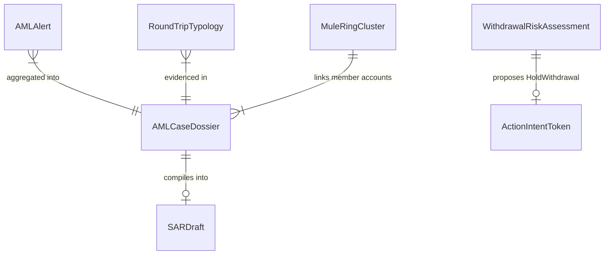

# Data Model & Schema Specifications: Client Fraud Sentinel / AML Transaction Monitoring (Module A / Slice S4)

**Feature**: `010-client-aml`  
**Created**: 2026-10-07  
**References**: `docs/brief/monitoring.md` `[BRIEF monitoring]`, `initial_plan.md` §5.4, `.specify/memory/constitution.md`

---

## 1. Core Domain Entities (Pydantic v2 Models)

```python
from datetime import datetime
from enum import Enum
from typing import Any
from pydantic import BaseModel, Field, ConfigDict


class AMLTriggerType(str, Enum):
    THRESHOLD_RULE = "THRESHOLD_RULE"
    ROUND_TRIP_SEQUENCE = "ROUND_TRIP_SEQUENCE"
    MULE_RING_CLUSTER = "MULE_RING_CLUSTER"
    COHORT_DEVIATION = "COHORT_DEVIATION"
    SUPERVISED_TRIAGE = "SUPERVISED_TRIAGE"


class AMLPriorityTier(str, Enum):
    CRITICAL = "CRITICAL"  # Top 50 prioritized case
    HIGH = "HIGH"
    MEDIUM = "MEDIUM"
    LOW = "LOW"


class AMLTypology(str, Enum):
    STRUCTURING = "STRUCTURING"
    MICRO_PNL_WASH = "MICRO_PNL_WASH"
    MULE_SYNDICATE = "MULE_SYNDICATE"
    RAPID_MOVEMENT = "RAPID_MOVEMENT"
    NONE = "NONE"


class WithdrawalDisposition(str, Enum):
    ALLOW = "ALLOW"
    PROPOSE_HOLD = "PROPOSE_HOLD"
    PROPOSE_FREEZE = "PROPOSE_FREEZE"


class AMLAlert(BaseModel):
    model_config = ConfigDict(strict=True, frozen=True)

    alert_id: str
    client_id: str
    trigger_type: AMLTriggerType
    risk_score: float = Field(ge=0.0, le=1.0)
    priority_tier: AMLPriorityTier
    typology: AMLTypology
    amount_usd: float = Field(ge=0.0)
    triggered_at: datetime
    is_triage_top50: bool = False
    attributes: dict[str, Any] = Field(default_factory=dict)


class RoundTripTypology(BaseModel):
    model_config = ConfigDict(strict=True, frozen=True)

    event_id: str
    client_id: str
    deposit_txn_id: str
    withdrawal_txn_id: str
    deposit_amount_usd: float = Field(ge=0.0)
    withdrawal_amount_usd: float = Field(ge=0.0)
    trade_count: int = Field(ge=0)
    net_pl_usd: float
    market_risk_pct: float = Field(ge=0.0)
    holding_duration_seconds: float = Field(ge=0.0)
    hours_since_kyc: float = Field(ge=0.0)
    typology_risk_score: float = Field(ge=0.0, le=1.0)


class MuleRingCluster(BaseModel):
    model_config = ConfigDict(strict=True, frozen=True)

    cluster_id: str
    member_client_ids: list[str]
    shared_payment_tokens: list[str]
    shared_device_tokens: list[str]
    shared_ip_tokens: list[str]
    suppressed_hub_tokens: list[str]
    cluster_size: int = Field(ge=1)
    total_volume_usd: float = Field(ge=0.0)
    is_syndicate: bool
    plain_language_explanation: str


class WithdrawalRiskAssessment(BaseModel):
    model_config = ConfigDict(strict=True, frozen=True)

    assessment_id: str
    withdrawal_id: str
    client_id: str
    amount_usd: float = Field(ge=0.0)
    risk_score: float = Field(ge=0.0, le=1.0)
    recommendation: WithdrawalDisposition
    decision_latency_ms: float = Field(ge=0.0)
    intent_id: str | None = None
    evaluated_at: datetime


class SARDraft(BaseModel):
    model_config = ConfigDict(strict=True, frozen=True)

    sar_id: str
    case_id: str
    client_id: str
    jurisdiction: str
    filing_type: str
    subject_info: dict[str, Any]
    suspicious_activity_summary: str
    chronological_transactions: list[dict[str, Any]]
    narrative_basis: str
    statutory_provisions: list[str]
    evidence_citations: list[str]
    created_at: datetime
    is_replay_fallback: bool = False


class AMLCaseDossier(BaseModel):
    model_config = ConfigDict(strict=True, frozen=True)

    case_id: str
    client_id: str
    as_of: datetime
    kyc_tier: str
    kyc_approved_at: datetime | None
    total_deposit_usd: float = Field(ge=0.0)
    total_withdrawal_usd: float = Field(ge=0.0)
    net_trading_pl_usd: float
    deposit_withdrawal_ratio: float = Field(ge=0.0)
    roundtrip_events: list[RoundTripTypology]
    mule_ring_id: str | None
    mule_ring_size: int = 0
    composite_risk_score: float = Field(ge=0.0, le=1.0)
    priority_tier: AMLPriorityTier
    recommended_action: str
    citations: list[str]
    statutory_references: list[str]
    narrative_summary: str
    sar_draft: SARDraft | None = None
```

---

## 2. In-Process DuckDB Hot State Schemas (`HotStateEngine`)

```sql
-- Hot State Table: AML Alert Scoring & Queue Triage
CREATE TABLE IF NOT EXISTS aml_alert_scores (
    alert_id VARCHAR PRIMARY KEY,
    client_id VARCHAR NOT NULL,
    trigger_type VARCHAR NOT NULL,
    risk_score DOUBLE NOT NULL,
    priority_tier VARCHAR NOT NULL,
    typology VARCHAR NOT NULL,
    amount_usd DOUBLE NOT NULL,
    is_triage_top50 BOOLEAN NOT NULL DEFAULT FALSE,
    triggered_at TIMESTAMP NOT NULL
);

-- Hot State Table: Round-Trip Structuring & Wash Laundering Events
CREATE TABLE IF NOT EXISTS aml_roundtrip_events (
    event_id VARCHAR PRIMARY KEY,
    client_id VARCHAR NOT NULL,
    deposit_txn_id VARCHAR NOT NULL,
    withdrawal_txn_id VARCHAR NOT NULL,
    deposit_amount_usd DOUBLE NOT NULL,
    withdrawal_amount_usd DOUBLE NOT NULL,
    trade_count INTEGER NOT NULL,
    net_pl_usd DOUBLE NOT NULL,
    market_risk_pct DOUBLE NOT NULL,
    holding_duration_seconds DOUBLE NOT NULL,
    hours_since_kyc DOUBLE NOT NULL,
    typology_risk_score DOUBLE NOT NULL,
    detected_at TIMESTAMP NOT NULL
);

-- Hot State Table: Coordinated Mule & Smurfing Rings
CREATE TABLE IF NOT EXISTS aml_mule_rings (
    cluster_id VARCHAR PRIMARY KEY,
    client_id VARCHAR NOT NULL,
    cluster_size INTEGER NOT NULL,
    shared_payment_count INTEGER NOT NULL,
    shared_device_count INTEGER NOT NULL,
    total_volume_usd DOUBLE NOT NULL,
    is_syndicate BOOLEAN NOT NULL,
    explanation VARCHAR NOT NULL,
    updated_at TIMESTAMP NOT NULL
);

-- Hot State Table: Real-Time Pre-Withdrawal Assessments
CREATE TABLE IF NOT EXISTS aml_withdrawal_assessments (
    assessment_id VARCHAR PRIMARY KEY,
    withdrawal_id VARCHAR NOT NULL,
    client_id VARCHAR NOT NULL,
    amount_usd DOUBLE NOT NULL,
    risk_score DOUBLE NOT NULL,
    recommendation VARCHAR NOT NULL,
    decision_latency_ms DOUBLE NOT NULL,
    intent_id VARCHAR,
    evaluated_at TIMESTAMP NOT NULL
);

-- Hot State Table: AML Case Dossiers
CREATE TABLE IF NOT EXISTS aml_case_dossiers (
    case_id VARCHAR PRIMARY KEY,
    client_id VARCHAR NOT NULL,
    composite_risk_score DOUBLE NOT NULL,
    priority_tier VARCHAR NOT NULL,
    recommended_action VARCHAR NOT NULL,
    total_deposit_usd DOUBLE NOT NULL,
    total_withdrawal_usd DOUBLE NOT NULL,
    roundtrip_count INTEGER NOT NULL,
    mule_ring_id VARCHAR,
    narrative_summary VARCHAR NOT NULL,
    created_at TIMESTAMP NOT NULL
);
```

---

## 3. Entity Relationships


