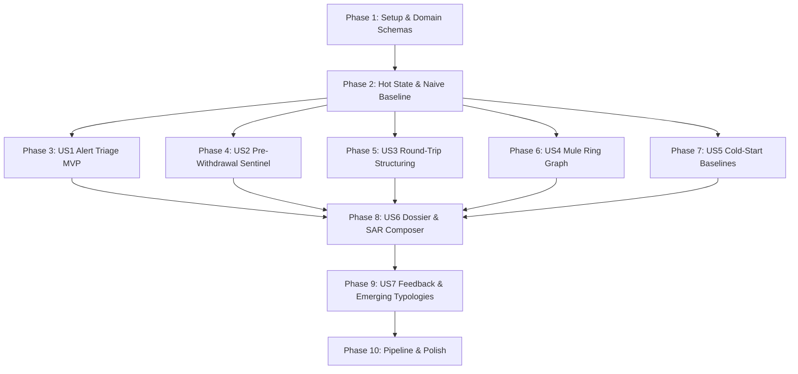

# Tasks: Client Fraud Sentinel / AML Transaction Monitoring (Module A / Slice S4)

**Input**: Design documents from `/specs/010-client-aml/` (`spec.md`, `plan.md`, `research.md`, `data-model.md`, `contracts/`, `quickstart.md`)  
**Authoritative References**: `docs/brief/monitoring.md` `[BRIEF monitoring]`, `initial_plan.md` §5.4, `docs/models_and_evals.md` §2, `.specify/memory/constitution.md`  
**Prerequisites**: Virtualenv active (`FEIOS/.venv/bin/python`), DuckDB hot-state engine, registered OMCP tools.  

## Format: `[ID] [P?] [Story] Description`

- **[P]**: Can run in parallel (different files, no dependencies on incomplete tasks)
- **[Story]**: User story label (`[US1]` through `[US7]`), omitted for Setup, Foundational, and Polish phases
- All tasks specify exact file paths in descriptions

---

## Phase 1: Setup (Shared Infrastructure & Domain Schemas)

**Purpose**: Package initialization, domain models, and synthetic test fixtures

- [x] T001 Initialize client AML package structure in FEIOS/src/eios/aml/__init__.py
- [x] T002 [P] Create Pydantic v2 domain schemas (AMLAlert, RoundTripTypology, MuleRingCluster, WithdrawalRiskAssessment, SARDraft, AMLCaseDossier) in FEIOS/src/eios/aml/models.py
- [x] T003 [P] Configure synthetic AML transaction generators and test fixtures (2,000 alert queue, round-trip micro-P&L events, mule network clusters, public Wi-Fi hubs, legitimate high-volume traders) in FEIOS/tests/aml/conftest.py

---

## Phase 2: Foundational (Blocking Prerequisites)

**Purpose**: Core hot-state storage, naive baseline, blocking eval gate, and statutory legal normalization  
**⚠️ CRITICAL**: Must complete before user story implementation begins

- [x] T004 Setup DuckDB analytical DDL schemas (aml_alert_scores, aml_roundtrip_events, aml_mule_rings, aml_withdrawal_assessments, aml_case_dossiers) in FEIOS/src/eios/ingestion/hot_state.py
- [x] T005 [P] Implement pre-registered naive threshold rule baseline detector (deposit > $10,000, 24h withdrawal velocity > 3, deposit-withdrawal gap < 60m) in FEIOS/src/eios/aml/baseline.py
- [x] T006 [P] Implement blocking eval-first test asserting supervised alert triage scorer beats naive baseline by >= 0.15 PR-AUC on sealed holdouts with >= 30% relative FPR reduction on hard negatives in FEIOS/tests/aml/test_aml_eval.py
- [x] T007 [P] Implement statutory citation normalizer regex mapping legal codes (31 CFR 1010, 31 U.S.C. 5318(g), Section 314(b)) to exempt statutory tokens in FEIOS/src/eios/aml/statutory_normalizer.py

**Checkpoint**: Foundation ready - hot state initialized, naive baseline established, blocking eval gate active, statutory normalizer configured.

---

## Phase 3: User Story 1 - High-Volume Alert Triage & False Positive Reduction (Priority: P1) 🎯 MVP

**Goal**: Compress ~2,000 weekly raw rule alerts into <= 50 high-confidence investigation cases, retaining >= 90% of planted true positive laundering events while reducing analyst false-alarm fatigue  
**Independent Test**: Run `pytest FEIOS/tests/aml/test_triage_scorer.py`; verify scorer filters 2,000 alerts down to top-50 with >= 90% true positive retention and bounds FPR on legitimate high-volume traders.

### Tests for User Story 1 (Eval-First) ⚠️
- [x] T008 [P] [US1] Write unit and evaluation tests for supervised alert triage scorer, queue compression (2,000 -> <= 50), precision@50, and FPR reduction in FEIOS/tests/aml/test_triage_scorer.py

### Implementation for User Story 1
- [x] T009 [US1] Implement alert feature extraction pipeline (peer z-scores, KYC recency delta, deposit-withdrawal ratios, alert history, network centrality) in FEIOS/src/eios/aml/triage_scorer.py
- [x] T010 [US1] Implement supervised calibrated classification model with analyst label history training and feature attribution in FEIOS/src/eios/aml/triage_scorer.py
- [x] T011 [US1] Implement top-k queue ranking and executive worklist compression (<= 50 cases) in FEIOS/src/eios/aml/triage_scorer.py
- [x] T012 [US1] Implement DuckDB hot-state batch persistence for scored alerts in FEIOS/src/eios/aml/triage_scorer.py

**Checkpoint**: User Story 1 (MVP) fully functional, testable independently, and achieving 2,000 -> <= 50 queue compression.

---

## Phase 4: User Story 2 - Real-Time Pre-Withdrawal Fraud Intervention (Priority: P1)

**Goal**: Evaluate withdrawal requests in real time (< 2.0s p95 latency) and emit Cloud KMS ECDSA P-256 signed Action Intent proposals (HoldWithdrawal, FreezeAccount) placed in PENDING status for human sign-off  
**Independent Test**: Run `pytest FEIOS/tests/aml/test_withdrawal_sentinel.py` and `pytest FEIOS/tests/aml/test_withdrawal_contract.py`; verify risk evaluation completes in < 2.0s, proposes HoldWithdrawal on acute risks, and strictly enforces human sign-off.

### Tests for User Story 2 (Eval-First) ⚠️
- [x] T013 [P] [US2] Write unit and latency benchmark tests for real-time pre-withdrawal risk scoring, KMS ECDSA P-256 token signing, and human governance in FEIOS/tests/aml/test_withdrawal_sentinel.py
- [x] T014 [P] [US2] Write contract validation test for withdrawal-risk-assessment.schema.json in FEIOS/tests/aml/test_withdrawal_contract.py

### Implementation for User Story 2
- [x] T015 [US2] Implement sub-2.0s Pre-Withdrawal Sentinel engine querying hot-state event history and assessing transaction risk in FEIOS/src/eios/aml/withdrawal_sentinel.py
- [x] T016 [US2] Implement Cloud KMS ECDSA P-256 signed Action Intent proposal emitter for HoldWithdrawal and FreezeAccount in FEIOS/src/eios/aml/withdrawal_sentinel.py
- [x] T017 [US2] Register HoldWithdrawal and FreezeAccount action specifications with human approval enforcement in FEIOS/src/eios/ontology/actions/intent_hub.py
- [x] T018 [US2] Implement hot-state persistence for withdrawal risk assessments in FEIOS/src/eios/aml/withdrawal_sentinel.py

**Checkpoint**: User Story 2 fully functional; real-time pre-withdrawal protection active with zero autonomous write-back.

---

## Phase 5: User Story 3 - Rapid Round-Trip Structuring & Micro-P&L Laundering Detection (Priority: P1)

**Goal**: Detect the "$500 deposit -> 10 min trading with $0.01 profit -> withdraw" structuring pattern within 72 hours of KYC approval, identifying near-zero market exposure  
**Independent Test**: Run `pytest FEIOS/tests/aml/test_roundtrip_detector.py` and `pytest FEIOS/tests/aml/test_roundtrip_contract.py`; verify sequence matcher flags planted micro-P&L round-trips with score >= 0.85 without penalizing genuine scalpers.

### Tests for User Story 3 (Eval-First) ⚠️
- [x] T019 [P] [US3] Write unit and sequence matching tests for rapid round-trip structuring, micro-P&L calculation, and 72h KYC recency in FEIOS/tests/aml/test_roundtrip_detector.py
- [x] T020 [P] [US3] Write contract validation test for roundtrip-structuring-alerts.schema.json in FEIOS/tests/aml/test_roundtrip_contract.py

### Implementation for User Story 3
- [x] T021 [US3] Implement temporal sequence correlation matching deposit -> trades -> withdrawal within 72-hour sliding windows in FEIOS/src/eios/aml/roundtrip_detector.py
- [x] T022 [US3] Implement market risk ratio calculation (|sum P&L| / deposited_amount <= 0.02) and trade holding duration velocity filter in FEIOS/src/eios/aml/roundtrip_detector.py
- [x] T023 [US3] Implement 72h KYC approval recency weighting boost and scalper variance discriminator in FEIOS/src/eios/aml/roundtrip_detector.py
- [x] T024 [US3] Implement hot-state batch persistence for detected round-trip structuring events in FEIOS/src/eios/aml/roundtrip_detector.py

**Checkpoint**: User Story 3 fully functional; micro-P&L round-trip money laundering schemes reliably identified.

---

## Phase 6: User Story 4 - Smurfing & Mule Network Graph Clustering with Hub Suppression (Priority: P2)

**Goal**: Construct bipartite entity graphs across shared payment credentials, devices, and IPs, applying degree-penalized hub suppression to isolate mule rings while preventing public Wi-Fi false-merges  
**Independent Test**: Run `pytest FEIOS/tests/aml/test_mule_ring_detector.py` and `pytest FEIOS/tests/aml/test_mule_contract.py`; verify >= 90% node recall on planted mule rings with < 5% false-merge rate on public Wi-Fi hubs.

### Tests for User Story 4 (Eval-First) ⚠️
- [x] T025 [P] [US4] Write unit and graph clustering tests for bipartite projection, Adamic-Adar edge weighting, hub suppression, and plain-language explanations in FEIOS/tests/aml/test_mule_ring_detector.py
- [x] T026 [P] [US4] Write contract validation test for mule-ring-cluster.schema.json in FEIOS/tests/aml/test_mule_contract.py

### Implementation for User Story 4
- [x] T027 [US4] Implement bipartite entity-attribute graph builder connecting client accounts to payment methods, devices, and IPs in FEIOS/src/eios/aml/mule_ring_detector.py
- [x] T028 [US4] Implement degree-penalized hub suppression dropping high-degree attribute nodes (> 99th percentile or is_shared_context=True) in FEIOS/src/eios/aml/mule_ring_detector.py
- [x] T029 [US4] Implement Adamic-Adar weighted projection and connected component clustering to isolate coordinated mule syndicates in FEIOS/src/eios/aml/mule_ring_detector.py
- [x] T030 [US4] Implement non-technical, plain-language network relationship explainer for compliance officers in FEIOS/src/eios/aml/mule_ring_detector.py

**Checkpoint**: User Story 4 operational; coordinated mule rings surfaced with explainable network topologies.

---

## Phase 7: User Story 5 - Cold-Start Peer-Cohort Baselines vs. Mature Account Anomaly Detection (Priority: P2)

**Goal**: Solve the cold-start problem by benchmarking new accounts (< 5 transactions) against peer cohorts, transitioning to personalized robust Z-scores as account history matures  
**Independent Test**: Run `pytest FEIOS/tests/aml/test_peer_baseline.py`; verify new signups are benchmarked against statistical cohort distributions while mature accounts evaluate against personal MAD baselines without false alarms on large routine deposits.

### Tests for User Story 5 (Eval-First) ⚠️
- [x] T031 [P] [US5] Write unit tests for cohort segment aggregation, cold-start robust MAD deviations, and transitional exponential weighting in FEIOS/tests/aml/test_peer_baseline.py

### Implementation for User Story 5
- [x] T032 [US5] Implement peer cohort baseline aggregator segmented by (country_tier, account_type, registration_channel) in FEIOS/src/eios/aml/peer_baseline.py
- [x] T033 [US5] Implement robust median and Median Absolute Deviation (MAD) dispersion scoring for cold-start accounts in FEIOS/src/eios/aml/peer_baseline.py
- [x] T034 [US5] Implement personalized rolling transaction baseline calculator and smooth exponential transition handler (alpha = min(1.0, txn_count / 20)) in FEIOS/src/eios/aml/peer_baseline.py

**Checkpoint**: User Story 5 operational; cold-start anomaly scoring normalized across customer lifecycles.

---

## Phase 8: User Story 6 - Automated Investigation Dossier & Regulator-Ready SAR Drafting (Priority: P2)

**Goal**: Compile 5+ source systems into a unified case dossier in < 2.5s and generate regulator-ready SAR narrative drafts with 100% cited metrics, passing the Metric Auditor Gate  
**Independent Test**: Run `pytest FEIOS/tests/aml/test_sar_composer.py`, `pytest FEIOS/tests/aml/test_dossier_contract.py`, and `pytest FEIOS/tests/aml/test_sar_contract.py`; verify dossier compilation in < 2.5s, complete citation coverage, and successful auditor verification of statutory codes.

### Tests for User Story 6 (Eval-First) ⚠️
- [x] T035 [P] [US6] Write integration tests for multi-source dossier assembly, SAR narrative compilation, Metric Auditor Gate compliance, and replay fallback in FEIOS/tests/aml/test_sar_composer.py
- [x] T036 [P] [US6] Write contract validation test for aml-case-dossier.schema.json in FEIOS/tests/aml/test_dossier_contract.py
- [x] T037 [P] [US6] Write contract validation test for sar-draft.schema.json in FEIOS/tests/aml/test_sar_contract.py

### Implementation for User Story 6
- [x] T038 [US6] Implement multi-source AML evidence collation engine assembling KYC, transactions, trades, network rings, and alerts in < 2.5s in FEIOS/src/eios/aml/dossier.py
- [x] T039 [US6] Implement regulator-ready SAR narrative composer formatting Suspect Info, Suspicious Activity Summary, Chronological Table, and Suspicion Basis in FEIOS/src/eios/aml/sar_composer.py
- [x] T040 [US6] Integrate statutory citation normalizer ensuring legal citations (31 CFR 1010, 31 U.S.C. 5318(g)) are white-listed and pass the Metric Auditor Gate in FEIOS/src/eios/aml/sar_composer.py
- [x] T041 [US6] Implement 6 canonical OMCP tool handlers (get_client_aml_dossier, get_mule_ring_graph, get_roundtrip_structuring_alerts, check_withdrawal_risk, generate_sar_draft, propose_aml_action) in FEIOS/src/eios/ontology/omcp/server.py
- [x] T042 [US6] Upgrade SentinelAMLSpecialist in FEIOS/src/eios/conversation/specialists/aml.py with OMCP grounding, non-technical network explanations, and deterministic replay fallback [REPLAY]

**Checkpoint**: User Story 6 operational; regulator-ready SAR drafts auto-generated with verified citations and OMCP specialist integration.

---

## Phase 9: User Story 7 - Analyst Decision Feedback Loop & Novel Typology Mining (Priority: P3)

**Goal**: Ingest analyst case dispositions (Confirmed SAR vs. Dismissed False Alarm) to recalibrate triage thresholds and run unsupervised novelty mining on residual unexplained transactions  
**Independent Test**: Run `pytest FEIOS/tests/aml/test_feedback_and_emerging.py`; verify batch recalibration uplift and detection of sealed holdout unplanted typologies in top-5 novelty report.

### Tests for User Story 7 (Eval-First) ⚠️
- [x] T043 [P] [US7] Write unit tests for analyst disposition ingestion, threshold recalibration uplift, and unsupervised novelty clustering on residual transactions in FEIOS/tests/aml/test_feedback_and_emerging.py

### Implementation for User Story 7
- [x] T044 [US7] Implement AnalystFeedbackLoop ingesting compliance dispositions and updating training label weights in FEIOS/src/eios/aml/feedback_loop.py
- [x] T045 [US7] Implement EmergingTypologyMiner executing unsupervised anomaly clustering on unexplained residual transactions to surface zero-day schemes in FEIOS/src/eios/aml/emerging_typologies.py

**Checkpoint**: User Story 7 operational; adaptive analyst feedback and unsupervised emerging typology discovery active.

---

## Phase 10: Polish & Cross-Cutting Concerns

**Purpose**: Pipeline coordinator, CLI runner scripts, and comprehensive regression verification

- [x] T046 [P] Implement end-to-end batch surveillance coordinator in FEIOS/src/eios/aml/pipeline.py
- [x] T047 [P] Create runnable batch surveillance CLI script in FEIOS/scripts/run_client_aml_pipeline.py
- [x] T048 [P] Create withdrawal testing script in FEIOS/scripts/test_withdrawal_sentinel.py
- [x] T049 Verify full regression test suite across FEIOS (ensuring >= 2,105 tests passing without regression)
- [x] T050 Verify provenance labels, documentation integrity, and clean checklist sign-off in specs/010-client-aml/

---

## Dependencies & Execution Graph

---

## Parallel Execution Opportunities

- **Phase 1**: T002 (Models) and T003 (Conftest Fixtures) can run concurrently.
- **Phase 2**: T005 (Naive Baseline), T006 (Eval Test), and T007 (Statutory Normalizer) can run concurrently after T004 (DDL).
- **Phases 3, 4, 5, 6, 7**: Once Phase 2 is complete, test tasks T008, T013, T014, T019, T020, T025, T026, T031 can all be written concurrently across user stories.
- **Phase 10**: Scripts T047 and T048 can be developed in parallel before final regression verification T049.

---

## Implementation Strategy & MVP Scope

1. **MVP (Minimal Viable Product)**: Deliver Phases 1, 2, and 3 (Tasks T001–T012). This achieves the single highest-value operational objective from `docs/brief/monitoring.md`: compressing 2,000 weekly alerts down to $\le 50$ high-confidence cases while beating the naive baseline by $\ge 0.15$ PR-AUC on sealed seeds.
2. **Incremental Delivery**:
   - Increment 2 (P1): User Story 2 (Pre-Withdrawal Sentinel) & User Story 3 (Round-Trip Structuring).
   - Increment 3 (P2): User Story 4 (Mule Ring Graph), User Story 5 (Cold-Start Baselines), and User Story 6 (Dossier & SAR Drafting + OMCP).
   - Increment 4 (P3): User Story 7 (Feedback Loop & Emerging Typologies) and Polish.
