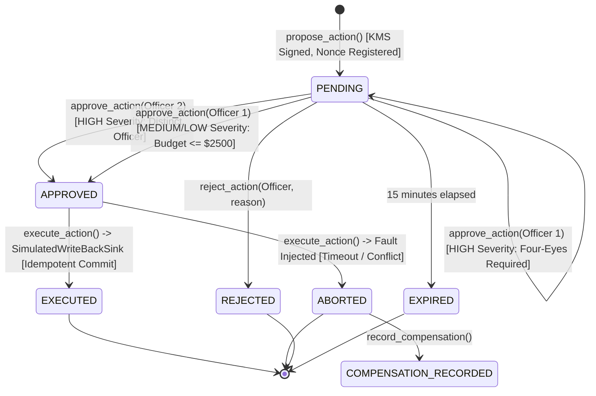

# Data Model: Governed Actions & Decision Ledger (F10 / Slice S5)

**Feature**: `011-governed-actions-ledger`  
**Date**: 2026-10-08  
**Status**: Completed  
**Authoritative References**: `initial_plan.md` §6.1, §6.2, `docs/brief/monitoring.md`, `docs/brief/fraud.md`, `.specify/memory/constitution.md` (Principles I, II, IV, VI, VII, VIII)

---

## 1. Domain Entities & Schemas

### 1.1 ActionIntentToken
Represents a non-autonomous mutation proposal emitted by an AI agent, signed with Cloud KMS ECDSA P-256 and subject to human-in-the-loop governance.

```python
class ActionSeverity(StrEnum):
    LOW = "LOW"
    MEDIUM = "MEDIUM"
    HIGH = "HIGH"

class ActionStatus(StrEnum):
    PENDING = "PENDING"
    APPROVED = "APPROVED"
    REJECTED = "REJECTED"
    EXECUTED = "EXECUTED"
    ABORTED = "ABORTED"
    EXPIRED = "EXPIRED"

class ActionIntentToken(BaseModel):
    intent_id: str = Field(description="Unique UUIDv4 identifying the action proposal")
    action_type: str = Field(description="Canonical action type from CANONICAL_ACTION_SPECS")
    parameters: dict[str, Any] = Field(description="Validated parameters matching action specification")
    evidence_refs: list[str] = Field(description="IDs of alerts, cases, or dossiers providing evidentiary proof")
    severity: ActionSeverity = Field(description="Risk severity level (LOW, MEDIUM, HIGH)")
    status: ActionStatus = Field(default=ActionStatus.PENDING, description="Current lifecycle state")
    nonce: str = Field(description="128-bit cryptographic single-use hex string")
    issued_at: datetime = Field(description="UTC timestamp of token issuance")
    expires_at: datetime = Field(description="UTC timestamp of token expiration (issued_at + 15 min)")
    requester_agent_id: str = Field(default="DomainAgent", description="Agent proposing the action")
    kms_key_id: str = Field(description="Cloud KMS Key resource ID used for asymmetric signing")
    signature: str = Field(description="Base64-encoded ASN.1 DER ECDSA P-256 signature")
    approvals: list[ApprovalRecord] = Field(default_factory=list, description="List of recorded human sign-offs")
    propensity_score: float | None = Field(default=1.0, ge=0.0, le=1.0, description="Estimated propensity score e(X)")
    causal_context: dict[str, Any] = Field(default_factory=dict, description="Contextual feature vector at proposal time")
    requires_dual_approval: bool = Field(default=True, description="Whether Four-Eyes authorization is mandatory")
    policy_tags: list[str] = Field(default_factory=list, description="Policy classification tags")
    ledger_seq: int | None = Field(default=None, description="Sequence number in atomic ledger once recorded")
    execution_receipt_id: str | None = Field(default=None, description="Linked receipt ID upon commit")
```

### 1.2 ApprovalRecord
Captures an authenticated human sign-off on an action intent.

```python
class ApprovalRecord(BaseModel):
    approver_id: str = Field(description="Authenticated officer identity (from IdP claims)")
    approver_role: str = Field(description="Authorized role (e.g. MLRO, COMPLIANCE_HEAD, PARTNER_LEAD)")
    approved_at: datetime = Field(default_factory=lambda: datetime.now(UTC), description="Approval timestamp")
    comment: str = Field(default="", description="Qualitative justification for review decision")
    override_applied: bool = Field(default=False, description="Whether the approver modified budget/parameters")
    override_reason: str | None = Field(default=None, description="Mandatory documented reason if override applied")
```

### 1.3 LedgerEntry
The core immutable audit log record maintained by the upstream sequencer with cryptographic hash chaining.

```python
class LedgerEventType(StrEnum):
    PROPOSAL_CREATED = "PROPOSAL_CREATED"
    APPROVAL_RECORDED = "APPROVAL_RECORDED"
    ACTION_EXECUTED = "ACTION_EXECUTED"
    ACTION_ABORTED = "ACTION_ABORTED"
    ACTION_REJECTED = "ACTION_REJECTED"
    COMPENSATION_RECORDED = "COMPENSATION_RECORDED"

class LedgerEntry(BaseModel):
    ledger_seq: int = Field(ge=1, description="Strictly monotonic, 1-indexed integer sequence number")
    prev_hash: str = Field(description="SHA-256 hex digest of entry (ledger_seq - 1), or genesis anchor")
    current_hash: str = Field(description="SHA-256 hex digest of prev_hash || ledger_seq || payload_digest")
    event_type: LedgerEventType = Field(description="Category of lifecycle event")
    entity_id: str = Field(description="Identifier of primary entity (e.g. intent_id, receipt_id)")
    payload_digest: str = Field(description="SHA-256 hex digest of RFC 8785 canonical JSON payload")
    payload: dict[str, Any] = Field(description="Canonical event payload content")
    recorded_at: datetime = Field(default_factory=lambda: datetime.now(UTC), description="Commit timestamp")
    worm_checkpoint_seq: int | None = Field(default=None, description="Referenced WORM checkpoint sequence, if locked")
```

### 1.4 ExecutionReceipt
Emitted by the simulated write-back sink upon committing an approved operational action.

```python
class ExecutionStatus(StrEnum):
    COMMITTED = "COMMITTED"
    REJECTED = "REJECTED"
    ABORTED = "ABORTED"

class ExecutionReceipt(BaseModel):
    receipt_id: str = Field(description="UUID identifying the execution receipt")
    intent_id: str = Field(description="Referenced ActionIntentToken intent_id")
    idempotency_key: str = Field(description="Unique idempotency deduplication key")
    external_transaction_id: str = Field(description="Simulated core banking / payment reference ID")
    action_type: str = Field(description="Action executed")
    status: ExecutionStatus = Field(description="Final commit state")
    simulated_latency_ms: float = Field(description="Simulated execution latency in milliseconds")
    executed_at: datetime = Field(default_factory=lambda: datetime.now(UTC), description="Execution timestamp")
    side_effects: dict[str, Any] = Field(default_factory=dict, description="Simulated system mutations")
    compensation_intent_id: str | None = Field(default=None, description="Linked compensation intent if aborted")
```

### 1.5 WORMAnchorCheckpoint
Represents a periodic snapshot locked into simulated immutable WORM storage.

```python
class WORMAnchorCheckpoint(BaseModel):
    checkpoint_seq: int = Field(ge=1, description="Strictly monotonic WORM checkpoint number")
    chain_head_seq: int = Field(ge=1, description="Highest ledger_seq locked at checkpoint creation")
    chain_head_hash: str = Field(description="SHA-256 hash digest of the chain head at checkpoint time")
    locked_at: datetime = Field(default_factory=lambda: datetime.now(UTC), description="Lock creation timestamp")
    retention_until: datetime = Field(description="Immutable retention expiration timestamp (7 years)")
    compliance_mode: bool = Field(default=True, description="Strict compliance mode lock flag")
    lock_signature: str = Field(description="KMS signature verifying WORM anchor authenticity")
```

### 1.6 DecisionOutcomeRecord
Captures proposal-time propensity scores, causal features, manager override flags, and forward multi-horizon actuals for Doubly Robust AIPW counterfactual tracking.

```python
class DecisionOutcomeRecord(BaseModel):
    outcome_id: str = Field(description="Unique UUID identifying the outcome record")
    intent_id: str = Field(description="Referenced ActionIntentToken intent_id")
    entity_id: str = Field(description="Target client_id or partner_id")
    action_type: str = Field(description="Action proposed / executed")
    treatment_assigned: int = Field(ge=0, le=1, description="1 if executed, 0 if rejected or aborted")
    propensity_score: float = Field(ge=0.0, le=1.0, description="Estimated propensity score e(X) at proposal")
    causal_features: dict[str, float] = Field(description="Covariate vector X at decision time")
    manager_override_flag: bool = Field(default=False, description="True if human altered agent recommendation")
    override_reason: str | None = Field(default=None, description="Documented reason for human override")
    observed_retained_revenue_30d: float | None = Field(default=None, description="Retained revenue at 30 days")
    observed_retained_revenue_60d: float | None = Field(default=None, description="Retained revenue at 60 days")
    actual_churn_60d: bool | None = Field(default=None, description="Whether entity churned at 60 days")
    clawback_recovered_usd_90d: float | None = Field(default=None, description="Total funds recovered at 90 days")
    recorded_at: datetime = Field(default_factory=lambda: datetime.now(UTC), description="Proposal record timestamp")
    reconciled_at: datetime | None = Field(default=None, description="Horizon reconciliation timestamp")
```

### 1.7 AuditVerificationReport
Output emitted by the continuous cryptographic audit walker after verifying the hash chain.

```python
class AuditVerificationReport(BaseModel):
    report_id: str = Field(description="Unique UUID identifying the audit run")
    verified_at: datetime = Field(default_factory=lambda: datetime.now(UTC), description="Audit execution timestamp")
    total_entries: int = Field(ge=0, description="Total ledger entries inspected")
    genesis_hash: str = Field(description="Genesis anchor hash verified at sequence 1")
    head_hash: str = Field(description="Cryptographic hash digest of latest chain entry")
    is_valid: bool = Field(description="True if 100% of links and WORM anchors match, False otherwise")
    integrity_score: float = Field(ge=0.0, le=1.0, description="Proportion of verified valid links (1.0 = valid)")
    tampered_sequence_id: int | None = Field(default=None, description="Exact ledger_seq where corruption occurred")
    failure_reason: str | None = Field(default=None, description="Detailed failure diagnostics")
    worm_checkpoints_verified: int = Field(default=0, description="Count of WORM anchor proofs matched")
    audit_duration_ms: float = Field(description="Execution latency of audit traversal in milliseconds")
```

---

## 2. State Machine Lifecycle & Transitions



### Transition Validation Rules:
1. **`propose_action()`**: Must validate all required parameters for `action_type`. Must generate a fresh 128-bit nonce; duplicate nonces raise `NonceReplayError`. Signs canonical payload with Cloud KMS; invalid signature raises `SignatureVerificationError`. Sets `status = PENDING`.
2. **`approve_action()`**:
   - Must fail with `TokenExpiredError` if `datetime.now(UTC) > token.expires_at`.
   - Must fail with `InvalidActionParameterError` if `approver_id` has already approved this token.
   - For `HIGH` severity: first approval appends to `approvals` and keeps `status = PENDING`. Second approval from distinct ID transitions `status = APPROVED`.
   - For `MEDIUM` severity with budget $\le \$2,500$: first approval transitions directly to `APPROVED`.
3. **`execute_action()`**:
   - Must fail with `FourEyesApprovalRequiredError` if `status != APPROVED` and `severity == HIGH` with $< 2$ approvals.
   - Must fail with `ActionExecutionError` if `status != APPROVED`.
   - Submits to `SimulatedWriteBackSink`. If `FaultMode == NONE`, returns `ExecutionReceipt` and transitions `status = EXECUTED`. If fault injected, transitions `status = ABORTED`.
4. **All transitions** emit an event to `LedgerSequencer`, which atomically increments `ledger_seq` and computes $H_i = \text{SHA-256}(H_{i-1} \parallel \text{seq}_i \parallel \text{digest}_i)$.

---

## 3. Hot State DuckDB Schema DDL

```sql
-- Upstream Atomic Sequence Ledger
CREATE TABLE IF NOT EXISTS atomic_sequence_ledger (
    ledger_seq BIGINT PRIMARY KEY,
    prev_hash VARCHAR(64) NOT NULL,
    current_hash VARCHAR(64) NOT NULL,
    event_type VARCHAR NOT NULL,
    entity_id VARCHAR NOT NULL,
    payload_digest VARCHAR(64) NOT NULL,
    payload JSON NOT NULL,
    recorded_at TIMESTAMP NOT NULL,
    worm_checkpoint_seq BIGINT
);

-- Governed Action Intents Hot Table
CREATE TABLE IF NOT EXISTS governed_action_intents (
    intent_id VARCHAR PRIMARY KEY,
    action_type VARCHAR NOT NULL,
    parameters JSON NOT NULL,
    evidence_refs JSON NOT NULL,
    severity VARCHAR NOT NULL,
    status VARCHAR NOT NULL,
    nonce VARCHAR NOT NULL UNIQUE,
    issued_at TIMESTAMP NOT NULL,
    expires_at TIMESTAMP NOT NULL,
    requester_agent_id VARCHAR NOT NULL,
    kms_key_id VARCHAR NOT NULL,
    signature VARCHAR NOT NULL,
    approvals JSON NOT NULL,
    propensity_score DOUBLE,
    causal_context JSON,
    requires_dual_approval BOOLEAN NOT NULL,
    policy_tags JSON,
    ledger_seq BIGINT,
    execution_receipt_id VARCHAR
);

-- Simulated Write-Back Execution Ledger
CREATE TABLE IF NOT EXISTS simulated_writeback_ledger (
    receipt_id VARCHAR PRIMARY KEY,
    intent_id VARCHAR NOT NULL,
    idempotency_key VARCHAR NOT NULL UNIQUE,
    external_transaction_id VARCHAR NOT NULL,
    action_type VARCHAR NOT NULL,
    status VARCHAR NOT NULL,
    simulated_latency_ms DOUBLE NOT NULL,
    executed_at TIMESTAMP NOT NULL,
    side_effects JSON NOT NULL,
    compensation_intent_id VARCHAR
);

-- WORM Anchor Checkpoint Ledger
CREATE TABLE IF NOT EXISTS worm_anchor_checkpoints (
    checkpoint_seq BIGINT PRIMARY KEY,
    chain_head_seq BIGINT NOT NULL,
    chain_head_hash VARCHAR(64) NOT NULL,
    locked_at TIMESTAMP NOT NULL,
    retention_until TIMESTAMP NOT NULL,
    compliance_mode BOOLEAN NOT NULL DEFAULT TRUE,
    lock_signature VARCHAR NOT NULL
);

-- Extended Decision Outcomes Ledger (Multi-Horizon Counterfactuals)
CREATE TABLE IF NOT EXISTS decision_outcomes_ledger (
    outcome_id VARCHAR PRIMARY KEY,
    intent_id VARCHAR NOT NULL,
    entity_id VARCHAR NOT NULL,
    action_type VARCHAR NOT NULL,
    treatment_assigned INTEGER NOT NULL,
    propensity_score DOUBLE NOT NULL,
    causal_features JSON NOT NULL,
    manager_override_flag BOOLEAN DEFAULT FALSE,
    override_reason VARCHAR,
    observed_retained_revenue_30d DOUBLE,
    observed_retained_revenue_60d DOUBLE,
    actual_churn_60d BOOLEAN,
    clawback_recovered_usd_90d DOUBLE,
    recorded_at TIMESTAMP NOT NULL,
    reconciled_at TIMESTAMP
);
```
