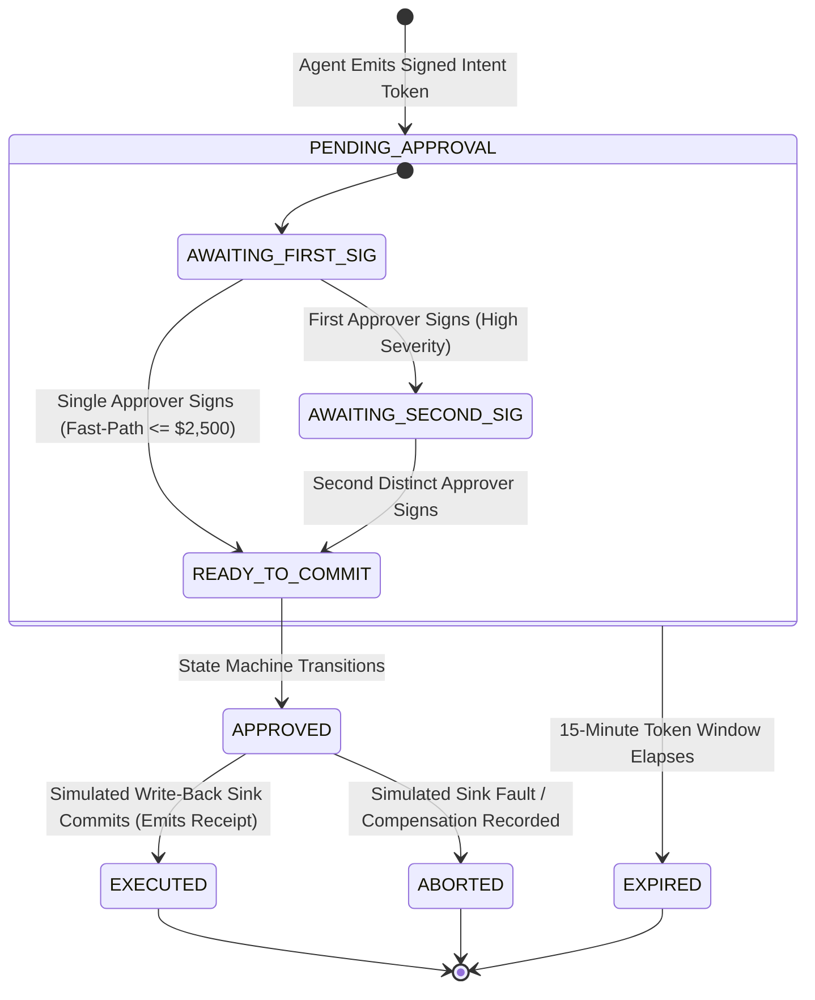

# Phase 1 Data Model: Executive Cockpit & Operator Workstations (012-cockpit)

**Feature**: Executive Cockpit & Operator Workstations (F11 / Slice S6)  
**Spec**: [`specs/012-cockpit/spec.md`](spec.md)  
**Authoritative References**: `initial_plan.md` §7, §6.1–6.3, `docs/archive/initial_plan_v2.md` §6, `docs/brief/monitoring.md`, `docs/brief/fraud.md`, `.specify/memory/constitution.md` (Principles I, II, III, IV, V, VI, VII, VIII)  
**Status**: Completed  

---

## 1. Domain Entities & Pydantic v2 Models

### 1. `WorkstationViewSession`
Represents an active operator session, binding identity claims to persona workstation tabs and filter states.

```python
from datetime import datetime
from enum import Enum
from typing import Dict, List, Optional
from pydantic import BaseModel, Field

class OperatorRole(str, Enum):
    EXECUTIVE = "EXECUTIVE"
    AML_INVESTIGATOR = "AML_INVESTIGATOR"
    PARTNER_MANAGER = "PARTNER_MANAGER"
    COMPLIANCE_AUDITOR = "COMPLIANCE_AUDITOR"
    DATA_OPERATIONS = "DATA_OPERATIONS"

class WorkstationTab(str, Enum):
    EXECUTIVE_SYNTHESIS = "EXECUTIVE_SYNTHESIS"
    AML_TRIAGE_DOSSIER = "AML_TRIAGE_DOSSIER"
    PARTNER_CHURN_RADAR = "PARTNER_CHURN_RADAR"
    COMPLIANCE_LEDGER = "COMPLIANCE_LEDGER"
    DATA_OPS_BOARD = "DATA_OPS_BOARD"

class WorkstationViewSession(BaseModel):
    session_id: str = Field(..., description="Unique UUID for the active browser session")
    operator_id: str = Field(..., description="Authenticated operator username or IdP subject")
    role: OperatorRole = Field(..., description="Active persona role controlling RBAC and layout")
    active_tab: WorkstationTab = Field(..., description="Currently active workstation tab")
    applied_filters: Dict[str, str] = Field(default_factory=dict, description="Active triage facet filters")
    last_active_at: datetime = Field(default_factory=datetime.utcnow, description="Last activity timestamp")
```

---

### 2. `ProvenanceMetadata`
The deterministic provenance record attached to every scalar metric rendered across cards and dossiers.

```python
class ProvenanceMetadata(BaseModel):
    metric_id: str = Field(..., description="Canonical metric identifier, e.g. 'net_revenue_usd'")
    definition_version: str = Field(..., description="Semantic layer definition version, e.g. 'v1.4.0'")
    as_of_timestamp: datetime = Field(..., description="Exact timestamp of source data freshness")
    computation_source: str = Field(..., description="Origin engine, e.g. 'SemanticRegistry.DuckDB'")
    owner_role: str = Field(..., description="Governing persona steward, e.g. 'Finance Lead'")
    formula_summary: Optional[str] = Field(None, description="Human-readable formula, e.g. 'deposits - withdrawals - fees'")
    is_replayed: bool = Field(False, description="True if value was loaded from fallback cache during outage")
```

---

### 3. `MorningBriefingDossier`
Synthesizes cross-horizon operational intelligence auto-pushed to C-level executives.

```python
class HorizonSummary(BaseModel):
    horizon_name: str = Field(..., description="One of: 'Competitive', 'Partner', 'Client', 'Financial'")
    headline: str = Field(..., description="Crisp one-sentence summary of the horizon movement")
    primary_metric_id: str = Field(..., description="Key driver metric identifier")
    observed_value: float = Field(..., description="Realized scalar value")
    delta_period_pct: float = Field(..., description="Percentage movement vs previous period")
    provenance: ProvenanceMetadata = Field(..., description="Deterministic provenance citation")

class StrategicRisk(BaseModel):
    risk_id: str = Field(..., description="Identifier for emerging risk")
    title: str = Field(..., description="Concise risk title")
    severity: str = Field(..., description="'HIGH', 'MEDIUM', 'LOW'")
    exposure_usd: float = Field(..., description="Estimated financial exposure in USD")
    provenance: ProvenanceMetadata = Field(..., description="Deterministic calculation provenance")

class StrategicOpportunity(BaseModel):
    opportunity_id: str = Field(..., description="Identifier for market opportunity")
    title: str = Field(..., description="Concise opportunity title")
    projected_upside_usd: float = Field(..., description="Projected revenue upside in USD")
    recommended_action_type: str = Field(..., description="Canonical Action Type link, e.g. 'DeployRetentionVIPDeal'")

class MorningBriefingDossier(BaseModel):
    briefing_id: str = Field(..., description="Unique briefing identifier, e.g. 'brf_20261009_0600'")
    generated_at: datetime = Field(..., description="Generation timestamp")
    horizons: List[HorizonSummary] = Field(..., min_length=4, max_length=4, description="Competitive, Partner, Client, Financial")
    risks: List[StrategicRisk] = Field(..., description="Ranked operational risks")
    opportunities: List[StrategicOpportunity] = Field(..., description="Ranked market opportunities")
    is_cached_fallback: bool = Field(False, description="True if served as replay fallback during outage")
```

---

### 4. `CausalDAGGraph`
The interactive causal network representation with DoWhy refuter test verification status.

```python
class CausalEdgeRefuterStatus(BaseModel):
    is_causal_verified: bool = Field(..., description="True if passing all refuter tests and confidence >= 0.80")
    confidence: float = Field(..., ge=0.0, le=1.0, description="Causal confidence score")
    placebo_effect: float = Field(..., description="Estimated effect on placebo treatment (passing: ~0)")
    placebo_p_value: float = Field(..., description="P-value of placebo refuter (passing: > 0.05)")
    status_label: str = Field(..., description="'Verified Causal' or 'Correlation Detected; Insufficient Evidence'")

class CausalNode(BaseModel):
    node_id: str = Field(..., description="Metric or variable identifier, e.g. 'competitor_payout_spread'")
    label: str = Field(..., description="Human-readable node label")
    domain: str = Field(..., description="'Competitive', 'Partner', 'Client', 'Financial'")
    current_value: float = Field(..., description="Current realized scalar value")
    provenance: ProvenanceMetadata = Field(..., description="Deterministic metric provenance")

class CausalEdge(BaseModel):
    source_node_id: str = Field(..., description="Source node ID")
    target_node_id: str = Field(..., description="Target node ID")
    weight: float = Field(..., description="Structural causal coefficient")
    refuter: CausalEdgeRefuterStatus = Field(..., description="DoWhy refuter validation results")

class CausalDAGGraph(BaseModel):
    dag_version: str = Field(..., description="Version of the cached structural causal model, e.g. 'scm_v2.1'")
    nodes: List[CausalNode] = Field(..., description="List of causal variables")
    edges: List[CausalEdge] = Field(..., description="Directed structural edges")
    as_of: datetime = Field(..., description="Batch calculation timestamp")
```

---

### 5. `EntityInvestigationDossier`
The 1-screen unified AML investigation record linking KYC declarations, discrepancies, and syndicate linkages.

```python
class KYCDeclaration(BaseModel):
    declared_monthly_income_usd: float = Field(..., description="Declared monthly income in USD")
    employment_status: str = Field(..., description="Declared employment status")
    country_of_residence: str = Field(..., description="ISO 3166-1 alpha-2 country code")
    kyc_approval_timestamp: datetime = Field(..., description="Timestamp of KYC verification approval")

class TransactionVelocityDiscrepancy(BaseModel):
    realized_deposit_volume_30d_usd: float = Field(..., description="Actual 30-day deposits in USD")
    discrepancy_multiplier: float = Field(..., description="Ratio of realized deposits to declared income")
    crypto_usdt_deposit_ratio: float = Field(..., ge=0.0, le=1.0, description="Proportion of deposits via crypto")
    provenance: ProvenanceMetadata = Field(..., description="Deterministic metric calculation provenance")

class EntityInvestigationDossier(BaseModel):
    case_id: str = Field(..., description="AML alert or investigation case ID")
    entity_id: str = Field(..., description="Account or Client ID, e.g. 'CR84920'")
    identity_cluster_key: str = Field(..., description="Pseudonymized cluster key 'tok_id_cluster_<hex16>'")
    composite_risk_score: int = Field(..., ge=0, le=100, description="Composite AML hazard score (0-100)")
    kyc: KYCDeclaration = Field(..., description="Declared KYC/KYB records")
    discrepancy: TransactionVelocityDiscrepancy = Field(..., description="Calculated deposit discrepancy metrics")
    syndicate_ring_size: int = Field(..., description="Number of linked accounts in the syndicate cluster")
    dowhy_refuter_confirmed: bool = Field(..., description="True if anomaly passed causal refuter tests")
    is_withdrawal_held: bool = Field(False, description="True if a 2PC HoldWithdrawal action is committed")
```

---

### 6. `KineticNetworkGraph`
Topological graph for entity relationships, transaction flows, and dynamic hub suppression.

```python
class KineticNodeType(str, Enum):
    CLIENT_ACCOUNT = "CLIENT_ACCOUNT"
    PARTNER_ACCOUNT = "PARTNER_ACCOUNT"
    PAYMENT_AGENT = "PAYMENT_AGENT"
    IP_ADDRESS = "IP_ADDRESS"
    DEVICE_FINGERPRINT = "DEVICE_FINGERPRINT"
    COLLAPSED_CLUSTER_HUB = "COLLAPSED_CLUSTER_HUB"

class KineticNode(BaseModel):
    node_id: str = Field(..., description="Unique node identifier")
    node_type: KineticNodeType = Field(..., description="Classification of the graph entity")
    label: str = Field(..., description="Display label")
    degree: int = Field(..., description="Total degree of the node")
    is_hub_suppressed: bool = Field(False, description="True if node is collapsed to prevent hairball")
    collapsed_node_count: int = Field(0, description="Count of underlying nodes if collapsed")

class KineticEdge(BaseModel):
    source_node_id: str = Field(..., description="Origin node ID")
    target_node_id: str = Field(..., description="Destination node ID")
    edge_type: str = Field(..., description="e.g. 'TRANSACTION_FLOW', 'MATCHED_TIMING', 'SHARED_DEVICE'")
    transaction_volume_usd: Optional[float] = Field(None, description="Total aggregated value transferred")
    matched_timing_seconds: Optional[float] = Field(None, description="Timing correlation window in seconds")

class KineticNetworkGraph(BaseModel):
    graph_id: str = Field(..., description="Graph instance identifier")
    seed_entity_id: str = Field(..., description="Target entity investigated")
    nodes: List[KineticNode] = Field(..., description="Graph entities")
    edges: List[KineticEdge] = Field(..., description="Relational connections")
    total_uncollapsed_entities: int = Field(..., description="Total entity count including collapsed items")
```

---

### 7. `SARDraftDocument`
The regulator-ready Suspicious Activity Report draft pre-populated with verified citations.

```python
class SARDraftDocument(BaseModel):
    sar_id: str = Field(..., description="Unique SAR draft ID, e.g. 'sar_20261009_84920'")
    case_id: str = Field(..., description="Associated AML investigation case ID")
    regulator_template_id: str = Field(..., description="Configurable template identifier, e.g. 'FinCEN_SAR_v1'")
    subject_entity_id: str = Field(..., description="Primary suspect account ID")
    pseudonymized_cluster_key: str = Field(..., description="Identity cluster key 'tok_id_cluster_<hex16>'")
    narrative_summary: str = Field(..., description="Structured suspicious activity narrative")
    cited_metric_ids: List[str] = Field(..., description="List of registered metric IDs cited in narrative")
    statutory_citations: List[str] = Field(..., description="Normalized legal citations, e.g. ['31 CFR 1010']")
    created_at: datetime = Field(default_factory=datetime.utcnow, description="Draft creation timestamp")
    investigator_id: str = Field(..., description="Authoring investigator operator ID")
```

---

### 8. `ChurnRadarScatter`
The dataset powering partner retention analysis and optimal intervention windows.

```python
class PartnerQuadrant(str, Enum):
    HIGH_VALUE_HIGH_RISK = "HIGH_VALUE_HIGH_RISK"
    HIGH_VALUE_STABLE = "HIGH_VALUE_STABLE"
    LOW_VALUE_HIGH_RISK = "LOW_VALUE_HIGH_RISK"
    LOW_VALUE_STABLE = "LOW_VALUE_STABLE"

class PartnerChurnItem(BaseModel):
    partner_id: str = Field(..., description="Unique partner affiliate ID, e.g. 'AP-1029'")
    realized_volume_30d_usd: float = Field(..., description="30-day realized trading volume (Y-axis)")
    churn_hazard_probability: float = Field(..., ge=0.0, le=1.0, description="Predicted churn probability (X-axis)")
    quadrant: PartnerQuadrant = Field(..., description="Categorized retention quadrant")
    days_to_intervention_deadline: int = Field(..., description="Remaining days in optimal 14-day intervention window")
    primary_root_cause: str = Field(..., description="e.g. 'Payout ticket delay + rival spread comparison'")
    login_decay_pct: float = Field(..., description="30-day login frequency decay rate")
    ftd_decay_pct: float = Field(..., description="First-Time Depositor (FTD) decay rate")
    provenance: ProvenanceMetadata = Field(..., description="Deterministic metric provenance")

class ChurnRadarScatter(BaseModel):
    as_of: datetime = Field(..., description="Model evaluation timestamp")
    partners: List[PartnerChurnItem] = Field(..., description="Scatter points of monitored partners")
```

---

### 9. `GovernedActionCard`
The presentation model for staged Two-Phase Commit mutation proposals.

```python
class ActionCommitStatus(str, Enum):
    PENDING_APPROVAL = "PENDING_APPROVAL"
    APPROVED = "APPROVED"
    EXECUTED = "EXECUTED"
    ABORTED = "ABORTED"
    EXPIRED = "EXPIRED"

class GovernedActionCard(BaseModel):
    intent_id: str = Field(..., description="Unique ActionIntentToken ID")
    action_type: str = Field(..., description="'HoldWithdrawal', 'FreezeAccount', 'ClawbackCommission', 'DeployRetentionVIPDeal'")
    target_entity_id: str = Field(..., description="Target account, partner, or cluster ID")
    severity: str = Field(..., description="'HIGH' (requires Four-Eyes) or 'MEDIUM' / 'LOW' (fast-path)")
    requires_four_eyes: bool = Field(..., description="True if action strictly requires 2 distinct human sign-offs")
    first_approver_id: Optional[str] = Field(None, description="Operator ID of first approval")
    second_approver_id: Optional[str] = Field(None, description="Operator ID of second approval (if Four-Eyes)")
    kms_signature_verified: bool = Field(..., description="True if Cloud KMS ECDSA P-256 signature is valid")
    status: ActionCommitStatus = Field(..., description="Current two-phase commit lifecycle status")
    seconds_remaining: int = Field(..., description="Seconds until 15-minute token expiration")
```

---

### 10. `DataProductSLAStatus`
Operational health record displayed on the Data Platform & Operations Board.

```python
class DataProductHealthStatus(str, Enum):
    HEALTHY = "HEALTHY"
    DEGRADED = "DEGRADED"
    BREACHED = "BREACHED"

class DataProductSLAStatus(BaseModel):
    product_name: str = Field(..., description="e.g. 'transactions_aml', 'client_360', 'partner_engagement_signals'")
    contract_schema_version: str = Field(..., description="Schema contract version, e.g. 'v1.2.0'")
    row_count: int = Field(..., description="Total row count ingested")
    null_check_pass_rate: float = Field(..., ge=0.0, le=1.0, description="DQ null validation score")
    last_ingestion_timestamp: datetime = Field(..., description="Latest record timestamp")
    freshness_sla_seconds: int = Field(..., description="Configured freshness SLA window in seconds")
    status: DataProductHealthStatus = Field(..., description="Current operational health status")
    is_degraded: bool = Field(..., description="True if contract breach or freshness delay is active")
```

---

## 2. Entity State Transitions (Governed Two-Phase Commit)


