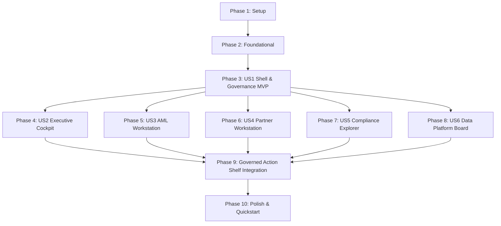

# Tasks: Executive Cockpit & Operator Workstations (012-cockpit)

**Input**: Design documents from `specs/012-cockpit/` (`plan.md`, `spec.md`, `research.md`, `data-model.md`, `contracts/`, `quickstart.md`)  
**Prerequisites**: `plan.md`, `spec.md`, `research.md`, `data-model.md`, `contracts/`  
**Constitution & Quality Doctrine**: Palantir Solution Designer $\times$ McKinsey QuantumBlack Design System (`QBDS`), Principles I–VIII, strict light mode (zero dark mode), technology-agnostic core (`ADR-009`, `ADR-014`).  
**Organization**: Tasks are grouped by user story to enable independent implementation and testing of each story.  

---

## Format: `- [ ] [ID] [P?] [Story] Description with file path`

- **[P]**: Can run in parallel (different files, no blocking dependencies)
- **[Story]**: Which user story this task belongs to (e.g. `[US1]`, `[US2]`, `[US3]`, `[US4]`, `[US5]`, `[US6]`)
- Every task includes an exact file path.

---

## Phase 1: Setup (Shared Infrastructure)

**Purpose**: Project initialization, directory structure, schemas, and institutional light-mode design tokens.

- [X] T001 Create cockpit module packages and `__init__.py` files in `FEIOS/src/eios/cockpit/__init__.py` and `FEIOS/tests/cockpit/__init__.py`
- [X] T002 [P] Register JSON Schemas from `specs/012-cockpit/contracts/` in schema validation registry in `FEIOS/src/eios/cockpit/schemas.py`
- [X] T003 [P] Implement Institutional Light-Mode Design Token Registry (Palantir `#ffffff` panels, `#f4f6f8` ground, `#1c2530` slate-navy rail, 0px border radius, zero dark mode) in `FEIOS/src/eios/cockpit/tokens.py`

---

## Phase 2: Foundational (Blocking Prerequisites)

**Purpose**: Core infrastructure that MUST be complete before ANY user story can be implemented.

**⚠️ CRITICAL**: No user story work can begin until this phase is complete.

- [X] T004 Implement `WorkstationViewSession` manager and RBAC permission evaluator in `FEIOS/src/eios/cockpit/session.py`
- [X] T005 [P] Implement sub-50ms Deterministic Metric Provenance Resolver with HotState cache in `FEIOS/src/eios/cockpit/provenance.py`
- [X] T006 [P] Implement Deterministic Replay & Fallback Engine with amber `[REPLAY]` badging for outages in `FEIOS/src/eios/cockpit/fallback.py`
- [X] T007 Implement Governed Action Shelf presenter and 2PC Four-Eyes state machine integration in `FEIOS/src/eios/cockpit/governance_shelf.py`

**Checkpoint**: Foundation ready — user story implementation can now begin.

---

## Phase 3: User Story 1 - Universal Common Operational Picture (COP) Shell & Governance Invariants (Priority: P1) 🎯 MVP

**Goal**: Deliver the universal tripartite Common Operational Picture (COP) shell (Left Triage, Center Dossier, Right Canvas, Bottom Action Shelf), pure institutional light mode, instant metric provenance popovers ($< 50$ ms), and deterministic fallback with `[REPLAY]` badges.

**Independent Test**: Load the workspace shell across all 5 roles; verify design tokens (`#ffffff` panels, `#f4f6f8` ground, `#1c2530` rail, 0px radius); verify instant provenance popover resolution; simulate an external outage and verify prominent amber `[REPLAY]` badges.

### Tests for User Story 1
- [X] T008 [P] [US1] Unit and contract tests for design tokens, contrast ratios, and dark-mode exclusion in `FEIOS/tests/cockpit/test_design_tokens.py`
- [X] T009 [P] [US1] Unit tests for sub-50ms provenance popover caching and Auditor Gate interception in `FEIOS/tests/cockpit/test_metric_provenance.py`
- [X] T010 [P] [US1] Unit tests for simulated LLM/gateway outage and `[REPLAY]` badging in `FEIOS/tests/cockpit/test_cockpit_fallback.py`

### Implementation for User Story 1
- [X] T011 [US1] Implement tripartite layout presenter and role-switching aggregator in `FEIOS/src/eios/cockpit/shell.py`
- [X] T012 [US1] Wire canonical OMCP workstation tools (`get_workstation_view`, `get_metric_provenance`) in `FEIOS/src/eios/ontology/omcp/server.py`

**Checkpoint**: User Story 1 fully functional and testable as the foundational MVP.

---

## Phase 4: User Story 2 - Executive Decision Cockpit: Morning Briefing & Causal Simulation (Priority: P1)

**Goal**: Deliver the Executive Decision Cockpit with 4-horizon Morning Briefing feed (Competitive, Partner, Client, Financial), 4-domain causal DAG with refuter validation gates, interactive What-If Shock Slider with $< 200$ ms parametric propagation, 100% additive attribution waterfall, and trade-off cards.

**Independent Test**: Query Morning Briefing feed; verify refuter test badges on causal DAG edges; adjust What-If Shock Slider and verify downstream 30/60/90-day updates in $< 200$ ms with attribution summing to exactly $100\% \pm 0.01\%$.

### Tests for User Story 2
- [X] T013 [P] [US2] Unit tests for Morning Briefing aggregation, What-If shock propagation latency ($< 200$ ms), and 100% attribution sum in `FEIOS/tests/cockpit/test_executive_what_if.py`

### Implementation for User Story 2
- [X] T014 [US2] Implement Executive Cockpit service (4-horizon briefing, causal DAG serialization with refuter status, parametric what-if propagation, and attribution waterfall) in `FEIOS/src/eios/cockpit/executive.py`
- [X] T015 [US2] Expose OMCP tools (`get_morning_briefing`, `simulate_what_if_shock`) in `FEIOS/src/eios/ontology/omcp/server.py`

**Checkpoint**: User Stories 1 AND 2 work independently.

---

## Phase 5: User Story 3 - AML Investigator Workstation: Entity Dossier, Kinetic Graph & SAR Composer (Priority: P1)

**Goal**: Deliver the AML Investigator Workstation with discrepancy-ranked triage inbox, 1-screen unified entity dossier (KYC/KYB, fiat/crypto transaction velocity, pseudonymized `tok_id_cluster_<hex16>`), kinetic network graph with hub suppression ($k > 100$), regulator-ready SAR draft composer, and 2PC `HoldWithdrawal` staging.

**Independent Test**: Triage high-risk account CR84920; load 1-screen dossier; verify hub suppression on high-degree payment agents; generate SAR draft with citations; stage 2PC `HoldWithdrawal` modal.

### Tests for User Story 3
- [X] T016 [P] [US3] Unit and contract tests for AML dossier assembly, kinetic graph hub suppression, SAR composer, and 2PC hold staging in `FEIOS/tests/cockpit/test_aml_workstation.py`

### Implementation for User Story 3
- [X] T017 [US3] Implement AML Investigator Workstation service (triage ranking, unified dossier aggregator, SAR composer, and kinetic graph with hub suppression) in `FEIOS/src/eios/cockpit/aml.py`
- [X] T018 [US3] Expose OMCP tools (`get_aml_entity_dossier`, `get_kinetic_network_graph`, `compose_sar_draft`) in `FEIOS/src/eios/ontology/omcp/server.py`

**Checkpoint**: User Stories 1, 2, AND 3 work independently.

---

## Phase 6: User Story 4 - Partner Manager Workstation: Churn Radar, Hierarchy & Playbooks (Priority: P2)

**Goal**: Deliver the Partner Manager Workstation with Churn Radar scatter plot ($P(\text{churn}) \times \text{value at risk}$) with 14-day countdowns, cohort decay map, partner referral tree with opposite-trading ring detection, and retention playbook recommender.

**Independent Test**: Load Churn Radar; inspect at-risk partner AP-1029 with 14-day intervention deadline; detect paired opposite-trading ring; stage retention playbook deal.

### Tests for User Story 4
- [X] T019 [P] [US4] Unit and contract tests for Churn Radar scatter, partner hierarchy rings, and playbook recommendations in `FEIOS/tests/cockpit/test_partner_workstation.py`

### Implementation for User Story 4
- [X] T020 [US4] Implement Partner Manager Workstation service (churn radar scatter builder, cohort anomaly aggregator, referral tree mirror-trading detector, and playbook recommender) in `FEIOS/src/eios/cockpit/partner.py`
- [X] T021 [US4] Expose OMCP tool (`get_churn_radar_scatter`) in `FEIOS/src/eios/ontology/omcp/server.py`

**Checkpoint**: User Stories 1 through 4 work independently.

---

## Phase 7: User Story 5 - Compliance & Audit Explorer: Cryptographic Ledger & WORM Proofs (Priority: P2)

**Goal**: Deliver the Compliance & Audit Explorer with monotonic ledger timeline (`ledger_seq = 1, 2, 3...`), interactive SHA-256 hash chain verification bar, WORM compliance checkpoint proofs, and Four-Eyes dual-approval audit trail.

**Independent Test**: Load ledger timeline; trigger interactive cryptographic hash chain verifier across 10,000 entries in $< 1.0$ s; inspect GCS Object Retention lock proofs; verify Four-Eyes signatures.

### Tests for User Story 5
- [X] T022 [P] [US5] Unit and contract tests for monotonic ledger timeline, interactive hash chain verification, WORM lock inspection, and Four-Eyes audit log in `FEIOS/tests/cockpit/test_compliance_explorer.py`

### Implementation for User Story 5
- [X] T023 [US5] Implement Compliance & Audit Explorer service (ledger timeline builder, interactive hash chain verifier runner, WORM proof inspector, and Four-Eyes log aggregator) in `FEIOS/src/eios/cockpit/compliance.py`
- [X] T024 [US5] Expose OMCP tools (`get_ledger_timeline`, `verify_hash_chain_interactive`) in `FEIOS/src/eios/ontology/omcp/server.py`

**Checkpoint**: User Stories 1 through 5 work independently.

---

## Phase 8: User Story 6 - Data Platform & Operations Board: Contracts, Freshness & Lineage (Priority: P3)

**Goal**: Deliver the Data Platform & Operations Board with real-time Data Quality board, contract breach alert stream, ingestion freshness SLA monitor with `DEGRADED` status propagation, Identity Cluster conflict inspector, and semantic metric catalog lineage topology.

**Independent Test**: Review active data products; simulate SLA delay / contract breach and verify immediate `DEGRADED` badging; inspect end-to-end lineage graph.

### Tests for User Story 6
- [X] T025 [P] [US6] Unit and contract tests for Data Quality board, freshness SLA monitors, `DEGRADED` status propagation, and metric lineage in `FEIOS/tests/cockpit/test_operations_board.py`

### Implementation for User Story 6
- [X] T026 [US6] Implement Data Platform & Operations Board service (DQ metrics aggregator, contract breach monitor, SLA status evaluator, and semantic lineage topology builder) in `FEIOS/src/eios/cockpit/operations.py`
- [X] T027 [US6] Expose OMCP tool (`get_data_quality_board`) in `FEIOS/src/eios/ontology/omcp/server.py`

**Checkpoint**: All 6 user stories work independently.

---

## Phase 9: Governed Action Shelf & Two-Phase Commit Integration

**Purpose**: Connect the bottom-anchored Governed Action Shelf across all 5 workstations with Cloud KMS signature validation and Four-Eyes dual approval.

- [X] T028 [P] Unit and state machine tests for Governed Action Shelf, KMS signature validation, dual-approval transitions, and simulated sink commitment in `FEIOS/tests/cockpit/test_governed_action_shelf.py`
- [X] T029 Implement action shelf presentation coordination and Four-Eyes approval modal handler in `FEIOS/src/eios/cockpit/governance_shelf.py`

---

## Phase 10: Polish & Cross-Cutting Concerns

**Purpose**: End-to-end validation, open decision compliance, contract validation, and test suite verification.

- [X] T030 [P] Run automated open decision validation check `tools.open_decision_check` to guarantee zero `ADR-009` or `ADR-014` breaches in `FEIOS/tools/open_decision_check/`
- [X] T031 [P] Validate all 10 JSON Schema contracts against domain model serialization in `FEIOS/tests/cockpit/test_contracts_validation.py`
- [X] T032 Execute end-to-end quickstart validation scenarios from `specs/012-cockpit/quickstart.md`
- [X] T033 Verify full test suite coverage ($\ge 80\%$ line and branch coverage across `FEIOS/src/eios/cockpit/`) and zero regressions against existing baselines in `FEIOS/`

---

## Dependencies & Completion Order

---

## Parallel Execution Opportunities

- **Parallel Setup**: Tasks `T002` (Schemas) and `T003` (Design tokens) can execute concurrently.
- **Parallel Foundations**: Tasks `T005` (Provenance resolver) and `T006` (Fallback engine) can execute concurrently.
- **Parallel Workstation Development**: Once `US1` (Universal Shell) is completed, `US2` (Executive), `US3` (AML), `US4` (Partner), `US5` (Compliance), and `US6` (Data Platform) have zero inter-story dependencies and can be implemented in parallel.
- **Parallel Test Execution**: All unit tests (`T008`, `T009`, `T010`, `T013`, `T016`, `T019`, `T022`, `T025`, `T028`, `T030`, `T031`) are isolated and can run concurrently via `pytest-xdist`.

---

## Implementation Strategy: MVP First

1. **Deploy MVP (Phases 1–3)**: Deliver the tripartite layout shell, institutional light-mode design tokens (zero dark mode), sub-50ms metric provenance popovers, and deterministic replay fallback (`[REPLAY]` badges).
2. **Incremental High-Impact Workstations (Phases 4–5)**: Implement Executive Decision Cockpit (Morning Briefing, What-If slider, 100% attribution) and AML Investigator Workstation (1-screen dossier, hub-suppressed graph, SAR composer).
3. **Operational Hardening (Phases 6–8)**: Implement Partner Manager Churn Radar, Compliance Ledger Explorer, and Data Platform Operations Board.
4. **Governed Commitment (Phase 9)**: Unify the 2PC action shelf with Four-Eyes dual approval across all workflows.
5. **Quality Verification (Phase 10)**: Verify zero `open_decision_check` findings, 100% contract adherence, and $\ge 80\%$ test coverage.
