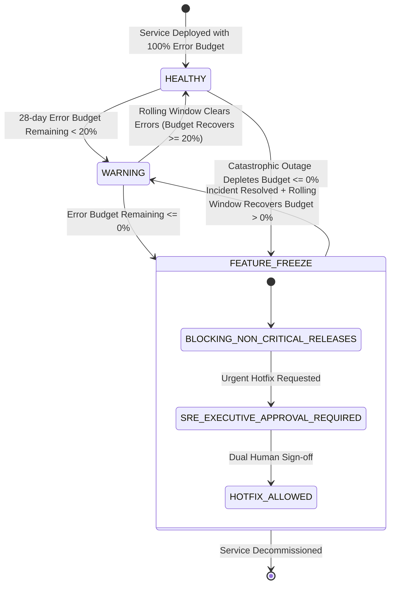

# Data Model Specification: Observability, SRE & Telemetry Spine (013-observability-sre)

**Feature**: Observability, SRE & Telemetry Spine (`013-observability-sre` / F12 / Slice S5)  
**Spec**: [`specs/013-observability-sre/spec.md`](spec.md)  
**Status**: Completed  
**Authoritative References**: `initial_plan.md` §3.3 (L5), §10; `docs/engagement_plan.md` §2, §5; `.specify/memory/constitution.md` (Principles I, II, IV, V, VI, VIII)

---

## 1. Core Domain Models (Pydantic v2 Schemas)

### 1. `TraceContextSpan`
Represents an individual unit of distributed work with W3C TraceContext standards and enterprise correlation identity.

```python
class SpanStatus(str, Enum):
    OK = "OK"
    ERROR = "ERROR"
    UNSET = "UNSET"

class TraceContextSpan(BaseModel):
    trace_id: str = Field(..., min_length=32, max_length=32, description="32-hex W3C trace ID")
    span_id: str = Field(..., min_length=16, max_length=16, description="16-hex W3C span ID")
    parent_span_id: Optional[str] = Field(None, min_length=16, max_length=16, description="Parent span ID if nested")
    correlation_id: str = Field(..., description="Enterprise transaction correlation identifier")
    service_name: str = Field(..., description="Service emitting the span, e.g. 'omcp_server', 'reasoning_coordinator'")
    operation_name: str = Field(..., description="Operation executed, e.g. 'resolve_provenance', 'execute_what_if'")
    start_time: datetime = Field(..., description="Span start timestamp in UTC")
    end_time: Optional[datetime] = Field(None, description="Span end timestamp in UTC")
    duration_ms: Optional[float] = Field(None, ge=0.0, description="Duration in milliseconds")
    status: SpanStatus = Field(default=SpanStatus.OK, description="Execution status")
    attributes: Dict[str, Any] = Field(default_factory=dict, description="Diagnostic tags and context attributes")
    events: List[Dict[str, Any]] = Field(default_factory=list, description="In-span events, e.g. exceptions or checkpoints")
```

---

### 2. `SLICategory` & `ServiceLevelObjectiveConfig`
Governs the 10 production Service Level Objectives defined in `docs/engagement_plan.md` §2.

```python
class SLICategory(str, Enum):
    INGESTION_FRESHNESS = "ingestion_freshness"               # Target: p95 <= 30s
    CONTRACT_ENFORCEMENT = "contract_enforcement"             # Target: 0 invalid in hot state
    METRIC_QUERY_LATENCY = "metric_query_latency"             # Target: p95 <= 500ms
    AGENT_TURN_FIRST_TOKEN = "agent_turn_first_token"         # Target: p95 <= 3s
    AGENT_TURN_FULL_ANSWER = "agent_turn_full_answer"         # Target: p95 <= 20s
    ALERT_DOSSIER_ASSEMBLY = "alert_dossier_assembly"         # Target: p95 <= 10s
    PRE_WITHDRAWAL_DECISION = "pre_withdrawal_decision"       # Target: p95 <= 2s
    MORNING_BRIEFING_AVAILABILITY = "morning_briefing_availability" # Target: 99.0%
    APPROVAL_SERVICE_AVAILABILITY = "approval_service_availability" # Target: 99.5%
    LEDGER_CHAIN_INTEGRITY = "ledger_chain_integrity"         # Target: 100.0% (SEV-1 if broken)
    HALLUCINATION_GATE = "hallucination_gate"                 # Target: 0 unverified claims

class SLOTier(str, Enum):
    TIER_1_CRITICAL = "TIER_1_CRITICAL"       # Exhaustion triggers immediate feature freeze
    TIER_2_OPERATIONAL = "TIER_2_OPERATIONAL" # Exhaustion triggers warning tickets

class ServiceLevelObjectiveConfig(BaseModel):
    sli_name: SLICategory = Field(..., description="Canonical SLI category")
    target_percentage: float = Field(..., ge=0.0, le=1.0, description="Target compliance percentage (e.g. 0.995)")
    target_threshold: float = Field(..., ge=0.0, description="Quantitative limit, e.g. 30.0s or 500.0ms")
    window_days: int = Field(default=28, ge=1, description="Evaluation window duration in days")
    tier: SLOTier = Field(default=SLOTier.TIER_1_CRITICAL, description="Governance severity tier")
```

---

### 3. `ServiceLevelIndicatorMeasurement` & `ErrorBudgetStatus`
Records discrete SLI observations and maintains rolling 28-day error budget accounting.

```python
class ErrorBudgetHealth(str, Enum):
    HEALTHY = "HEALTHY"
    WARNING = "WARNING"
    FEATURE_FREEZE = "FEATURE_FREEZE"

class ServiceLevelIndicatorMeasurement(BaseModel):
    measurement_id: str = Field(..., description="Unique event ID")
    timestamp: datetime = Field(..., description="Measurement timestamp in UTC")
    sli_name: SLICategory = Field(..., description="Measured SLI category")
    observed_value: float = Field(..., description="Observed quantitative value (seconds, ms, count)")
    target_threshold: float = Field(..., description="Configured SLA threshold for comparison")
    is_compliant: bool = Field(..., description="True if within SLA, False if breached")
    correlation_id: str = Field(..., description="Request correlation identifier")

class ErrorBudgetStatus(BaseModel):
    sli_name: SLICategory = Field(..., description="SLI evaluated")
    window_days: int = Field(default=28, description="Rolling evaluation window in days")
    total_events: int = Field(..., ge=0, description="Total observed events in window")
    compliant_events: int = Field(..., ge=0, description="Total compliant events in window")
    failed_events: int = Field(..., ge=0, description="Total non-compliant events in window")
    compliance_percentage: float = Field(..., ge=0.0, le=100.0, description="Observed compliance percentage")
    target_percentage: float = Field(..., ge=0.0, le=100.0, description="SLO target percentage")
    budget_remaining_pct: float = Field(..., description="Remaining error budget percentage (can be < 0%)")
    burn_rate_1h: float = Field(default=0.0, ge=0.0, description="Current 1-hour window burn rate multiplier")
    burn_rate_6h: float = Field(default=0.0, ge=0.0, description="Current 6-hour window burn rate multiplier")
    burn_rate_24h: float = Field(default=0.0, ge=0.0, description="Current 24-hour window burn rate multiplier")
    status: ErrorBudgetHealth = Field(..., description="Operational status based on budget balance")
    is_frozen: bool = Field(..., description="True if release freeze is active due to budget exhaustion")
```

---

### 4. `SREAlertEvent`
Notification emitted by multi-window multi-burn-rate alerting policies and critical system monitors.

```python
class SREAlertSeverity(str, Enum):
    PAGE_CRITICAL_SEV1 = "PAGE_CRITICAL_SEV1" # Immediate on-call pager
    TICKET_HIGH_SEV2 = "TICKET_HIGH_SEV2"     # Urgent high-priority ticket
    TICKET_MEDIUM_SEV3 = "TICKET_MEDIUM_SEV3" # Standard queue ticket
    INFO = "INFO"

class SREAlertEvent(BaseModel):
    alert_id: str = Field(..., description="Unique alert UUID")
    policy_name: str = Field(..., description="Triggered alerting policy rule name")
    severity: SREAlertSeverity = Field(..., description="Alert severity level")
    sli_name: Optional[SLICategory] = Field(None, description="Associated SLI if applicable")
    service_name: str = Field(..., description="Affected service, e.g. 'omcp_server', 'ledger_sequencer'")
    burn_rate: float = Field(default=0.0, ge=0.0, description="Observed burn rate multiplier")
    message: str = Field(..., description="Human-readable diagnostic summary")
    triggered_at: datetime = Field(..., description="Trigger timestamp in UTC")
    is_active: bool = Field(default=True, description="True if currently firing")
```

---

### 5. `LLMInvocationTelemetry` & `AuditorGateTelemetry`
Per-call telemetry for AI model invocations and Constitution Principle I auditor verification tracking.

```python
class AuditorVerdict(str, Enum):
    PASSED = "PASSED"
    MASKED = "MASKED"
    REJECTED = "REJECTED"

class LLMInvocationTelemetry(BaseModel):
    call_id: str = Field(..., description="Unique LLM invocation call ID")
    trace_id: str = Field(..., description="Active W3C trace ID")
    correlation_id: str = Field(..., description="Enterprise transaction correlation ID")
    prompt_id: str = Field(..., description="Versioned prompt template ID")
    prompt_version: str = Field(..., description="Semantic version of prompt")
    model_id: str = Field(..., description="LLM model identifier, e.g. 'gemini-1.5-pro'")
    prompt_tokens: int = Field(..., ge=0, description="Input prompt tokens consumed")
    completion_tokens: int = Field(..., ge=0, description="Output tokens generated")
    cached_tokens: int = Field(default=0, ge=0, description="Tokens read from prompt prefix cache")
    duration_ms: float = Field(..., ge=0.0, description="Total call latency in milliseconds")
    cost_usd: float = Field(..., ge=0.0, description="Calculated financial cost in USD")
    timestamp: datetime = Field(..., description="Invocation timestamp in UTC")

class AuditorGateTelemetry(BaseModel):
    audit_id: str = Field(..., description="Unique auditor verification ID")
    trace_id: str = Field(..., description="Active W3C trace ID")
    correlation_id: str = Field(..., description="Enterprise correlation ID")
    text_hash: str = Field(..., description="SHA-256 hash digest of validated output text")
    total_claims_checked: int = Field(..., ge=0, description="Total quantitative numeric claims parsed")
    verified_claims_count: int = Field(..., ge=0, description="Claims traced to deterministic tool outputs")
    unverified_claims_count: int = Field(..., ge=0, description="Ungrounded claims intercepted")
    verdict: AuditorVerdict = Field(..., description="Auditor Gate decision")
    citation_references: List[str] = Field(default_factory=list, description="Verified ontology metric or entity IDs")
    evaluated_at: datetime = Field(..., description="Evaluation timestamp in UTC")
```

---

### 6. `ServiceGoldenSignals`
Four Golden Signals exported by all core platform services.

```python
class ServiceGoldenSignals(BaseModel):
    service_name: str = Field(..., description="Microservice name")
    timestamp: datetime = Field(..., description="Sampling timestamp in UTC")
    requests_per_second: float = Field(..., ge=0.0, description="Throughput in requests per second")
    latency_p50_ms: float = Field(..., ge=0.0, description="50th percentile latency in milliseconds")
    latency_p90_ms: float = Field(..., ge=0.0, description="90th percentile latency in milliseconds")
    latency_p95_ms: float = Field(..., ge=0.0, description="95th percentile latency in milliseconds")
    latency_p99_ms: float = Field(..., ge=0.0, description="99th percentile latency in milliseconds")
    error_rate_pct: float = Field(..., ge=0.0, le=100.0, description="Error percentage of total requests")
    saturation_pct: float = Field(..., ge=0.0, le=100.0, description="Resource saturation percentage")
    is_saturated: bool = Field(default=False, description="True if saturation exceeds 85.0%")
```

---

## 2. Entity State Transitions (Error Budget & Release Gate)


