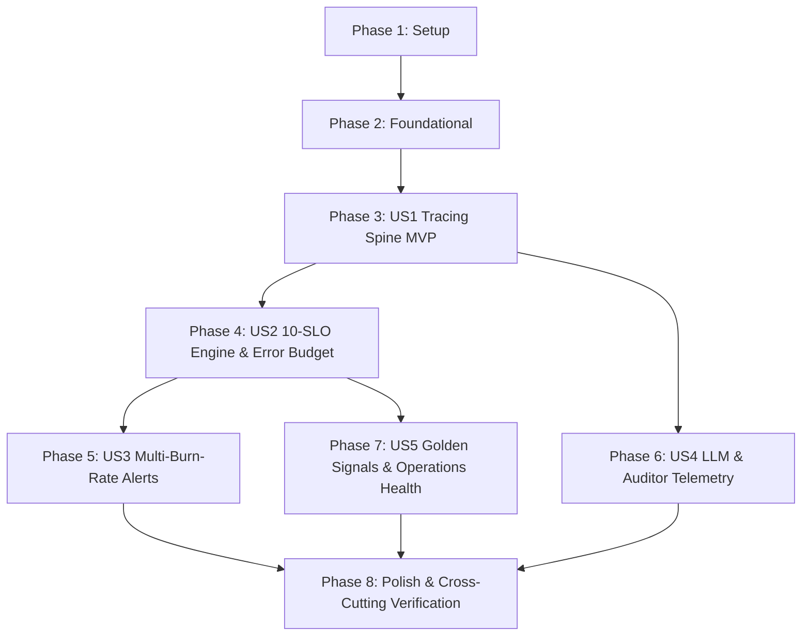

# Tasks: Observability, SRE & Telemetry Spine (013-observability-sre)

**Input**: Design documents from `specs/013-observability-sre/` (`plan.md`, `spec.md`, `research.md`, `data-model.md`, `contracts/`, `quickstart.md`)  
**Prerequisites**: `plan.md`, `spec.md`, `research.md`, `data-model.md`, `contracts/`  
**Constitution & Quality Doctrine**: Google SRE Handbook $\times$ Palantir/QuantumBlack Operational Rigor, Principles I–VIII, 10 Production SLOs, multi-burn-rate alerting ($14.4\times, 6\times, 1\times$), technology-agnostic core (`ADR-009`, `ADR-014`).  
**Organization**: Tasks are grouped by user story to enable independent implementation and testing of each story.  

---

## Format: `- [ ] [ID] [P?] [Story] Description with file path`

- **[P]**: Can run in parallel (different files, no blocking dependencies)
- **[Story]**: Which user story this task belongs to (e.g. `[US1]`, `[US2]`, `[US3]`, `[US4]`, `[US5]`)
- Every task includes an exact file path.

---

## Phase 1: Setup (Shared Infrastructure)

**Purpose**: Project initialization, directory structure, schemas, and canonical SLI catalog.

- [X] T001 Create observability module package and test directories in `FEIOS/src/eios/observability/__init__.py` and `FEIOS/tests/observability/__init__.py`
- [X] T002 [P] Register JSON Schemas from `specs/013-observability-sre/contracts/` in schema validation registry in `FEIOS/src/eios/observability/schemas.py`
- [X] T003 [P] Implement canonical SLI configuration catalog (all 10 production SLOs from `engagement_plan.md` §2) and tier definitions in `FEIOS/src/eios/observability/slo_catalog.py`

---

## Phase 2: Foundational (Blocking Prerequisites)

**Purpose**: Core in-memory buffers and W3C context carriers that MUST be complete before ANY user story can be implemented.

**⚠️ CRITICAL**: No user story work can begin until this phase is complete.

- [X] T004 Implement in-memory thread-safe discrete rolling ring buffer for high-throughput event recording in `FEIOS/src/eios/observability/buffer.py`
- [X] T005 [P] Implement W3C TraceContext injector/extractor and ambient correlation baggage carrier in `FEIOS/src/eios/observability/carrier.py`

**Checkpoint**: Foundation ready — user story implementation can now begin.

---

## Phase 3: User Story 1 - Distributed Tracing Spine & End-to-End Context Propagation (Priority: P1) 🎯 MVP

**Goal**: Deliver the universal OpenTelemetry distributed tracing spine attaching W3C `trace_id`, `span_id`, and ambient enterprise `correlation_id` across Cockpit $\to$ OMCP $\to$ Coordinator $\to$ Tools $\to$ Hot-State $\to$ Ledger with $< 2$ ms overhead.

**Independent Test**: Execute distributed trace across simulated client $\to$ tool $\to$ database; verify W3C `traceparent` headers and `correlation_id` injection on 100% of spans.

### Tests for User Story 1
- [X] T006 [P] [US1] Unit and contract tests for W3C context propagation, span hierarchy, and correlation ID injection in `FEIOS/tests/observability/test_tracing_spine.py`

### Implementation for User Story 1
- [X] T007 [US1] Implement `OpenTelemetrySpine` (`TraceContextSpan`, `_CorrelationSpanProcessor`, in-memory & OTLP exporters, adaptive tail sampling) in `FEIOS/src/eios/observability/tracing.py`

**Checkpoint**: User Story 1 fully functional and testable as the foundational MVP.

---

## Phase 4: User Story 2 - Continuous SLO Monitoring & 28-Day Error Budget Tracker (Priority: P1)

**Goal**: Deliver real-time evaluation of all 10 production SLOs (`engagement_plan.md` §2) in $< 100$ ms with 28-day rolling error budgets and automated `FEATURE_FREEZE` release gate gating.

**Independent Test**: Ingest event stream across 10 SLO categories; verify real-time SLI calculation in $< 100$ ms; deplete budget $\le 0\%$ and verify immediate transition to `FEATURE_FREEZE`.

### Tests for User Story 2
- [X] T008 [P] [US2] Unit and contract tests for 10-SLO continuous evaluation, percentile estimators, and error budget math in `FEIOS/tests/observability/test_slo_engine.py`
- [X] T009 [P] [US2] Unit tests for automated feature-freeze gating and break-glass hotfix overrides in `FEIOS/tests/observability/test_error_budget_freeze.py`

### Implementation for User Story 2
- [X] T010 [US2] Implement `SLOMonitoringEngine` (ratio-based SLI calculators, rolling 28-day window evaluation, error budget consumption, and release freeze gates) in `FEIOS/src/eios/observability/slo_engine.py`

**Checkpoint**: User Stories 1 AND 2 work independently.

---

## Phase 5: User Story 3 - Multi-Window Multi-Burn-Rate SRE Alerting Policies (Priority: P2)

**Goal**: Deliver Google SRE dual-window confirmation alerting ($14.4\times$ over 1 hour $\to$ Page SEV-1; $6\times$ over 6 hours $\to$ Ticket SEV-2), Dead-Letter Queue (DLQ) depth monitors, and SEV-1 cryptographic ledger mismatch alerts.

**Independent Test**: Simulate rapid 1-hour budget burn ($14.4\times$); verify Page SEV-1 alert fires in $< 60$s while transient 30-second spikes suppress paging; simulate ledger sequence gap and verify SEV-1 emergency alert.

### Tests for User Story 3
- [X] T011 [P] [US3] Unit and contract tests for multi-window multi-burn-rate alerting, DLQ alerts, and ledger integrity alerts in `FEIOS/tests/observability/test_burn_rate_alerts.py`

### Implementation for User Story 3
- [X] T012 [US3] Implement `SREAlertEngine` (dual-window evaluation: short window + long window confirmation, flapping hysteresis suppression, alert routing) in `FEIOS/src/eios/observability/alerts.py`

**Checkpoint**: User Stories 1, 2, AND 3 work independently.

---

## Phase 6: User Story 4 - LLM Gateway Telemetry & Auditor Gate Tracking (Priority: P2)

**Goal**: Deliver per-call tracking of LLM token consumption (prompt/completion/cached), USD cost accounting, latency distributions, and Constitution Principle I Auditor Gate verification verdicts (`PASSED`, `MASKED`, `REJECTED`).

**Independent Test**: Execute simulated LLM calls; verify token accounting and cost calculation; verify Auditor Gate verdicts and metric citations recorded in telemetry.

### Tests for User Story 4
- [X] T013 [P] [US4] Unit and contract tests for LLM token accounting, pricing cost tables, and Auditor Gate validation verdicts in `FEIOS/tests/observability/test_llm_auditor_telemetry.py`

### Implementation for User Story 4
- [X] T014 [US4] Implement `LLMTelemetryCollector` and Auditor Gate recorder in `FEIOS/src/eios/observability/llm_telemetry.py`

**Checkpoint**: User Stories 1 through 4 work independently.

---

## Phase 7: User Story 5 - Golden Signals Dashboard & Health Telemetry Emitter (Priority: P3)

**Goal**: Deliver the Four Golden Signals (Traffic, Latency $p50/p90/p95/p99$, Errors, Saturation) across all 6 core platform services with saturation warning alerts ($> 85\%$) feeding the Data Platform & Operations Board.

**Independent Test**: Query health telemetry across all services; verify golden signals export with percentile distributions and saturation indicators.

### Tests for User Story 5
- [X] T015 [P] [US5] Unit and contract tests for Four Golden Signals, percentile estimators, and saturation warnings in `FEIOS/tests/observability/test_golden_signals.py`

### Implementation for User Story 5
- [X] T016 [US5] Implement `GoldenSignalsCollector` and unified health aggregator in `FEIOS/src/eios/observability/golden_signals.py`
- [X] T017 [US5] Wire canonical OMCP tool `get_system_reliability_status` in `FEIOS/src/eios/ontology/omcp/server.py`

**Checkpoint**: All 5 user stories work independently.

---

## Phase 8: Polish & Cross-Cutting Concerns

**Purpose**: End-to-end contract validation, open decision compliance, quickstart validation, and test suite verification.

- [X] T018 [P] Validate all 6 JSON Schema contracts against domain model serialization in `FEIOS/tests/observability/test_contracts_validation.py`
- [X] T019 [P] Run automated open decision validation check `tools.open_decision_check` to guarantee zero `ADR-009` or `ADR-014` breaches in `FEIOS/tools/open_decision_check/`
- [X] T020 Execute end-to-end quickstart validation scenarios from `specs/013-observability-sre/quickstart.md`
- [X] T021 Verify full test suite coverage ($\ge 80\%$ line and branch coverage across `FEIOS/src/eios/observability/`) and zero regressions against existing baselines in `FEIOS/`

---

## Dependencies & Completion Order

---

## Parallel Execution Opportunities

- **Parallel Setup**: Tasks `T002` (Schemas) and `T003` (SLI catalog) can execute concurrently.
- **Parallel Foundational**: Task `T005` (Context carrier) can run in parallel with `T004` (Ring buffer).
- **Parallel Tests**: All test suites (`T006`, `T008`, `T009`, `T011`, `T013`, `T015`, `T018`, `T019`) can run concurrently via `pytest-xdist`.
- **Parallel Development**: Once `US1` (Tracing) and `US2` (SLO Engine) are complete, `US3` (Alerts), `US4` (LLM Telemetry), and `US5` (Golden Signals) have independent implementations.

---

## Implementation Strategy: MVP First

1. **Deploy MVP (Phases 1–3)**: Deliver the universal OpenTelemetry tracing spine with W3C carrier propagation, ambient correlation ID injection, and adaptive tail sampling ($< 2$ ms overhead).
2. **Formal Reliability Core (Phase 4)**: Implement the 10-SLO continuous evaluation engine and rolling 28-day error budget ring buffer with automated release freeze gating.
3. **Operational Protection (Phases 5–6)**: Implement Google SRE dual-window multi-burn-rate alerting ($14.4\times, 6\times, 1\times$) and LLM token/cost + Auditor Gate telemetry.
4. **Platform Health Integration (Phase 7)**: Implement Four Golden Signals across all 6 core services and wire OMCP tool `get_system_reliability_status`.
5. **Quality Verification (Phase 8)**: Verify 100% contract compliance, zero `open_decision_check` findings, and $\ge 80\%$ test coverage.
