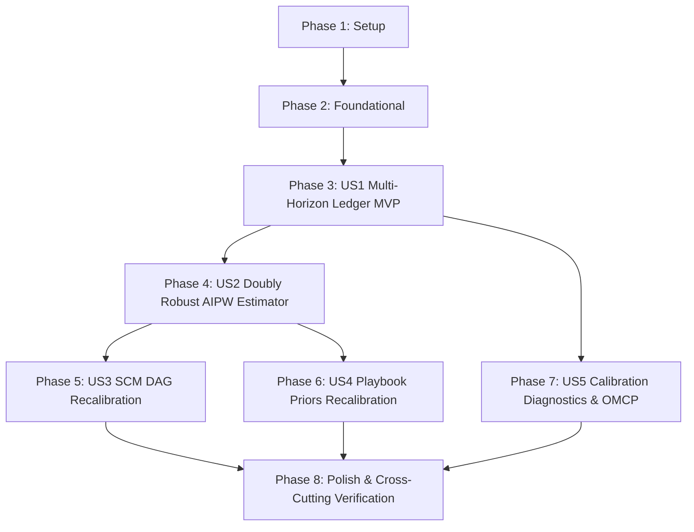

# Tasks: Closed-Loop Decision Learning Flywheel (014-flywheel)

**Input**: Design documents from `specs/014-flywheel/` (`plan.md`, `spec.md`, `research.md`, `data-model.md`, `contracts/`, `quickstart.md`)  
**Prerequisites**: `plan.md`, `spec.md`, `research.md`, `data-model.md`, `contracts/`  
**Constitution & Quality Doctrine**: Principles I–VIII, Doubly Robust AIPW Causal Inference, Causal-Evidence Gate Refuters (Principle III), Multi-Horizon Decision Ledger (30d/60d/90d), Offline Batch Decoupled Recalibration (Principle VII), Open Decisions Preservation (`ADR-002`, `ADR-003`, `ADR-009`, `ADR-014`).  
**Organization**: Tasks are grouped by user story to enable independent implementation and testing of each story.  

---

## Format: `- [ ] [ID] [P?] [Story] Description with file path`

- **[P]**: Can run in parallel (different files, no blocking dependencies)
- **[Story]**: Which user story this task belongs to (e.g. `[US1]`, `[US2]`, `[US3]`, `[US4]`, `[US5]`)
- Every task includes an exact file path.

---

## Phase 1: Setup (Shared Infrastructure)

**Purpose**: Project initialization, directory structure, schemas, and Pydantic domain models.

- [X] T001 Create flywheel module package and test directories in `FEIOS/src/eios/flywheel/__init__.py` and `FEIOS/tests/flywheel/__init__.py`
- [X] T002 [P] Register JSON Schemas from `specs/014-flywheel/contracts/` in schema validation registry in `FEIOS/src/eios/flywheel/schemas.py`
- [X] T003 [P] Implement core Pydantic v2 data models (`DecisionOutcomeRecord`, `CausalUpliftEstimate`, `SCMRecalibrationCheckpoint`, `CalibrationDiagnosticsReport`, `PlaybookPolicyPrior`) in `FEIOS/src/eios/flywheel/models.py`

---

## Phase 2: Foundational (Blocking Prerequisites)

**Purpose**: Core outcomes ledger repository and covariate matrix utilities that MUST be complete before ANY user story can be implemented.

**⚠️ CRITICAL**: No user story work can begin until this phase is complete.

- [X] T004 Implement thread-safe multi-horizon `DecisionOutcomesLedger` repository and in-memory table in `FEIOS/src/eios/flywheel/ledger.py`
- [X] T005 [P] Implement causal covariate matrix builder and propensity score clipper ($[0.01, 0.99]$) in `FEIOS/src/eios/flywheel/covariates.py`

**Checkpoint**: Foundation ready — user story implementation can now begin.

---

## Phase 3: User Story 1 - Multi-Horizon Decision Outcomes Ledger & Reconciliation (Priority: P1) 🎯 MVP

**Goal**: Deliver the immutable, append-only Decision Outcomes Ledger capturing proposal propensity scores $e(X)$ and reconciling 30d, 60d, and 90d actual outcomes against predictions with cryptographic SHA-256 lineage digests.

**Independent Test**: Ingest action intents with pre-treatment covariates and propensity scores; ingest milestone actuals; verify prediction residuals and tamper-evident provenance records stored with $< 2$s latency for 1,000 records.

### Tests for User Story 1
- [X] T006 [P] [US1] Unit and contract tests for multi-horizon ledger append, propensity logging, and 30d/60d/90d reconciliation in `FEIOS/tests/flywheel/test_outcomes_ledger.py`

### Implementation for User Story 1
- [X] T007 [US1] Implement ledger milestone reconciliation engine (residual computation, temporal alignment, cryptographic lineage hash) in `FEIOS/src/eios/flywheel/reconciliation.py`

**Checkpoint**: User Story 1 fully functional and testable as the foundational MVP.

---

## Phase 4: User Story 2 - Doubly Robust AIPW Causal Uplift Estimator (Priority: P1)

**Goal**: Deliver the Doubly Robust Augmented Inverse Propensity Weighting (AIPW) causal estimator correcting for confounding by indication, along with the Causal-Evidence Gate refuter test suite (Placebo, Random Common Cause, Data Subset bootstrap).

**Independent Test**: Execute AIPW on synthetic confounded holdout data; verify $\ge 80\%$ bias reduction compared to naive differences-in-means; verify Causal-Evidence Gate certifies valid uplift while rejecting ungrounded claims.

### Tests for User Story 2
- [X] T008 [P] [US2] Unit and contract tests for Doubly Robust AIPW estimator, bias reduction on confounded data, and influence function standard errors in `FEIOS/tests/flywheel/test_aipw_estimator.py`
- [X] T009 [P] [US2] Unit tests for Causal-Evidence Gate refuter suite (placebo treatment, random common cause, bootstrap data subset) in `FEIOS/tests/flywheel/test_causal_gate_refuters.py`

### Implementation for User Story 2
- [X] T010 [US2] Implement `AIPWCausalEstimator` and Causal-Evidence Gate refuter engine (Principle III) in `FEIOS/src/eios/flywheel/aipw.py` and `FEIOS/src/eios/flywheel/refuters.py`

**Checkpoint**: User Stories 1 AND 2 work independently.

---

## Phase 5: User Story 3 - Automated SCM DAG Edge-Weight Recalibration (Priority: P2)

**Goal**: Deliver offline, regularized residual gradient re-estimation of Structural Causal Model (SCM) DAG edge weights, maintaining topological acyclicity and generating immutable versioned checkpoints.

**Independent Test**: Ingest prediction residuals reflecting shifted causal elasticity; run offline SCM recalibration; verify updated edge weights reduce residual MAE and preserve DAG acyclicity.

### Tests for User Story 3
- [X] T011 [P] [US3] Unit and contract tests for offline SCM DAG edge-weight recalibration and Kahn's topological sort acyclicity verification in `FEIOS/tests/flywheel/test_scm_dag_recalibration.py`

### Implementation for User Story 3
- [X] T012 [US3] Implement `SCMRecalibrator` (regularized residual gradient update, edge weight bounds $[-2.0, 2.0]$, checkpoint emitter) in `FEIOS/src/eios/flywheel/recalibration.py`

**Checkpoint**: User Stories 1, 2, AND 3 work independently.

---

## Phase 6: User Story 4 - Decision Policy Confidence & Playbook Prior Recalibration (Priority: P2)

**Goal**: Deliver automated recalibration of frontline action playbook priors, updating empirical win-rates, expected payoff bands, and confidence ratings across Churn, AML, and Partner interventions.

**Independent Test**: Ingest intervention outcomes; verify updated win-rates, payoff distributions, and operator confidence popover metrics within 10% empirical tolerance.

### Tests for User Story 4
- [X] T013 [P] [US4] Unit and contract tests for playbook policy prior updates, empirical win-rates, and confidence intervals in `FEIOS/tests/flywheel/test_playbook_priors.py`

### Implementation for User Story 4
- [X] T014 [US4] Implement `PlaybookPriorUpdater` (empirical win-rates, expected payoffs, frontline confidence scoring) in `FEIOS/src/eios/flywheel/playbook_priors.py`

**Checkpoint**: User Stories 1 through 4 work independently.

---

## Phase 7: User Story 5 - Model Calibration Diagnostics & Operations Workstation Integration (Priority: P3)

**Goal**: Deliver Expected Calibration Error (ECE), Brier scores, reliability curves, and operational drift alerting ($ECE > 0.15$) feeding the Operations Workstation via canonical OMCP tools.

**Independent Test**: Query calibration diagnostics via OMCP; verify calculation of 10-bin reliability curves, Brier scores, and automated drift warnings under $< 200$ ms.

### Tests for User Story 5
- [X] T015 [P] [US5] Unit and contract tests for Expected Calibration Error (ECE), Brier score, reliability curves, and drift detection in `FEIOS/tests/flywheel/test_calibration_diagnostics.py`

### Implementation for User Story 5
- [X] T016 [US5] Implement `CalibrationDiagnosticsEngine` (10-bin ECE, Brier score, drift alert trigger) in `FEIOS/src/eios/flywheel/diagnostics.py`
- [X] T017 [US5] Wire canonical OMCP tool `get_flywheel_calibration_status` in `FEIOS/src/eios/ontology/omcp/server.py`

**Checkpoint**: All 5 user stories work independently.

---

## Phase 8: Polish & Cross-Cutting Concerns

**Purpose**: End-to-end contract validation, open decision compliance, quickstart validation, and test suite verification.

- [X] T018 [P] Validate all 5 JSON Schema contracts against domain model serialization in `FEIOS/tests/flywheel/test_contracts_validation.py`
- [X] T019 [P] Run automated open decision validation check `tools.open_decision_check` to guarantee zero `ADR-002`, `ADR-003`, `ADR-009`, or `ADR-014` breaches in `FEIOS/tools/open_decision_check/`
- [X] T020 Execute end-to-end quickstart validation scenarios from `specs/014-flywheel/quickstart.md`
- [X] T021 Verify full test suite coverage ($\ge 80\%$ line and branch coverage across `FEIOS/src/eios/flywheel/`) and zero regressions against existing baselines in `FEIOS/`

---

## Dependencies & Completion Order

---

## Parallel Execution Opportunities

- **Parallel Setup**: Tasks `T002` (Schemas) and `T003` (Pydantic models) can execute concurrently.
- **Parallel Foundational**: Task `T005` (Covariate matrix builder) can run in parallel with `T004` (Ledger repository).
- **Parallel Tests**: All test suites (`T006`, `T008`, `T009`, `T011`, `T013`, `T015`, `T018`, `T019`) can run concurrently via `pytest-xdist`.
- **Parallel Development**: Once `US1` (Ledger) and `US2` (AIPW) are complete, `US3` (SCM Recalibration), `US4` (Playbook Priors), and `US5` (Calibration Diagnostics) have decoupled implementations.

---

## Implementation Strategy: MVP First

1. **Deploy MVP (Phases 1–3)**: Deliver the multi-horizon Decision Outcomes Ledger tracking proposal propensity scores $e(X)$ and reconciling 30d/60d/90d actuals with cryptographic SHA-256 provenance.
2. **Causal Estimation Core (Phase 4)**: Implement the Doubly Robust AIPW estimator and Causal-Evidence Gate refuter test suite, proving $\ge 80\%$ bias reduction.
3. **Autonomous Recalibration (Phases 5–6)**: Implement regularized SCM DAG edge-weight recalibration and frontline playbook prior adjustments.
4. **Operations Integration (Phase 7)**: Implement Expected Calibration Error (ECE) diagnostics, Brier scores, and wire canonical OMCP tool `get_flywheel_calibration_status`.
5. **Quality Verification (Phase 8)**: Verify 100% contract compliance, zero `open_decision_check` findings, and $\ge 80\%$ test coverage.
