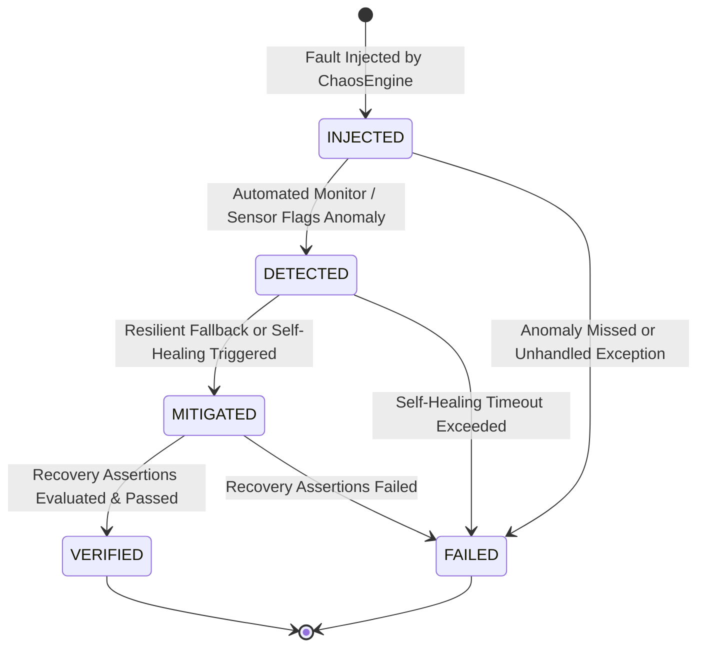
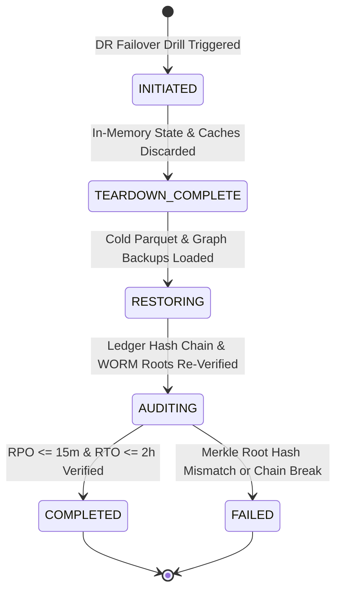

# Data Model Specification: Production Hardening, Chaos & Disaster Recovery (015-hardening-dr)

**Feature**: Production Hardening, Chaos Engineering, Soak Testing & Automated Disaster Recovery (`015-hardening-dr` / Feature F14 / Phase P3 / Slice S5)  
**Spec**: [`specs/015-hardening-dr/spec.md`](spec.md)  
**Status**: Completed  
**Authoritative References**: `initial_plan.md` §3.1 (L5), §8 (Slice S5), §10, §12 (`F14-hardening-dr`); `docs/engagement_plan.md` §1 (Phase P3), §2, §7, §8; `.specify/memory/constitution.md` (Principles I–VIII)

---

## 1. Core Domain Models (Pydantic v2 Schemas)

### 1. `ChaosExperimentRecord` & `ChaosExperimentStatus`
Captures the execution lifecycle, fault parameters, detection latency, and recovery assertion results for an injected chaos experiment.

```python
class ChaosExperimentStatus(str, Enum):
    INJECTED = "INJECTED"
    DETECTED = "DETECTED"
    MITIGATED = "MITIGATED"
    FAILED = "FAILED"

class ChaosExperimentRecord(BaseModel):
    experiment_id: str = Field(..., description="Unique chaos experiment UUID")
    injection_type: str = Field(..., description="Type of fault injected, e.g. 'PROCESS_CRASH', 'DLQ_FLOOD', 'LLM_OUTAGE', 'DUPLICATE_NONCE', 'LEDGER_TAMPER'")
    target_subsystem: str = Field(..., description="Target service or component, e.g. 'hot_state', 'llm_gateway', 'ledger_sequencer'")
    timestamp: datetime = Field(..., description="Experiment injection timestamp in UTC")
    parameters: Dict[str, Any] = Field(default_factory=dict, description="Fault injection configuration parameters")
    status: ChaosExperimentStatus = Field(..., description="Experiment lifecycle state")
    detection_latency_ms: float = Field(..., ge=0.0, description="Elapsed milliseconds from injection to automated detection")
    recovery_latency_ms: float = Field(..., ge=0.0, description="Elapsed milliseconds from detection to full recovery")
    fallback_activated: bool = Field(default=False, description="True if a deterministic fallback mode was activated")
    assertions_passed: bool = Field(..., description="True if all expected recovery assertions succeeded")
    error_message: Optional[str] = Field(None, description="Diagnostic error message if experiment failed")
```

---

### 2. `DisasterRecoveryDrillReport` & `DRDrillStatus`
Documents the end-to-end execution of a simulated disaster recovery drill, recording achieved RPO and RTO metrics.

```python
class DRDrillStatus(str, Enum):
    INITIATED = "INITIATED"
    TEARDOWN_COMPLETE = "TEARDOWN_COMPLETE"
    RESTORING = "RESTORING"
    AUDITING = "AUDITING"
    COMPLETED = "COMPLETED"
    FAILED = "FAILED"

class DisasterRecoveryDrillReport(BaseModel):
    drill_id: str = Field(..., description="Unique DR drill UUID")
    backup_snapshot_id: str = Field(..., description="Cold storage backup snapshot identifier")
    drill_timestamp: datetime = Field(..., description="Drill initiation timestamp in UTC")
    status: DRDrillStatus = Field(..., description="Current status of the recovery drill")
    rpo_achieved_minutes: float = Field(..., ge=0.0, description="Measured Recovery Point Objective in minutes")
    rto_achieved_seconds: float = Field(..., ge=0.0, description="Measured Recovery Time Objective in seconds")
    rpo_target_met: bool = Field(default=True, description="True if RPO <= 15 minutes target")
    rto_target_met: bool = Field(default=True, description="True if RTO <= 2 hours target")
    restored_ledger_records: int = Field(..., ge=0, description="Count of ledger records successfully restored")
    restored_graph_nodes: int = Field(..., ge=0, description="Count of property graph nodes restored")
    cryptographic_chain_valid: bool = Field(..., description="True if 100% of restored ledger records pass SHA-256 chain verification")
    worm_root_hash: str = Field(..., description="Forensic SHA-256 Merkle root hash anchored to WORM storage")
```

---

### 3. `SoakTestTelemetryReport`
Records operational health and telemetry across an accelerated 7-day operational workload simulation.

```python
class SoakTestTelemetryReport(BaseModel):
    soak_id: str = Field(..., description="Unique soak test execution UUID")
    simulated_days: float = Field(..., ge=1.0, description="Simulated operational days covered (e.g. 7.0)")
    execution_duration_seconds: float = Field(..., ge=0.0, description="Wall-clock execution duration in seconds")
    total_events_ingested: int = Field(..., ge=0, description="Total events ingested across the simulation")
    total_queries_served: int = Field(..., ge=0, description="Total metric queries served")
    total_actions_processed: int = Field(..., ge=0, description="Total action intent proposals and approvals processed")
    initial_memory_mb: float = Field(..., ge=0.0, description="Baseline memory consumption in MB")
    peak_memory_mb: float = Field(..., ge=0.0, description="Peak memory consumption in MB")
    final_memory_mb: float = Field(..., ge=0.0, description="Memory consumption at soak conclusion in MB")
    memory_slope_mb_per_k_events: float = Field(..., description="Linear regression slope of memory growth")
    is_leak_free: bool = Field(..., description="True if memory growth slope is approximately zero")
    latency_p50_ms: float = Field(..., ge=0.0, description="50th percentile query latency")
    latency_p95_ms: float = Field(..., ge=0.0, description="95th percentile query latency")
    latency_p99_ms: float = Field(..., ge=0.0, description="99th percentile query latency")
    slo_error_budgets_healthy: bool = Field(..., description="True if all 10 SLO error budgets remained unexhausted")
```

---

### 4. `SecurityThreatDrillResult` & `STRIDECategory`
Captures results from active testing against the STRIDE threat matrix and Red-Line security evals.

```python
class STRIDECategory(str, Enum):
    SPOOFING = "SPOOFING"
    TAMPERING = "TAMPERING"
    REPUDIATION = "REPUDIATION"
    INFORMATION_DISCLOSURE = "INFORMATION_DISCLOSURE"
    DENIAL_OF_SERVICE = "DENIAL_OF_SERVICE"
    ELEVATION_OF_PRIVILEGE = "ELEVATION_OF_PRIVILEGE"

class SecurityThreatDrillResult(BaseModel):
    drill_id: str = Field(..., description="Unique security drill UUID")
    stride_category: STRIDECategory = Field(..., description="STRIDE threat category tested")
    attack_vector: str = Field(..., description="Description of the injected attack vector")
    target_component: str = Field(..., description="Targeted component or interface")
    bypass_attempted: bool = Field(..., description="True if an adversarial bypass was attempted")
    attack_blocked: bool = Field(..., description="True if security gates successfully blocked the attack")
    mitigation_verified: str = Field(..., description="Active defense verified, e.g. 'AuditorGate', 'TokenVault', 'KMS_Signature', 'FourEyesPolicy'")
    audit_event_logged: bool = Field(default=True, description="True if a security audit event was logged")
    timestamp: datetime = Field(..., description="Drill timestamp in UTC")
```

---

### 5. `RunbookExecutionProof` & `RunbookResolutionStatus`
Certifies automated execution and verification of one of the 10 production runbooks.

```python
class RunbookResolutionStatus(str, Enum):
    RESOLVED = "RESOLVED"
    ESCALATED = "ESCALATED"
    FAILED = "FAILED"

class RunbookExecutionProof(BaseModel):
    proof_id: str = Field(..., description="Unique runbook proof UUID")
    runbook_id: str = Field(..., description="Canonical runbook identifier, e.g. 'RUNBOOK-01', 'RUNBOOK-05'")
    runbook_title: str = Field(..., description="Runbook title, e.g. 'Ledger Chain Break / Sequence Anomaly'")
    trigger_signal: str = Field(..., description="Detection alert or anomaly that triggered execution")
    diagnosis_summary: str = Field(..., description="Automated root-cause diagnosis output")
    mitigation_applied: str = Field(..., description="Remediation actions executed by the automated runbook")
    time_to_mitigate_seconds: float = Field(..., ge=0.0, description="Elapsed seconds from trigger to resolution")
    resolution_status: RunbookResolutionStatus = Field(..., description="Post-remediation operational status")
    post_incident_audit_verified: bool = Field(..., description="True if post-incident verification checks passed")
    executed_at: datetime = Field(..., description="Runbook execution timestamp in UTC")
```

---

## 2. Entity State Transitions

### Chaos Experiment Lifecycle



### Disaster Recovery Failover Sequence


