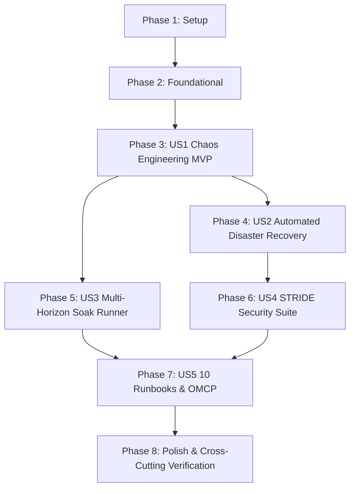

# Tasks: Production Hardening, Chaos & Disaster Recovery (015-hardening-dr)

**Input**: Design documents from `specs/015-hardening-dr/` (`plan.md`, `spec.md`, `research.md`, `data-model.md`, `contracts/`, `quickstart.md`)  
**Prerequisites**: `plan.md`, `spec.md`, `research.md`, `data-model.md`, `contracts/`  
**Constitution & Quality Doctrine**: Principles I–VIII, Deterministic Metrics, No Autonomous Write-Back, Causal-Evidence Gate, Decoupled Pipelines, Deterministic Fallback with Replay Badges, Open Decisions Preservation (`ADR-002`, `ADR-003`, `ADR-009`, `ADR-014`).  
**Organization**: Tasks are grouped by user story to enable independent implementation and testing of each story.  

---

## Format: `- [ ] [ID] [P?] [Story] Description with file path`

- **[P]**: Can run in parallel (different files, no blocking dependencies)
- **[Story]**: Which user story this task belongs to (e.g. `[US1]`, `[US2]`, `[US3]`, `[US4]`, `[US5]`)
- Every task includes an exact file path.

---

## Phase 1: Setup (Shared Infrastructure)

**Purpose**: Project initialization, directory structure, schemas, and Pydantic domain models.

- [x] T001 Create hardening module package and test directories in `FEIOS/src/eios/hardening/__init__.py` and `FEIOS/tests/hardening/__init__.py`
- [x] T002 [P] Register JSON Schemas from `specs/015-hardening-dr/contracts/` in schema validation registry in `FEIOS/src/eios/hardening/schemas.py`
- [x] T003 [P] Implement core Pydantic v2 data models (`ChaosExperimentRecord`, `DisasterRecoveryDrillReport`, `SoakTestTelemetryReport`, `SecurityThreatDrillResult`, `RunbookExecutionProof`) in `FEIOS/src/eios/hardening/models.py`

---

## Phase 2: Foundational (Blocking Prerequisites)

**Purpose**: Base chaos injection hooks, interceptors, and telemetry utilities that MUST be complete before ANY user story can be implemented.

**⚠️ CRITICAL**: No user story work can begin until this phase is complete.

- [x] T004 Implement base chaos injection hooks and interceptor interface in `FEIOS/src/eios/hardening/base.py`
- [x] T005 [P] Implement synthetic telemetry collector and memory leak regression detector in `FEIOS/src/eios/hardening/telemetry.py`

**Checkpoint**: Foundation ready — user story implementation can now begin.

---

## Phase 3: User Story 1 - Chaos Engineering Injection & Resilient Degradation (Priority: P1) 🎯 MVP

**Goal**: Deliver the automated Chaos Engineering suite injecting process crashes, DLQ floods, simulated LLM outages, duplicate deliveries, and ledger bit-flips, verifying self-healing and graceful degradation.

**Independent Test**: Execute the automated chaos test runner injecting process crashes, dead letter queue (DLQ) floods, simulated LLM outages, duplicate action attempts, and ledger bit-flips; verify all services either recover cleanly or transition to deterministic fallback modes without data loss.

### Tests for User Story 1
- [x] T006 [P] [US1] Unit and integration tests for crash recovery, DLQ flood, simulated LLM outage, duplicate delivery, and ledger tampering in `FEIOS/tests/hardening/test_chaos_injection.py`

### Implementation for User Story 1
- [x] T007 [US1] Implement `ChaosEngine` (process crash warm-start, poison ingestion quarantine, LLM outage cached replay fallback, duplicate delivery idempotency, ledger tamper detection) in `FEIOS/src/eios/hardening/chaos.py`

**Checkpoint**: User Story 1 fully functional and testable as the foundational MVP.

---

## Phase 4: User Story 2 - Automated Disaster Recovery (DR) & Failover Drill (Priority: P1)

**Goal**: Deliver the automated Disaster Recovery coordinator and clean-site restore workflow meeting institutional RPO $\le$ 15 min and RTO $\le$ 2 h with cryptographic SHA-256 chain verification.

**Independent Test**: Trigger an automated DR failover drill that wipes existing in-memory state, restores all data products, property graphs, and ledger sequences from cold Parquet backups and WORM checkpoints, and validates cryptographic continuity.

### Tests for User Story 2
- [x] T008 [P] [US2] Unit and contract tests for cold storage snapshotting, clean-site restore, RPO <= 15m, RTO <= 2h, and SHA-256 chain verification in `FEIOS/tests/hardening/test_disaster_recovery.py`

### Implementation for User Story 2
- [x] T009 [US2] Implement `DisasterRecoveryCoordinator` (snapshot creation, clean teardown, cold Parquet rehydration, WORM Merkle root forensic verification) in `FEIOS/src/eios/hardening/dr.py`

**Checkpoint**: User Stories 1 AND 2 work independently.

---

## Phase 5: User Story 3 - Multi-Horizon Accelerated Soak Testing & SLO Compliance (Priority: P2)

**Goal**: Deliver the accelerated 7-day multi-horizon operational soak simulation verifying memory leak absence and 100% compliance with established SLO error budgets.

**Independent Test**: Run a high-concurrency 7-day operational workload simulation evaluating continuous ingestion, metric queries, agent turns, and approval handoffs; verify zero memory leaks and 100% compliance with established SLO error budgets.

### Tests for User Story 3
- [x] T010 [P] [US3] Unit and contract tests for accelerated 7-day soak simulation, memory slope leak analysis, and SLO error budget preservation in `FEIOS/tests/hardening/test_soak_runner.py`

### Implementation for User Story 3
- [x] T011 [US3] Implement `AcceleratedSoakTestRunner` (7-day workload synthesis, linear regression memory slope evaluation, SLO error budget tracking) in `FEIOS/src/eios/hardening/soak.py`

**Checkpoint**: User Stories 1, 2, AND 3 work independently.

---

## Phase 6: User Story 4 - STRIDE Threat Model Mitigations & Red-Line Security Verification (Priority: P2)

**Goal**: Deliver active verification of STRIDE threat model defenses, testing prompt injection defense in partner comms, token signature forgery rejection, Token Vault PII anonymization, and Four-Eyes enforcement.

**Independent Test**: Execute the Red-Line security suite testing prompt injection in partner communications, token signature forgery, Token Vault pseudonymization under adversarial extraction, and Four-Eyes authorization bypass attempts.

### Tests for User Story 4
- [x] T012 [P] [US4] Unit and contract tests for prompt injection neutralization, forged token rejection, Token Vault PII anonymization, and Four-Eyes enforcement in `FEIOS/tests/hardening/test_stride_security.py`

### Implementation for User Story 4
- [x] T013 [US4] Implement `STRIDESecuritySuite` (adversarial prompt sanitizer, KMS signature validator, Token Vault extractor stress test, Four-Eyes authorization gate) in `FEIOS/src/eios/hardening/stride.py`

**Checkpoint**: User Stories 1 through 4 work independently.

---

## Phase 7: User Story 5 - Automated 10 Production Runbook Verification & OMCP Integration (Priority: P3)

**Goal**: Deliver automated incident triage and remediation harnesses for all 10 production runbooks from `docs/engagement_plan.md` §8, generating certified execution proofs and integrating with OMCP.

**Independent Test**: Trigger simulated operational incidents corresponding to each of the 10 production runbooks; verify each automated diagnosis and mitigation script resolves the incident cleanly.

### Tests for User Story 5
- [x] T014 [P] [US5] Unit and contract tests for automated execution of Runbooks 1–10 and proof generation in `FEIOS/tests/hardening/test_runbooks_execution.py`

### Implementation for User Story 5
- [x] T015 [US5] Implement `RunbookVerificationEngine` (executable handlers and triage workflows for Runbooks 1–10, proof certification) in `FEIOS/src/eios/hardening/runbooks.py`
- [x] T016 [US5] Wire canonical OMCP tool `get_hardening_drill_status` in `FEIOS/src/eios/ontology/omcp/server.py`

**Checkpoint**: All 5 user stories work independently.

---

## Phase 8: Polish & Cross-Cutting Concerns

**Purpose**: End-to-end contract validation, open decision compliance, quickstart validation, and test suite verification.

- [x] T017 [P] Validate all 5 JSON Schema contracts against domain model serialization in `FEIOS/tests/hardening/test_contracts_validation.py`
- [x] T018 [P] Run automated open decision validation check `tools.open_decision_check` to guarantee zero `ADR-002`, `ADR-003`, `ADR-009`, or `ADR-014` breaches in `FEIOS/tools/open_decision_check/`
- [x] T019 Execute end-to-end quickstart validation scenarios from `specs/015-hardening-dr/quickstart.md`
- [x] T020 Verify full test suite coverage ($\ge 80\%$ line and branch coverage across `FEIOS/src/eios/hardening/`) and zero regressions against existing baselines in `FEIOS/`

---

## Dependencies & Completion Order

---

## Parallel Execution Opportunities

- **Parallel Setup**: Tasks `T002` (Schemas) and `T003` (Pydantic models) can execute concurrently.
- **Parallel Foundational**: Task `T005` (Telemetry & leak detector) can run in parallel with `T004` (Base hooks).
- **Parallel Tests**: All test suites (`T006`, `T008`, `T010`, `T012`, `T014`, `T017`, `T018`) can run concurrently via `pytest-xdist`.
- **Parallel Development**: Once `US1` (Chaos Engine) is in place, `US2` (DR Coordinator), `US3` (Soak Runner), and `US4` (STRIDE Security) have independent component boundaries.

---

## Implementation Strategy: MVP First

1. **Deploy MVP (Phases 1–3)**: Deliver the Chaos Engineering Engine injecting crashes, DLQ floods, simulated LLM outages, duplicate tokens, and ledger bit-flips with deterministic fallback modes.
2. **Disaster Recovery (Phase 4)**: Implement the Disaster Recovery coordinator and cold-site clean restore proving RPO $\le$ 15m and RTO $\le$ 2h.
3. **Soak Simulation (Phase 5)**: Implement the accelerated 7-day soak harness verifying memory stability and SLO error budget preservation.
4. **Security Hardening (Phase 6)**: Implement the STRIDE security verification suite testing prompt injection, token forgery, PII pseudonymization, and Four-Eyes rules.
5. **Operations Integration (Phase 7)**: Implement the 10 production runbook verification engine and wire canonical OMCP tool `get_hardening_drill_status`.
6. **Quality Verification (Phase 8)**: Verify 100% contract compliance, zero `open_decision_check` findings, and $\ge 80\%$ test coverage.
