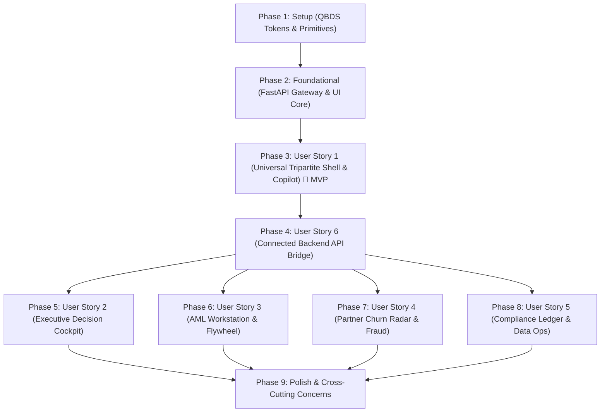

# Tasks: Institutional Operator Cockpit & QuantumBlack Design System Frontend (016-cockpit-frontend)

**Input**: Design documents from `/specs/016-cockpit-frontend/`  
**Prerequisites**: [plan.md](file:///Users/abdullahabtahi/Real-Time%20Enterprise%20Intelligence%20Agent/specs/016-cockpit-frontend/plan.md), [spec.md](file:///Users/abdullahabtahi/Real-Time%20Enterprise%20Intelligence%20Agent/specs/016-cockpit-frontend/spec.md), [research.md](file:///Users/abdullahabtahi/Real-Time%20Enterprise%20Intelligence%20Agent/specs/016-cockpit-frontend/research.md), [data-model.md](file:///Users/abdullahabtahi/Real-Time%20Enterprise%20Intelligence%20Agent/specs/016-cockpit-frontend/data-model.md), [contracts/](file:///Users/abdullahabtahi/Real-Time%20Enterprise%20Intelligence%20Agent/specs/016-cockpit-frontend/contracts/), [quickstart.md](file:///Users/abdullahabtahi/Real-Time%20Enterprise%20Intelligence%20Agent/specs/016-cockpit-frontend/quickstart.md)  
**Governance**: `.specify/memory/constitution.md` (Principles I–VIII)

---

## Phase 1: Setup (Shared Infrastructure & Design Tokens)

**Purpose**: Initialize QuantumBlack Design System (QBDS) tokens, variable fonts, and test harness in the Next.js workspace.

- [X] T001 Configure QuantumBlack Design System `@theme` tokens (Mist and Slate scales, 0px sharp radii, monospace tabular tracking) in `FEIOS/web-prototype/src/app/globals.css`
- [X] T002 [P] Import Google Material Symbols Sharp variable font and ligature styling in `FEIOS/web-prototype/src/app/globals.css`
- [X] T003 [P] Configure Vitest and React Testing Library setup in `FEIOS/web-prototype/vitest.config.ts`

---

## Phase 2: Foundational (Blocking Prerequisites)

**Purpose**: Core backend FastAPI gateway, Next.js state store, QBDS Base UI primitives, and cross-cutting governance components.  
**⚠️ CRITICAL**: No user story work can begin until this phase is complete.

- [X] T004 Implement Python FastAPI Cockpit API Gateway in `FEIOS/src/eios/cockpit/server.py` wrapping `CockpitShellPresenter`, `ExecutiveCockpitService`, `AMLWorkstationService`, `PartnerWorkstationService`, `ComplianceExplorerService`, `DataPlatformOperationsService`, `GovernedActionShelf`, `MetricAuditorGate`, and `DecisionOutcomesLedger`
- [X] T005 [P] Implement core TypeScript domain types in `FEIOS/web-prototype/src/components/cockpit/state/cockpit-types.ts` mirroring `specs/016-cockpit-frontend/data-model.md`
- [X] T006 [P] Port QBDS Base UI primitives (`popover.tsx`, `dialog.tsx`, `slider.tsx`, `tabs.tsx`, `table.tsx`, `tag.tsx`, `separator.tsx`, `scroll-area.tsx`) from `.quantumblack-design-system-repo/src/components/ui/` into `FEIOS/web-prototype/src/components/ui/`
- [X] T007 [P] Implement pre-compiled verified contract fixtures and fallback data loader in `FEIOS/web-prototype/src/components/cockpit/state/fixtures.ts`
- [X] T008 Implement React Context and State Reducer in `FEIOS/web-prototype/src/components/cockpit/state/cockpit-context.tsx` managing active persona, selected entity, staged action cards, what-if parameters, and simulated outage mode
- [X] T009 [P] Implement `<MetricProvenanceBadge>` with Base UI popover in `FEIOS/web-prototype/src/components/cockpit/common/metric-provenance.tsx` displaying Metric ID, definition version, calculation engine, as-of time, steward role, and citation tag (Principles I & V)
- [X] T010 [P] Implement `<FallbackReplayBadge>` and `<FallbackReplayBanner>` in `FEIOS/web-prototype/src/components/cockpit/common/fallback-replay-badge.tsx` rendering amber `[REPLAY]` badges with timestamp during outages (Principle VIII)
- [X] T011 Implement Two-Phase Commit `<GovernedActionShelf>` with Cloud KMS ECDSA P-256 signature badges and `<FourEyesApprovalModal>` in `FEIOS/web-prototype/src/components/cockpit/shell/governed-action-shelf.tsx` and `common/four-eyes-modal.tsx` (Principle II)

**Checkpoint**: Foundation ready — all shared components, API server, and state management established.

---

## Phase 3: User Story 1 - Universal Tripartite COP Shell, QuantumBlack Design System & Copilot Command Bar (Priority: P1) 🎯 MVP

**Goal**: Deliver the universal high-density institutional light-mode tripartite Common Operational Picture (COP) layout, role switcher, and omnipresent Copilot Command Bar with Metric Auditor Gate.  
**Independent Test**: Load `/cockpit`; verify tripartite grid (Left Rail, Center Dossier, Right Canvas, Bottom Action Shelf); verify strict light mode (`#ffffff` on `#f4f6f8` ground, 0px sharp radii, zero dark mode); verify `Cmd+K` opens Copilot Command Bar; verify provenance popovers trigger on hover.

### Tests for User Story 1

- [X] T012 [P] [US1] Unit and layout contract test for Tripartite Shell in `FEIOS/web-prototype/src/tests/cockpit/tripartite-shell.test.tsx`
- [X] T013 [P] [US1] Unit test for Copilot Command Bar and Metric Auditor Gate in `FEIOS/web-prototype/src/tests/cockpit/copilot-command-bar.test.tsx`

### Implementation for User Story 1

- [X] T014 [US1] Implement Cockpit Header Navigation with Persona Role Switcher, System Health, Lag Indicator, and Outage Toggle in `FEIOS/web-prototype/src/components/cockpit/shell/header-nav.tsx`
- [X] T015 [US1] Implement Omnipresent `<CopilotCommandBar>` with `Cmd+K` shortcut and Auditor Gate evaluation indicator in `FEIOS/web-prototype/src/components/cockpit/shell/copilot-command-bar.tsx` (Feature 007)
- [X] T016 [US1] Implement Left-Rail `<TriageRail>` with search filtering, severity tags, and compact entity rows in `FEIOS/web-prototype/src/components/cockpit/shell/triage-rail.tsx`
- [X] T017 [US1] Implement Center `<CopilotDossier>` container with semantic narrative sections and provenance triggers in `FEIOS/web-prototype/src/components/cockpit/shell/copilot-dossier.tsx`
- [X] T018 [US1] Implement Right `<KineticCanvas>` container with dynamic visualization dispatch in `FEIOS/web-prototype/src/components/cockpit/shell/kinetic-canvas.tsx`
- [X] T019 [US1] Implement Tripartite Grid Shell assembling Top Bar, Left Rail ($300\text{px}$), Center Dossier ($560\text{px}$), Right Canvas, and Bottom Action Shelf in `FEIOS/web-prototype/src/components/cockpit/shell/tripartite-shell.tsx`
- [X] T020 [US1] Mount the Tripartite Shell at the `/cockpit` page entrypoint in `FEIOS/web-prototype/src/app/cockpit/page.tsx` and wire the "Launch Cockpit" CTA on the landing page in `FEIOS/web-prototype/src/app/page.tsx`

**Checkpoint**: User Story 1 (MVP) is fully functional and testable independently.

---

## Phase 4: User Story 6 - Connected Backend Integration Bridge & Dual-Mode Execution (Priority: P1)

**Goal**: Establish real HTTP / JSON communication between Next.js App Router API route handlers and the Python EIOS presentation engine, ensuring zero contract drift and graceful fallback replay badging.  
**Independent Test**: Start Python server; fetch `/api/cockpit/workstations/executive`; verify live JSON payload validates against `cockpit-ui-contract.schema.json`. Stop Python server; verify endpoint falls back to cached snapshot with `is_cached_fallback = true` and amber `[REPLAY]` badging.

### Tests for User Story 6

- [X] T021 [P] [US6] Contract integration test for API route handlers in `FEIOS/web-prototype/src/tests/cockpit/api-bridge.test.tsx`

### Implementation for User Story 6

- [X] T022 [US6] Implement Next.js Workstation State API Route Handler in `FEIOS/web-prototype/src/app/api/cockpit/workstations/[role]/route.ts` proxying to FastAPI backend with zero-drift fallback to pre-compiled contract fixtures
- [X] T023 [P] [US6] Implement Next.js What-If Simulation API Route Handler in `FEIOS/web-prototype/src/app/api/cockpit/simulate/route.ts`
- [X] T024 [P] [US6] Implement Next.js Governed Actions API Route Handlers in `FEIOS/web-prototype/src/app/api/cockpit/actions/stage/route.ts` and `FEIOS/web-prototype/src/app/api/cockpit/actions/authorize/route.ts`
- [X] T025 [P] [US6] Implement Next.js Copilot Query API Route Handler in `FEIOS/web-prototype/src/app/api/cockpit/copilot/query/route.ts` routing to `MetricAuditorGate`
- [X] T026 [P] [US6] Implement Next.js Flywheel Feedback API Route Handler in `FEIOS/web-prototype/src/app/api/cockpit/flywheel/feedback/route.ts` logging to `DecisionOutcomesLedger`
- [X] T027 [P] [US6] Implement Next.js Cryptographic Ledger Verification API Route Handler in `FEIOS/web-prototype/src/app/api/cockpit/audit/verify/route.ts`

**Checkpoint**: Backend bridge established; Next.js frontend is connected to live Python EIOS presentation engines.

---

## Phase 5: User Story 2 - Executive Decision Cockpit: Morning Briefing & Causal Simulation (Priority: P1)

**Goal**: Deliver the Executive Decision Cockpit with 4-horizon Morning Briefing feed, interactive 4-domain Causal DAG distinguishing verified vectors from correlations, and sub-200ms What-If shock slider with 100% additive attribution waterfall.  
**Independent Test**: Navigate to Executive persona; verify Morning Briefing loads 4 horizons (Competitive, Partner, Client, Financial); verify Causal DAG renders solid emerald vectors for refuter-passed edges ($p > 0.05$) and dashed amber vectors for correlations; adjust What-If slider; verify revenue projections update in $< 200\text{ms}$ and waterfall sums to $100.0\% \pm 0.01\%$.

### Tests for User Story 2

- [X] T028 [P] [US2] Unit test for Executive Morning Briefing and What-If 100% waterfall attribution sum in `FEIOS/web-prototype/src/tests/cockpit/executive-cockpit.test.tsx`

### Implementation for User Story 2

- [X] T029 [US2] Implement Executive Workstation View displaying 4-horizon Morning Briefing and Strategic Trade-off cards in `FEIOS/web-prototype/src/components/cockpit/workstations/executive-cockpit.tsx`
- [X] T030 [US2] Implement interactive `<CausalDagCanvas>` in `FEIOS/web-prototype/src/components/cockpit/common/causal-dag-canvas.tsx` rendering solid vectors for verified causal edges and dashed amber vectors for correlations (Principle III)
- [X] T031 [US2] Implement `<WhatIfSlider>` and Waterfall Attribution chart in `FEIOS/web-prototype/src/components/cockpit/common/what-if-slider.tsx` executing sub-200ms parametric propagation and asserting $\sum \text{attributions} = 100.0\% \pm 0.01\%$

**Checkpoint**: Executive Cockpit fully functional and testable independently.

---

## Phase 6: User Story 3 - AML Investigator Workstation, Relational Graph Canvas & Flywheel Feedback (Priority: P2)

**Goal**: Deliver AML Investigator Workstation with priority triage queue ($\le 50$ cases), one-screen evidence dossier, kinetic graph with dynamic CGNAT hub suppression ($k > 100$), near-final SAR draft composer, and Active Learning Flywheel feedback loop.  
**Independent Test**: Navigate to AML persona; select suspicious case; verify center pane displays KYC, turnover velocity, and round-trip micro-P&L; verify right canvas renders sub-graph with CGNAT hubs suppressed; edit SAR draft narrative and click "Submit Flywheel Feedback"; verify submission persists to outcomes ledger.

### Tests for User Story 3

- [X] T032 [P] [US3] Unit test for AML Alert Triage, CGNAT Hub Suppression, and SAR editor in `FEIOS/web-prototype/src/tests/cockpit/aml-workstation.test.tsx`

### Implementation for User Story 3

- [X] T033 [US3] Implement AML Investigator Workstation View with discrepancy-ranked triage queue ($\le 50$ cases) and one-screen evidence dossier in `FEIOS/web-prototype/src/components/cockpit/workstations/aml-workstation.tsx`
- [X] T034 [US3] Implement `<TopologicalGraphCanvas>` in `FEIOS/web-prototype/src/components/cockpit/common/topological-graph.tsx` with dynamic CGNAT proxy hub suppression ($k > 100$) and account link exploration
- [X] T035 [US3] Implement Near-Final SAR Draft Narrative Composer with 100% metric citations and statutory normalization in `FEIOS/web-prototype/src/components/cockpit/common/sar-composer.tsx`
- [X] T036 [US3] Implement Active Learning Flywheel Feedback Component in `FEIOS/web-prototype/src/components/cockpit/common/flywheel-feedback.tsx` allowing investigators to record narrative edits and false-positive flags into the outcomes ledger (Feature 014)

**Checkpoint**: AML Investigator Workstation fully functional and testable independently.

---

## Phase 7: User Story 4 - Partner Manager Workstation, Churn Radar & Fraud Ring Canvas (Priority: P2)

**Goal**: Deliver Partner Manager Workstation with Churn Hazard Radar ($P(\text{churn}) \times \text{VaR}$), change-point decay indicators, 3-tier sub-affiliate tree, mirror trading ring detection, and VIP retention playbook launchers.  
**Independent Test**: Navigate to Partner persona; verify Churn Radar scatter plot overlays quadrants; click partner node; verify dossier displays decay root causes; inspect right canvas 3-tier hierarchy and mirror trading correlation metric ($\ge 85\%$); stage a `LaunchRetentionPlaybook` or `FreezePartnerCommission` action.

### Tests for User Story 4

- [X] T037 [P] [US4] Unit test for Partner Churn Radar, 3-tier tree, and mirror trading detection in `FEIOS/web-prototype/src/tests/cockpit/partner-workstation.test.tsx`

### Implementation for User Story 4

- [X] T038 [US4] Implement Partner Manager Workstation View with triage queue, change-point decay indicators, and VIP retention playbook launchers in `FEIOS/web-prototype/src/components/cockpit/workstations/partner-workstation.tsx`
- [X] T039 [US4] Implement `<ChurnRadarScatter>` visualizer in `FEIOS/web-prototype/src/components/cockpit/common/churn-radar-scatter.tsx` plotting partners across $P(\text{churn})$ vs. Value at Risk with quadrant overlays
- [X] T040 [US4] Implement 3-Tier Sub-Affiliate Tree Visualizer and Mirror Trading Ring Detection Card in `FEIOS/web-prototype/src/components/cockpit/common/partner-tree.tsx` highlighting timing co-occurrence ($\ge 85\%$) and staging commission clawback intents (Feature 009)

**Checkpoint**: Partner Manager Workstation fully functional and testable independently.

---

## Phase 8: User Story 5 - Compliance Ledger Explorer, Data Platform Operations & Disaster Recovery Board (Priority: P3)

**Goal**: Deliver Compliance & Audit Explorer with monotonic Decision Ledger timeline, interactive SHA-256 hash chain verification bar, WORM compliance proofs, Data Product SLA freshness monitors ($< 30$s), 10-SLO error budget burndown, and Disaster Recovery runbook proofs.  
**Independent Test**: Navigate to Compliance & Audit persona; verify ledger timeline displays sequential records (`ledger_seq = 1, 2, 3...`); click "Verify Chain Continuity"; verify SHA-256 badge displays `VALID`; switch to Data Operations tab; verify streaming lag ($< 30$s), 10-SLO cards, Red-Line gates RL-1..RL-7, and DR runbook proofs.

### Tests for User Story 5

- [X] T041 [P] [US5] Unit test for Compliance Ledger verification, SLO burndown, and DR proofs in `FEIOS/web-prototype/src/tests/cockpit/compliance-ops.test.tsx`

### Implementation for User Story 5

- [X] T042 [US5] Implement Compliance & Audit Explorer View in `FEIOS/web-prototype/src/components/cockpit/workstations/compliance-explorer.tsx` displaying monotonic ledger entries (`ledger_seq = 1, 2, 3...`), interactive SHA-256 hash chain verification bar, and WORM anchor compliance lock proofs
- [X] T043 [US5] Implement Data Platform Operations Board in `FEIOS/web-prototype/src/components/cockpit/workstations/operations-board.tsx` displaying 6 Data Product SLA freshness monitors ($< 30$s), DLQ quarantine depth, 10-SLO continuous evaluation error budget burndowns, and Red-Line test gates (RL-1..RL-7)
- [X] T044 [US5] Implement Disaster Recovery & Hardening Proof Card in `FEIOS/web-prototype/src/components/cockpit/common/dr-proof-card.tsx` displaying automated Cloud KMS key rotation status (`ACTIVE_ROTATED`), backup checkpoint hash, and warm-start cache health (Feature 015)

**Checkpoint**: Compliance Ledger and Data Platform Operations Board fully functional and testable independently.

---

## Phase 9: Polish & Cross-Cutting Concerns

**Purpose**: Design system contrast audit, responsive drawer collapse, and full-stack end-to-end verification.

- [X] T045 [P] Verify WCAG 2.2 AA contrast ratios ($\ge 4.5:1$ across all text/card pairs) and 0px sharp radii conformance via `FEIOS/src/eios/cockpit/tokens.py` validator
- [X] T046 [P] Implement responsive drawer collapse for Left Rail and Right Canvas on smaller displays ($< 1280\text{px}$) in `FEIOS/web-prototype/src/components/cockpit/shell/tripartite-shell.tsx`
- [X] T047 Validate end-to-end full-stack execution against all 8 scenarios in `specs/016-cockpit-frontend/quickstart.md` running both backend server (`python -m eios.cockpit.server`) and frontend (`npm run dev`)
- [X] T048 Run full-stack automated test suites: backend pytest (`pytest tests/cockpit/ -v`), frontend Vitest (`npm test`), TypeScript verification (`npx tsc --noEmit`), and ESLint (`npm run lint`)

---

## Dependencies & Execution Order

### Phase Dependencies



### User Story Execution Strategy

1. **MVP First (User Story 1 & User Story 6)**:
   - Deliver Setup $\to$ Foundational $\to$ Universal Tripartite Shell (US1) $\to$ Backend API Bridge (US6).
   - Enables immediate live interactive demonstration of the QuantumBlack institutional light mode workstation with the Copilot Command Bar and Governed Action Shelf.
2. **Incremental Persona Rollout**:
   - Executive Cockpit (US2) $\to$ AML Workstation (US3) $\to$ Partner Workstation (US4) $\to$ Compliance & Operations Board (US5).
   - Each workstation functions independently without breaking others.
3. **Full 15-Feature Integration**:
   - Every single subsystem from F001 to F015 is wired into its corresponding surface with zero disconnected mockups.

---

## Parallel Opportunities Identified

```bash
# Parallel Foundations (within Phase 2):
Task: "T005 [P] Implement core TypeScript domain types in cockpit-types.ts"
Task: "T006 [P] Port QBDS Base UI primitives from .quantumblack-design-system-repo"
Task: "T007 [P] Implement pre-compiled verified contract fixtures in fixtures.ts"
Task: "T009 [P] Implement <MetricProvenanceBadge> in metric-provenance.tsx"
Task: "T010 [P] Implement <FallbackReplayBadge> in fallback-replay-badge.tsx"

# Parallel API Handlers (within Phase 4):
Task: "T023 [P] [US6] Implement What-If Simulation API Route Handler in simulate/route.ts"
Task: "T024 [P] [US6] Implement Governed Actions API Route Handlers in actions/stage/route.ts"
Task: "T025 [P] [US6] Implement Copilot Query API Route Handler in copilot/query/route.ts"
Task: "T026 [P] [US6] Implement Flywheel Feedback API Route Handler in flywheel/feedback/route.ts"
Task: "T027 [P] [US6] Implement Cryptographic Ledger Verification API Route Handler in audit/verify/route.ts"

# Parallel Workstation Canvases (across Phases 5-8):
Task: "T030 [US2] Implement <CausalDagCanvas> in causal-dag-canvas.tsx"
Task: "T034 [US3] Implement <TopologicalGraphCanvas> in topological-graph.tsx"
Task: "T039 [US4] Implement <ChurnRadarScatter> in churn-radar-scatter.tsx"
Task: "T044 [US5] Implement Disaster Recovery Proof Card in dr-proof-card.tsx"
```
