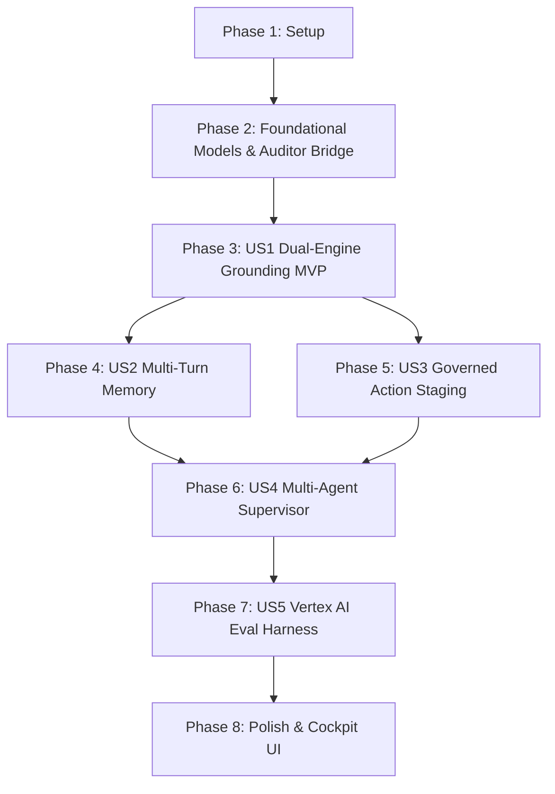

# Tasks: Production-Grade Gen AI Conversational Agent Mesh (F018)

**Input**: Design documents from `/specs/018-genai-conversational-agent/`  
**Prerequisites**: plan.md, spec.md, research.md, data-model.md, contracts/ (all present and verified)  
**Tests**: MANDATORY per Constitution Principle VI (Eval-first, test-driven red $\to$ green $\to$ refactor, $\ge 80\%$ coverage).  
**Organization**: Grouped by user story (US1 to US5) to enable independent, testable, and demonstrable MVP delivery.  

## Format: `[ID] [P?] [Story] Description with exact file paths`

- **[P]**: Can run in parallel (independent files and modules)
- **[US#]**: User Story label mapping directly to `spec.md`

---

## Phase 1: Setup & Dependencies

**Purpose**: Initialize the conversational agent module structure and configure Vertex AI and LangGraph dependencies.

- [ ] T001 Verify and add dependencies in `FEIOS/pyproject.toml` (`google-genai>=0.1.0`, `langgraph>=0.2.0`, `langchain-core>=0.3.0`, `google-cloud-firestore>=2.19.0`, `tqdm>=4.66.0`).
- [ ] T002 [P] Create conversational mesh package directories: `FEIOS/src/eios/conversation/specialists/` and `FEIOS/tests/conversation/`.
- [ ] T003 [P] Copy contract schemas from `specs/018-genai-conversational-agent/contracts/` into `FEIOS/schemas/` (`omcp-tool-catalog.schema.json`, `conversation-query-response.schema.json`).

---

## Phase 2: Foundational (Blocking Prerequisites)

**Purpose**: Core data models, Metric Auditor Gate egress bridge, and Cloud KMS / ADC client setup required across all user stories.

### Tests first (RED)
- [x] T004 [P] Write `FEIOS/tests/conversation/test_data_models.py`: validate Pydantic v2 schemas for `ConversationSession`, `BlackboardState`, `ToolExecutionTrace`, `ActionIntentToken`, and `AuditorRecord`. RED.
- [x] T005 [P] Write `FEIOS/tests/conversation/test_auditor_bridge.py`: verify `ConversationAuditorBridge` passes numerical tokens matching tool traces within $\pm 1\%$ tolerance, exempts legal citations (`31 CFR § 1020.320`, `314(b)`), and blocks unanchored figures. RED.

### Implementation (GREEN)
- [x] T006 [P] Implement `FEIOS/src/eios/conversation/models.py`: strongly typed Pydantic models conforming to `data-model.md`. Makes T004 pass.
- [x] T007 [P] Implement `FEIOS/src/eios/conversation/auditor_bridge.py`: Metric Auditor Gate bridge with statutory citation regex normalization. Makes T005 pass.
- [x] T008 Implement `FEIOS/src/eios/conversation/client.py`: factory for `google.genai.Client(vertexai=True, project=..., location=...)` with ADC authentication, context caching helper, and offline replay fallback mode (Principle VIII).

**Checkpoint**: Foundation green. User story implementation can begin.

---

## Phase 3: User Story 1 - Dual-Engine Grounding across Ontology & Regulatory Policies (Priority: P1) 🎯 MVP

**Goal**: Deliver a grounded conversational agent that queries both structured Ontology engines (DuckDB KPIs, AML dossiers, Graph topologies) and unstructured regulatory policies (31 CFR § 1020, FATF, internal SOPs) with zero metric hallucinations.

**Independent Test**: Prompt the agent with an inquiry requiring both account turnover calculations and regulatory threshold lookups (`"Check CR84920's turnover discrepancy and cite the AML filing rule"`). Verify tool calling, zero unanchored numbers, and `auditor_status: PASS`.

### Tests first (RED)
- [x] T009 [P] [US1] Write `FEIOS/tests/conversation/test_omcp_tools.py`: assert `get_governed_metric`, `inspect_aml_entity`, `query_graph_topology`, and `run_causal_what_if` return structured payloads with verified provenance. RED.
- [x] T010 [P] [US1] Write `FEIOS/tests/conversation/test_copilot_engine_grounding.py`: assert Gemini 3.8 Flash AFC executes OMCP tools and Vertex Search, validates outputs against the Auditor Gate, and returns `auditor_status: PASS`. RED.
- [x] T011 [P] [US1] Write `FEIOS/tests/conversation/test_honest_refusal.py`: assert speculative queries without data ("What will competitor make in 2030?") return canonical refusal `"insufficient data"` with 0 fabricated figures (Principle III). RED.

### Implementation (GREEN)
- [x] T012 [P] [US1] Implement `FEIOS/src/eios/conversation/tools.py`: strongly-typed OMCP Python tools wrapping `SemanticRegistry.DuckDB`, `AMLWorkstationService`, `KineticGraphEngine`, and `ExecutiveCockpitService`. Makes T009 pass.
- [x] T013 [P] [US1] Implement `FEIOS/src/eios/conversation/rag_tools.py`: policy and precedent retrieval tools wrapping `types.VertexAISearch` and `types.VertexRagStore`.
- [x] T014 [US1] Implement `FEIOS/src/eios/conversation/copilot_engine.py`: core Gemini 3.8 Flash agent loop with Automatic Function Calling (AFC), system instructions, and Metric Auditor verification. Makes T010 and T011 pass.
- [x] T015 [US1] Expose `/api/cockpit/copilot/query` in `FEIOS/src/eios/cockpit/server.py` delegating to `copilot_engine.py` with contract-compliant JSON response.

**Checkpoint**: User Story 1 (MVP) is fully functional and independently testable.

---

## Phase 4: User Story 2 - Multi-Turn Conversational Investigation with Session Memory (Priority: P2)

**Goal**: Enable multi-turn conversational investigations where later turns resolve pronouns and entity anchors established in earlier turns, persisted across turns via a durable checkpointer.

**Independent Test**: Run a 3-turn dialogue (`Turn 1: Identify Partner AP-1029` $\to$ `Turn 2: What is their primary root cause?` $\to$ `Turn 3: What retention playbook fits them?`). Assert pronoun resolution and unbroken context.

### Tests first (RED)
- [x] T016 [P] [US2] Write `FEIOS/tests/conversation/test_memory_pronominal.py`: assert entity anchor tracking resolves *"them"*, *"their"*, and *"it"* to active entities (`AP-1029`, `CR84920`). RED.
- [x] T017 [P] [US2] Write `FEIOS/tests/conversation/test_checkpointer_persistence.py`: assert session state and turn histories persist and rehydrate cleanly across simulated thread reloads. RED.

### Implementation (GREEN)
- [x] T018 [P] [US2] Implement `FEIOS/src/eios/conversation/memory.py`: session state manager and pronominal resolver maintaining entity anchors. Makes T016 pass.
- [x] T019 [US2] Implement Firestore / SQLite persistent checkpointer wrapper in `FEIOS/src/eios/conversation/checkpointer.py`. Makes T017 pass.
- [x] T020 [US2] Integrate multi-turn thread context and history compaction into `copilot_engine.py`.

**Checkpoint**: User Story 2 verified. Multi-turn dialogue operates seamlessly.

---

## Phase 5: User Story 3 - Human-in-the-Loop Governed Action Staging (`interrupt` & 2PC) (Priority: P2)

**Goal**: Allow operators to stage operational interventions (withdrawal hold, VIP spread rebate) during chat turns without executing direct database mutations, enforcing Principle II and Four-Eyes dual control.

**Independent Test**: Prompt the agent to *"Hold withdrawal for account CR84920"*. Verify that execution pauses via `interrupt()`, an `ActionIntentToken` with KMS P-256 signature is staged, and zero database mutations occur.

### Tests first (RED)
- [x] T021 [P] [US3] Write `FEIOS/tests/conversation/test_action_staging.py`: assert operational action requests produce an `ActionIntentToken` with valid nonce, KMS signature, and `status: STAGED_FOR_REVIEW`. RED.
- [x] T022 [P] [US3] Write `FEIOS/tests/conversation/test_no_autonomous_write.py`: assert static AST scan and runtime assertions verify zero direct SQL mutations exist in the conversational reasoning mesh (Principle II). RED.

### Implementation (GREEN)
- [x] T023 [US3] Implement `stage_action_intent` tool in `FEIOS/src/eios/conversation/tools.py` using `langgraph.types.interrupt` and Cloud KMS ECDSA P-256 signing. Makes T021 pass.
- [x] T024 [US3] Wire staged recommendation cards to the Governed Action Shelf in `FEIOS/src/eios/cockpit/server.py`.
- [x] T025 [US3] Run AST static assertion script verifying zero SQL `UPDATE/DELETE/INSERT` statements in `eios.conversation`. Makes T022 pass.

**Checkpoint**: User Story 3 verified. Actions are governed and safe.

---

## Phase 6: User Story 4 - Multi-Agent Supervisory Arbitration with Bounded Reflection (Priority: P3)

**Goal**: Coordinate cross-domain inquiries across 5 specialized agents with an Arbitrating Coordinator that reconciles conflicting goals and caps deliberation to $\le 3$ reflection loops.

**Independent Test**: Query an entity with both high churn risk and active fraud alerts. Assert that supervisor routes to both specialists, prioritizes compliance hold over commercial rebate, and halts within $\le 3$ reflection cycles.

### Tests first (RED)
- [x] T026 [P] [US4] Write `FEIOS/tests/conversation/test_supervisor_routing.py`: assert router assigns domain inquiries to correct specialists with $\ge 95\%$ accuracy on benchmark queries. RED.
- [x] T027 [P] [US4] Write `FEIOS/tests/conversation/test_arbitration_hierarchy.py`: assert compliance holds strictly override commercial retention rebates when conflicting goals arise. RED.
- [x] T028 [P] [US4] Write `FEIOS/tests/conversation/test_reflection_cap.py`: assert deliberation cycles terminate strictly at $\le 3$ iterations. RED.

### Implementation (GREEN)
- [x] T029 [P] [US4] Implement specialist agents in `FEIOS/src/eios/conversation/specialists/` (`synthesis.py`, `aml.py`, `churn.py`, `fraud.py`, `governance.py`) with strict tool allow-lists.
- [x] T030 [US4] Implement `FEIOS/src/eios/conversation/supervisor.py`: LangGraph StateGraph coordinator with priority arbitration and $\le 3$ reflection cap. Makes T026, T027, and T028 pass.
- [x] T031 [US4] Connect `supervisor.py` into `FEIOS/src/eios/conversation/engine.py` as the primary reasoning pipeline.

**Checkpoint**: User Story 4 complete. Multi-agent supervisory mesh active.

---

## Phase 7: User Story 5 - Automated Evaluation Harness & Red-Line Gates (Priority: P3)

**Goal**: Provide continuous automated evaluation via Vertex AI `EvalTask` and blocking CI Red-Line test gates (RL-1 through RL-7).

**Independent Test**: Run the evaluation suite against 50 gold-standard turns; assert Groundedness $\ge 0.95$, Faithfulness $\ge 0.95$, and 100% Metric Auditor pass rate.

### Tests first (RED)
- [x] T032 [P] [US5] Write `FEIOS/tests/conversation/test_red_line_suite.py`: automated test harness asserting RL-1 through RL-7 (hallucination rate $= 0.0\%$, citation coverage $= 100.0\%$, turn latency $p95 < 3.5\text{s}$). RED.

### Implementation (GREEN)
- [x] T033 [US5] Implement `FEIOS/src/eios/evals/red_line_runner.py`: standalone CI runner executing blocking Red-Line gates. Makes T032 pass.
- [x] T034 [US5] Implement `FEIOS/src/eios/evals/run_vertex_eval.py`: Vertex AI `EvalTask` runner measuring Groundedness, Faithfulness, and Safety.
- [x] T035 [US5] Create evaluation golden set in `FEIOS/tests/fixtures/eval_golden_turns.json` covering multi-domain queries and hard negatives.

**Checkpoint**: User Story 5 complete. Automated eval gates operational.

---

## Phase 8: Polish, Frontend Integration & Quickstart Validation

**Purpose**: Wire Next.js Cockpit Command Bar UI, configure Context Caching, and run end-to-end smoke tests.

- [x] T036 Update `FEIOS/web-prototype/src/app/api/cockpit/copilot/query/route.ts` to support multi-turn session streaming and SSE badges.
- [x] T037 [P] Update `FEIOS/web-prototype/src/components/cockpit/shell/copilot-command-bar.tsx` to display multi-turn chat history, provenance citation badges, and a direct "Stage to Action Shelf" button.
- [x] T038 Implement Vertex AI Context Caching initializer in `FEIOS/src/eios/conversation/client.py` for system prompts and ontology schemas.
- [x] T039 Execute full quickstart validation per `specs/018-genai-conversational-agent/quickstart.md` on project `spatial-cat-489006-a4`.
- [x] T040 Run complete test suite: `PYTHONPATH=src .venv/bin/pytest tests/conversation/ -v --cov=src/eios/conversation --cov-fail-under=80`.

---

## Dependencies & Execution Order

### MVP Milestone
- Complete **Phase 1 through Phase 3 (US1)**.
- Delivers live, grounded Gemini 3.8 Flash query processing against OMCP tools and policy search with 100% Metric Auditor Gate protection on project `spatial-cat-489006-a4`.
